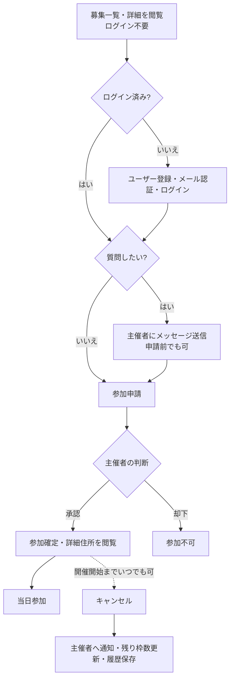
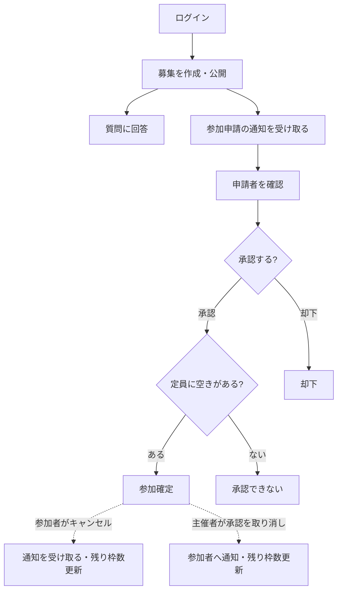
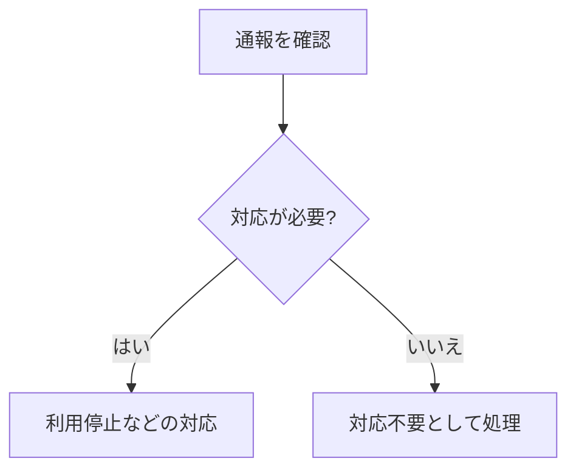

# 02 ターゲット・利用シーン

表記ルールは [01_企画概要](01_企画概要.md) を参照。

## 1. ターゲットユーザー【合意済み】

| 区分 | 内容 |
|---|---|
| 地域 | 名古屋市内でバレーボールをしたい人・開催したい人 |
| 中心層 | 20代・30代の男女 |
| 年齢 | 年齢制限は設けず、他の年齢層も利用可能（登録時に年齢の区分を申告する。18歳未満の制限は11の7-1。法的な条件は公開前に確認する、Q-30） |
| 経験 | 未経験者・初心者・経験者 |
| 参加形式 | 一人参加・友人同士の参加（友人同士の場合も、各自が登録して1人ずつ申請する） |

### 想定ユーザー像

検討用の架空の例であり、実在の利用者や調査結果ではない。

| 例 | 立場 | 状況 | 重視すること |
|---|---|---|---|
| A | 参加者・未経験 | 一人で新しい趣味を始めたい | 初心者歓迎か、雰囲気が分かるか |
| B | 参加者・経験者 | 学生時代以来、久しぶりに再開したい | 日時、エリア、レベル |
| C | 参加者・友人同士 | 友人と一緒に参加したい | まとめて参加できるか |
| D | 主催者 | 活動の人数が足りない | 早く集まるか、キャンセルが分かるか |
| E | 主催者 | 初めて募集する | 操作の簡単さ、安全性 |

## 2. 参加者側の課題（仮説）

- 一人や初心者で参加できる場を見つけにくい
- 参加前に聞きたいことがあるが、連絡先の交換には抵抗がある
- 知らない人との交流に不安がある
- 申請したあとの状態（承認待ち・承認・却下）が分かりにくい
- 都合が悪くなったときに連絡しづらい

## 3. 主催者側の課題（仮説）

- 参加者を集める場が限られる
- 参加希望者の経験レベルなどが事前に分からない
- 定員、申請、キャンセルの管理が手間
- 詳細な開催場所を不特定多数に公開したくない
- 迷惑行為をする利用者への対処手段がない

## 4. 利用シーン

| No. | シーン | 主な利用者 | 利用する機能 |
|---|---|---|---|
| S-1 | 募集を眺めて雰囲気を知る | 未ログイン | 募集一覧・募集詳細 |
| S-2 | 初心者でもよいか質問する | 参加希望者 | チャット |
| S-3 | 参加を申請し、承認を待つ | 参加希望者 | 参加申請・申請状態の確認 |
| S-4 | 承認後に会場を確認する | 承認済み参加者 | 詳細住所の閲覧 |
| S-5 | 急用で参加を取りやめる | 参加者 | キャンセル |
| S-6 | 人数を集める | 主催者 | 募集作成 |
| S-7 | 申請者を確認して判断する | 主催者 | 申請一覧・承認・却下 |
| S-8 | 迷惑な相手を遠ざける | ログイン済み | ブロック・通報 |
| S-9 | 違反した利用者に対応する | 管理者 | 通報確認・利用停止 |

## 5. ユーザーの利用フロー

### 5-1. 参加者

必須プロフィール（ニックネーム・経験レベル）は、初回ログインの直後に入力する（11のQ-40）。

### 5-2. 主催者

主催者は、開催開始前に募集の編集・締切・中止ができる（11のQ-16）。

### 5-3. 管理者

管理者画面は「通報管理」と「利用者管理」の2画面に分ける【合意済み】。詳細は11の4章（Q-28・Q-29）。
