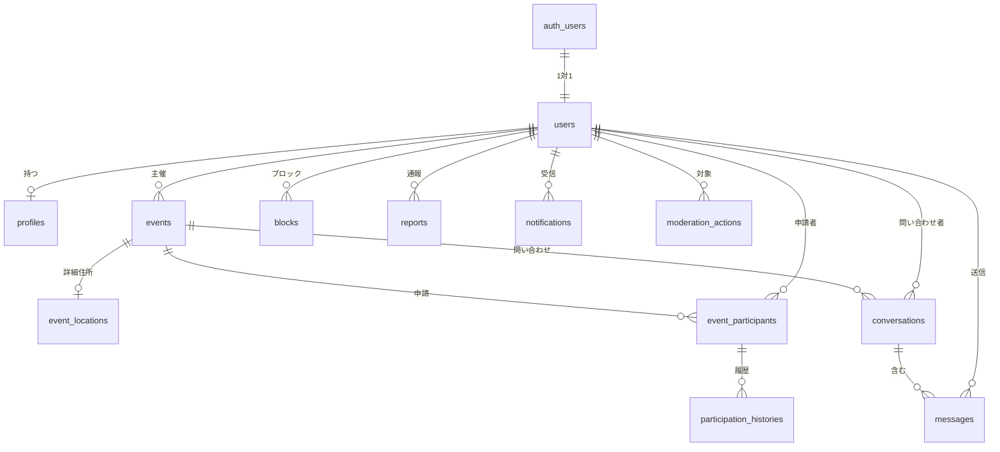
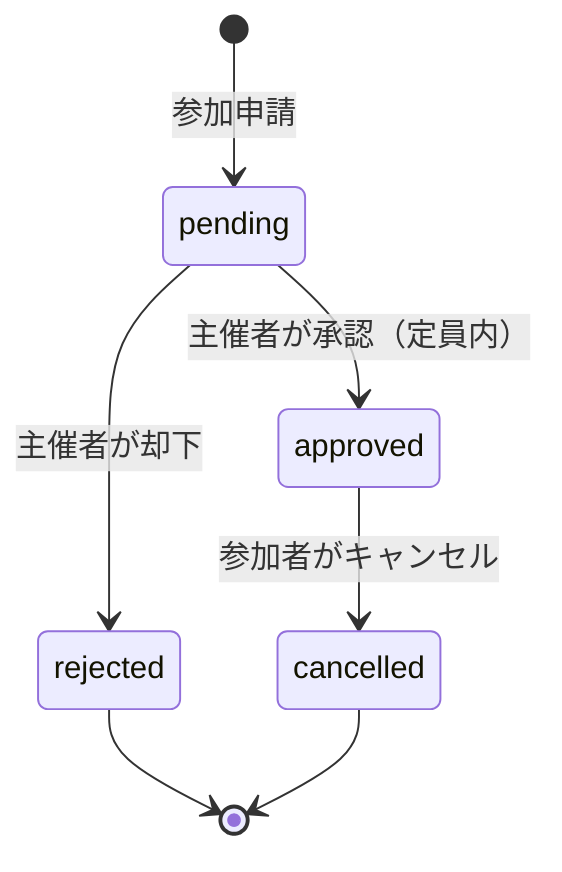

# 06 データベース設計（基本方針）

表記ルールは [01_企画概要](01_企画概要.md) を参照。

> 実装前の設計案【提案】であり、SQLは作成していない。文字数や選択肢の値は【未決定】Q-19。

## 1. 基本方針

1. **公開範囲の違う情報はテーブルを分ける。** RLSは行単位の制御であり、同じ行の一部の列だけを隠す用途には向かない
2. 公開スキーマの全テーブルでRLSを有効にし、許可する操作だけを定義する
3. 定員・重複・ブロック・送信回数は、画面ではなくDBで強制する
4. 状態変更（申請・承認・却下・キャンセル・利用停止）はDB関数を通し、テーブルの直接更新を許可しない
5. 日時は `timestamptz` で保存し、画面では日本時間で表示する
6. 主キーは原則 `uuid`
7. メールアドレスは `auth.users` だけに置き、アプリのテーブルへ複製しない
8. DB変更は `supabase/migrations` で管理する

## 2. テーブル一覧

| テーブル | 役割 | 区分 |
|---|---|---|
| `auth.users` | 認証情報（Supabase管理） | 既存の仕組み |
| `users` | 権限・利用状態 | 指示された対象 |
| `profiles` | プロフィール | 指示された対象 |
| `events` | 募集の公開情報 | 指示された対象 |
| `event_locations` | 募集の詳細住所 | **追加** |
| `event_participants` | 参加申請・参加状態 | 指示された対象 |
| `participation_histories` | 申請・キャンセルなどの履歴 | **追加** |
| `conversations` | 会話 | 指示された対象 |
| `messages` | メッセージ | 指示された対象 |
| `blocks` | ブロック | 指示された対象 |
| `reports` | 通報 | 指示された対象 |
| `notifications` | 通知 | 指示された対象 |
| `moderation_actions` | 利用停止などの記録 | **追加** |

追加した理由：

- `event_locations`：公開情報と分け、承認済みユーザーだけに行単位で許可するため
- `participation_histories`：キャンセル履歴を、現在の状態と分けて改ざんできない形で残すため
- `moderation_actions`：誰がいつ利用停止したかを残すため

## 3. 関係図

## 4. テーブル定義案

「必須」は NOT NULL を表す。

### 4-1. users

| カラム | 型 | 必須 | 制約・備考 |
|---|---|:-:|---|
| id | uuid | ○ | 主キー、外部キー → `auth.users.id` |
| role | text | ○ | `user` / `admin`。初期値 `user`。付与方法はQ-28 |
| status | text | ○ | `active` / `suspended`。初期値 `active` |
| created_at / updated_at | timestamptz | ○ | |

- メールアドレス・電話番号を持たない
- 利用者による `role`・`status` の変更を禁止する
- 削除時の外部キーの動作は退会仕様に合わせる（Q-27）

### 4-2. profiles

| カラム | 型 | 必須 | 制約・備考 |
|---|---|:-:|---|
| user_id | uuid | ○ | 主キー、外部キー → `users.id` |
| nickname | text | ○ | 空白のみ不可。一意にするかはQ-19 |
| experience_level | text | ○ | 未経験者・初心者・経験者に対応する値 |
| avatar_path | text | | Storage上のパス |
| bio | text | | 自己紹介 |
| age_group | text | | 年代 |
| gender | text | | 性別 |
| activity_area | text | | 活動地域 |
| volleyball_history | text | | バレーボール歴 |
| position | text | | 複数選択にする場合は配列・別表を検討（Q-19） |
| created_at / updated_at | timestamptz | ○ | |

未ログインユーザーには、募集の表示に必要な**主催者ニックネームだけ**を、限定したビューまたは関数で返す。ほかの公開範囲はQ-18で決める。

### 4-3. events

公開してよい情報だけを置く。

| カラム | 型 | 必須 | 制約・備考 |
|---|---|:-:|---|
| id | uuid | ○ | 主キー |
| host_id | uuid | ○ | 外部キー → `users.id` |
| title | text | ○ | 空白のみ不可 |
| starts_at | timestamptz | ○ | 開催日時 |
| area | text | ○ | 開催エリア。粒度はQ-17 |
| capacity | integer | ○ | 1以上。主催者を含むかはQ-13 |
| fee | integer | ○ | 円、0以上。支払い方法はQ-25 |
| status | text | ○ | 値の種類はQ-16 |
| created_at / updated_at | timestamptz | ○ | |

- 終了日時、説明文、対象レベルなどを追加するかは【未決定】Q-17
- 自由入力欄に住所が書かれると限定公開が崩れるため、入力時の注意表示と通報で補う
- 会話の主催者を検証するため、`(id, host_id)` に一意制約を置く
- インデックス：`(status, starts_at)`、`(area, starts_at)`、`host_id`

### 4-4. event_locations

| カラム | 型 | 必須 | 制約・備考 |
|---|---|:-:|---|
| event_id | uuid | ○ | 主キー、外部キー → `events.id` |
| venue_name | text | | 施設名 |
| address | text | ○ | 詳細住所 |
| note | text | | 集合場所など |
| updated_at | timestamptz | ○ | |

### 4-5. event_participants

| カラム | 型 | 必須 | 制約・備考 |
|---|---|:-:|---|
| id | uuid | ○ | 主キー |
| event_id | uuid | ○ | 外部キー → `events.id` |
| user_id | uuid | ○ | 外部キー → `users.id` |
| status | text | ○ | `pending` / `approved` / `rejected` / `cancelled` |
| applied_at | timestamptz | ○ | |
| decided_at | timestamptz | | 承認・却下の日時 |
| cancelled_at | timestamptz | | キャンセル日時 |

- **部分一意インデックス**：`(event_id, user_id)`、条件 `status in ('pending','approved')`
- インデックス：`(event_id, status)`、`(user_id, status)`
- 1行を1人分とする。友人を含む申請の扱いはQ-22で決まり、**定員の数え方に影響する**

状態の変化：

承認前の取り下げ（Q-15）、却下・キャンセル後の再申請（Q-14）は【未決定】。再申請を認める場合は新しい行を作れば、過去の記録を残せる。

### 4-6. participation_histories

| カラム | 型 | 必須 | 制約・備考 |
|---|---|:-:|---|
| id | uuid | ○ | 主キー |
| participant_id | uuid | ○ | 外部キー → `event_participants.id` |
| from_status | text | | 初回は空 |
| to_status | text | ○ | |
| actor_id | uuid | | 操作者。退会後の扱いはQ-27 |
| created_at | timestamptz | ○ | |

状態変更と同じトランザクションで追加する。利用者による追加・更新・削除は許可しない。インデックス：`participant_id`

### 4-7. conversations

| カラム | 型 | 必須 | 制約・備考 |
|---|---|:-:|---|
| id | uuid | ○ | 主キー |
| event_id | uuid | ○ | |
| host_id | uuid | ○ | `(event_id, host_id)` を `events(id, host_id)` への複合外部キーとし、主催者のなりすましを防ぐ |
| inquirer_id | uuid | ○ | 外部キー → `users.id`。`host_id` と異なること |
| created_at / last_message_at | timestamptz | ○ | |

- 一意制約：`(event_id, inquirer_id)`。会話を募集単位にするかはQ-21
- インデックス：`(host_id, last_message_at)`、`(inquirer_id, last_message_at)`

### 4-8. messages

| カラム | 型 | 必須 | 制約・備考 |
|---|---|:-:|---|
| id | uuid | ○ | 主キー |
| conversation_id | uuid | ○ | 外部キー → `conversations.id` |
| sender_id | uuid | ○ | 外部キー → `users.id`。会話の当事者であること。クライアントから受け取らず、送信関数が `auth.uid()` を設定する（5-7） |
| body | text | ○ | 空白のみ不可。上限はQ-19 |
| created_at | timestamptz | ○ | DB側で設定 |

インデックス：`(conversation_id, created_at)`、`(sender_id, created_at)`（後者は送信回数の検証にも使う）

### 4-9. blocks

| カラム | 型 | 必須 | 制約・備考 |
|---|---|:-:|---|
| blocker_id | uuid | ○ | 外部キー → `users.id` |
| blocked_id | uuid | ○ | 外部キー → `users.id`。`blocker_id` と異なること |
| created_at | timestamptz | ○ | |

主キー：`(blocker_id, blocked_id)`。インデックス：`blocked_id`

### 4-10. reports

| カラム | 型 | 必須 | 制約・備考 |
|---|---|:-:|---|
| id | uuid | ○ | 主キー |
| reporter_id | uuid | ○ | 外部キー → `users.id` |
| reported_user_id | uuid | | 外部キー → `users.id` |
| event_id | uuid | | 外部キー → `events.id` |
| message_id | uuid | | 外部キー → `messages.id` |
| reason | text | ○ | 分類はQ-29 |
| detail | text | | |
| status | text | ○ | 値の種類はQ-29 |
| created_at / updated_at | timestamptz | ○ | |

- `reported_user_id`・`event_id`・`message_id` の**ちょうど1つ**に値があることをCHECK制約で保証する
- 通報後に対象が削除・変更された場合の証跡の残し方はQ-29
- インデックス：`(status, created_at)`

### 4-11. notifications

| カラム | 型 | 必須 | 制約・備考 |
|---|---|:-:|---|
| id | uuid | ○ | 主キー |
| user_id | uuid | ○ | 受信者。外部キー → `users.id` |
| type | text | ○ | 確定しているのは「参加申請」「キャンセル」の2種。ほかはQ-12 |
| event_id | uuid | | 外部キー → `events.id` |
| participant_id | uuid | | 外部キー → `event_participants.id` |
| read_at | timestamptz | | |
| created_at | timestamptz | ○ | |

通知文に住所やメールアドレスを保存しない。インデックス：`(user_id, read_at, created_at)`

### 4-12. moderation_actions

| カラム | 型 | 必須 | 制約・備考 |
|---|---|:-:|---|
| id | uuid | ○ | 主キー |
| admin_id | uuid | ○ | 外部キー → `users.id` |
| target_user_id | uuid | ○ | 外部キー → `users.id` |
| action | text | ○ | 確定しているのは利用停止。ほかはQ-28 |
| reason | text | | |
| report_id | uuid | | 外部キー → `reports.id` |
| created_at | timestamptz | ○ | |

## 5. 重点課題への対応

### 5-1. 定員超過を防ぐ

承認は1つのDB関数・1トランザクションで行う。

1. `events` の対象行を `FOR UPDATE` でロックする
2. 操作者が主催者で、利用停止中でないことを確認する
3. 申請が `pending` であることを確認する
4. ロック後に承認済み人数を数え、定員未満であることを確認する
5. `approved` に更新し、履歴を追加する

- 申請・キャンセルも同じ募集行をロックし、判定の競合を防ぐ
- 定員を変更できるようにする場合は、承認済み人数より小さくできないようにする
- 残り枠数は別カラムに保存せず、`capacity` と承認済み人数から算出する（不整合を防ぐため）
- 承認待ちを定員に数えるかはQ-13

### 5-2. 申請の重複を防ぐ

部分一意インデックスで保証する。「確認してから追加」だけでは同時送信を防げないため、制約を必須とする。

### 5-3. ブロックした相手とのメッセージを防ぐ

- 会話の作成時と送信時に、どちらか一方でもブロックしていれば拒否する
- 本人以外は `blocks` を読めないため、判定は限定したDB関数で行う
- ブロック以外の機能（申請・閲覧・過去の会話）への影響はQ-20
- 送信時の判定は5-7の送信関数で行う

### 5-4. 承認済みユーザーだけが住所を閲覧する

`event_locations` の閲覧を、主催者、または**現在** `approved` の参加者に限定する。キャンセル後は閲覧できなくなる。一度表示された情報を回収することはできない。

### 5-5. 個人情報を保護する

- メールアドレスは `auth.users` のみ。電話番号は収集しない
- 公開スキーマに `auth.users` を参照するビューを作らない
- 必要な列だけを取得し、`select *` を公開用の処理に使わない

### 5-6. 送信回数を制限する

送信用のDB関数で、`sender_id` ごとの直近の送信数を検証する。利用者単位のロックなどにより、並列送信で上限を超えないようにする。数値と集計単位はQ-10。検証の順序は5-7を参照。

### 5-7. メッセージの送信・閲覧権限を保証する

メッセージの追加は**送信用のDB関数（以下、送信関数）だけ**で行い、一般ユーザーが `messages` へ直接INSERTできないようにする。RLSとDB関数のどちらか一方に頼らず、両方で権限を確認する。

| 保証する内容 | テーブル側（権限・RLS） | 送信関数 |
|---|---|---|
| ログイン済みであること | 未ログインには `messages` の権限を与えない | `auth.uid()` が空なら拒否する。未ログインに実行権限を与えない |
| 送信者が本人であること | 直接INSERTを許可しない | `sender_id` を引数で受け取らず、`auth.uid()` を設定する |
| 会話の当事者であること | 閲覧ポリシーを当事者（`host_id` または `inquirer_id` が `auth.uid()`）に限定する | `auth.uid()` が対象会話の当事者でなければ拒否する |
| ブロックされていないこと | 直接INSERTを許可しない | どちらか一方でも相手をブロックしていれば拒否する |
| 利用停止中でないこと | 直接INSERTを許可しない | `users.status` が `active` でなければ拒否する |
| 送信回数の上限内であること | 直接INSERTを許可しない | 直近の送信数を数え、上限に達していれば拒否する（Q-10） |

テーブル側の方針：

- ログイン済み・未ログインのどちらのロールにも `messages` のINSERT権限を与えず（既定で付与される場合は取り消す）、INSERTを許可するRLSポリシーも作らない
- 閲覧は当事者だけに許可する。管理者の閲覧範囲はQ-28
- 更新・削除を認めるかはQ-21。決まるまでは許可する権限・ポリシーを作らない

送信関数の処理（1トランザクション）：

1. 関数内で `auth.uid()` を取得し、空なら拒否する。引数は会話IDと本文だけとする
2. 対象の会話を取得し、`auth.uid()` が当事者であることを検証する。相手は会話の `host_id`・`inquirer_id` から求め、引数で受け取らない
3. 送信回数の判定が並列送信で競合しないよう、ロックを取得する。ロックの対象はQ-10の集計単位に合わせる
4. 利用停止状態を検証する
5. ブロック状態を双方向で検証する
6. **ロック取得後に**直近の送信数を数え、上限内であることを検証する
7. `sender_id` に `auth.uid()`、`created_at` にDBの時刻を設定して追加し、会話の `last_message_at` を更新する

いずれかの検証に失敗した場合は、何も保存しない。

関数の権限：

- 呼び出した利用者の権限で動く関数（`SECURITY INVOKER`）だけで追加するには、利用者自身にINSERT権限が必要になり、直接INSERTを防げない。そのため、追加の処理は `SECURITY DEFINER` とする【提案】
- `SECURITY DEFINER` の関数内では、所有者によってはRLSが適用されない。上記の検証を省略せず、関数内で必ず行う
- `search_path` を固定し、参照するテーブルや関数にはスキーマ名を付ける
- 実行権限は既定の `PUBLIC` から取り消し、ログイン済みユーザーに必要なものだけを与える
- `SECURITY DEFINER` の関数を公開しないスキーマに置く方針（6章）を守るため、Data APIから呼ぶ入口は、公開スキーマの `SECURITY INVOKER` 関数とし、処理本体を呼び出すだけにする【提案】
- ブロックの判定関数は利用者から直接実行できないようにし、ブロック情報を推測されないようにする

未決定事項との関係：

- 送信回数の数値・期間・集計単位はQ-10。メッセージの削除を認める場合（Q-21）は、削除によって送信回数の制限を回避できないようにする
- 利用停止中は送信できない。送信以外に制限する操作の範囲や、相手が利用停止中の場合の扱いはQ-28
- 拒否理由をブロックされた側に示すかはQ-20
- メール未認証ユーザーの扱いはQ-40

## 6. RLS方針

| テーブル | 閲覧 | 追加 | 更新 | 削除 |
|---|---|---|---|---|
| users | 本人、管理者 | 登録処理 | 管理用関数のみ | Q-27 |
| profiles | 本人。他者はQ-18 | 本人 | 本人 | Q-27 |
| events | 全員（公開中のもの） | ログイン済み・停止中でない | 主催者（Q-16） | Q-16 |
| event_locations | 主催者・承認済み参加者（管理者はQ-28） | 主催者 | 主催者 | Q-16 |
| event_participants | 本人・主催者 | 申請関数のみ | 承認・却下・キャンセル関数のみ | 不可 |
| participation_histories | 本人。他者はQ-26 | 状態変更関数のみ | 不可 | 不可 |
| conversations | 当事者（管理者はQ-28） | 会話作成関数のみ | 送信関数のみ | Q-27 |
| messages | 当事者（管理者はQ-28） | 送信関数のみ（直接INSERT不可、5-7） | Q-21 | Q-21 |
| blocks | ブロックした本人 | 本人 | 不可 | 本人（Q-20） |
| reports | 通報者本人・管理者 | 通報者本人 | 管理者 | 不可 |
| notifications | 受信者本人 | システム処理のみ | 受信者本人（既読のみ） | Q-11 |
| moderation_actions | 管理者 | 管理用関数のみ | 不可 | 不可 |

注意点：

- 参照し合うポリシーは無限再帰を起こし得るため、権限判定は専用関数にまとめる
- `SECURITY DEFINER` の関数は公開しないスキーマに置き、`search_path` を固定し、実行権限を必要最小限にする
- クライアントから呼ぶ状態変更関数は、引数の利用者IDを信用せず `auth.uid()` で判定する
- ビューは作り方によってRLSを迂回するため、`security_invoker` の指定や返す列を確認する
- 利用停止は、発行済みのセッションが残っていても効くよう、書き込み時にDBの `status` を確認する
- RLSを迂回できるシークレットキーはブラウザで使わない

## 7. Storage方針

- 保存対象はプロフィール画像
- パスは `<ユーザーID>/<ファイル名>` とし、本人の領域だけに追加・更新・削除を許可する
- 公開バケットのURLは閲覧時に権限判定を通らないため、公開・非公開はQ-18と合わせて決める
- 無料プランに画像変換が含まれないため、送信前に縮小する
- 形式と容量の上限はQ-19

## 8. 実装時の確認項目

- [ ] 定員1の募集に複数の承認を同時実行しても1件だけ成功する
- [ ] 同じユーザーの同時申請で1件だけ登録される
- [ ] 未ログイン・承認待ち・却下・キャンセル済みでは住所を取得できない
- [ ] 他人のメールアドレスを取得できない
- [ ] ブロック後、APIを直接呼んでも双方向に送信できない
- [ ] 会話の当事者でも、`messages` へ直接INSERTできない
- [ ] 未ログインでは送信関数を実行できない
- [ ] 他人を送信者として送信できない
- [ ] 会話の当事者以外は、APIでもRealtimeでもメッセージを取得・送信できない
- [ ] 利用停止後、既存のセッションで送信関数を実行しても送信できない
- [ ] 並列に送信しても、送信回数の上限（Q-10）を超えない
- [ ] 一般ユーザーが `role`・`status`・申請状態を直接変更できない
- [ ] 利用停止後、既存のセッションで書き込みできない
- [ ] 全テーブルでRLSが有効になっている
