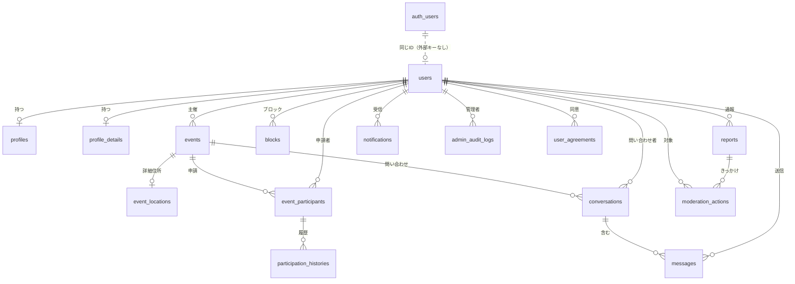
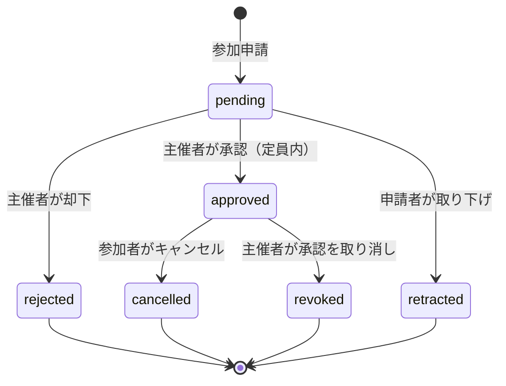

# 06 データベース設計

表記ルールは [01_企画概要](01_企画概要.md) を参照。

> - 実装前の設計案【提案】であり、SQLは作成していない。文字数や選択肢の値は [11_詳細仕様](11_詳細仕様.md) の3-3（Q-19）。本書の `Q-xx` のうち決定済みのものは11を参照。
> - 仕様・運営方針の判断が必要な点は、11章に `DB-xx` として整理した。DB-01〜DB-16は2026-11-25にユーザーが決定し、本書に反映した。
> - Supabaseの仕様のうち [S1] などを付けたものは、2026-11-25に公式ページの検索結果の要約で確認した（13章）。実装前に原文と実際の動作を確認する。

## 1. 基本方針

1. **公開範囲の違う情報はテーブルを分ける。** RLSは行単位の制御であり、同じ行の一部の列だけを隠す用途には向かない
2. 公開スキーマの全テーブルでRLSを有効にし、許可する操作だけを定義する
3. 定員・重複・ブロック・送信回数は、画面ではなくDBで強制する
4. 状態変更（申請・承認・却下・承認の取り消し・キャンセル・利用停止・解除など）はDB関数を通し、テーブルの直接更新を許可しない
5. 日時は `timestamptz` で保存し、画面では日本時間で表示する
6. 主キーは原則 `uuid`。順序が必要な表だけ `bigint` の連番を併用する
7. メールアドレスは `auth.users` だけに置き、アプリのテーブルへ複製しない
8. DB変更は `supabase/migrations` で管理する
9. **テーブルの権限（GRANT）とRLSの両方で守る。** 既定の権限に頼らず、必要な権限だけを明示的に与える（6-1）
10. **守るべき条件は、まず制約で、制約で表せないものをDB関数で守る。** どこで守るかを5-11に一覧にする
11. 内部だけで使う表と関数は、Data APIに公開しない `private` スキーマに置く

## 2. テーブル一覧

| テーブル | スキーマ | 役割 | 区分 |
|---|---|---|---|
| `auth.users` | auth | 認証情報（Supabase管理） | 既存の仕組み |
| `users` | public | 権限・利用状態 | 指示された対象 |
| `profiles` | public | プロフィール（ログイン済みに公開する項目） | 指示された対象 |
| `profile_details` | public | プロフィール（年代・性別・活動地域） | 追加 |
| `events` | public | 募集の公開情報 | 指示された対象 |
| `event_locations` | public | 募集の詳細住所 | 追加 |
| `event_participants` | public | 参加申請・参加状態 | 指示された対象 |
| `participation_histories` | private | 申請・キャンセルなどの履歴 | 追加 |
| `conversations` | public | 会話 | 指示された対象 |
| `messages` | public | メッセージ | 指示された対象 |
| `blocks` | public | ブロック | 指示された対象 |
| `reports` | private | 通報 | 指示された対象 |
| `notifications` | public | 通知 | 指示された対象 |
| `moderation_actions` | private | 利用停止などの措置の記録 | 追加 |
| `reregistration_blocks` | private | 利用停止中に退会した人の再登録の防止 | 追加 |
| `admin_audit_logs` | private | 管理者の閲覧・操作の記録 | **今回追加** |
| `rate_limit_events` | private | 操作回数の記録 | **今回追加** |
| `user_agreements` | private | 規約等への同意の記録 | **今回追加** |

追加した理由：

- `profile_details`：公開範囲の違う年代・性別・活動地域を、`profiles` と行単位で分けて制御するため
- `event_locations`：公開情報と分け、承認済みユーザーだけに行単位で許可するため
- `participation_histories`：キャンセル履歴を、現在の状態と分けて改ざんできない形で残すため
- `moderation_actions`：誰がいつ利用停止したかを残すため
- `reregistration_blocks`：退会後に個人情報を残さず、利用停止逃れを防ぐため
- `admin_audit_logs`：管理者が他人のメッセージを見たことを、後から確認できるようにするため
- `user_agreements`：どの版に、いつ同意したかを残すため（CND-09）
- `rate_limit_events`：取り消しや削除をしても操作回数を正しく数えるため

`private` に置く表は、本人や管理者に見せる場合もDB関数が必要な列だけを返す。

## 3. 関係図

外部キーの削除時の動作は、記録を守るため原則 `RESTRICT` とする。`CASCADE` は使わず、消すものは退会処理（5-8）などで明示的に消す。

## 4. テーブル定義案

「必須」は NOT NULL を表す。`created_at`・`updated_at` はDB側で設定し、クライアントから受け取らない。

### 4-1. users

| カラム | 型 | 必須 | 制約・備考 |
|---|---|:-:|---|
| id | uuid | ○ | 主キー。`auth.users.id` と同じ値。**外部キーは置かない**（5-8） |
| role | text | ○ | `user` / `admin`。初期値 `user`。運営者がDBの管理操作で付与する（Q-28） |
| status | text | ○ | `active` / `suspended` / `withdrawing`（退会処理中）/ `withdrawn`（退会済み）。初期値 `active` |
| age_category | text | | 18歳以上／18歳未満（保護者の同意あり）。登録時の申告。生年月日は持たない。18歳未満の制限は11の7-1、法的な条件はQ-30。退会時に消す |
| status_changed_at | timestamptz | ○ | 状態を最後に変えた日時 |
| withdrawal_requested_at | timestamptz | | 退会処理を始めた日時 |
| withdrawn_at | timestamptz | | 退会が完了した日時 |
| withdrawn_while_suspended | boolean | ○ | 利用停止中に退会したか。初期値 `false` |
| created_at / updated_at | timestamptz | ○ | |

CHECK制約：

- `age_category` は、`withdrawing`・`withdrawn` 以外では必須
- `withdrawing`・`withdrawn` のときだけ `withdrawal_requested_at` があり、`withdrawn` のときだけ `withdrawn_at` がある
- `role` が `admin` の行は `status` が `active` に限る（管理者は停止・退会できない。先に権限を外す）

そのほか：

- メールアドレス・電話番号を持たない
- 利用者による `role`・`status`・`age_category` の直接の変更を禁止する。`age_category` は、18歳になった本人が「18歳未満」から「18歳以上」へ変える関数だけを用意し、逆の変更はできない
- 登録時は `auth.users` への追加に合わせたトリガーで行を作る。`role` は常に `user` とし、登録時に渡された値からは `age_category` と同意した規約等の版だけを受け取る。決めた値以外や、現在の版への同意がそろっていない場合は登録を拒否する。同意は同じトランザクションで `user_agreements` に記録する
- `role` の変更は、トリガーで `admin_audit_logs` に残す
- 退会後も行を残し、記録の参照先とする（5-8）

### 4-2. profiles

| カラム | 型 | 必須 | 制約・備考 |
|---|---|:-:|---|
| user_id | uuid | ○ | 主キー、外部キー → `users.id` |
| nickname | text | ○ | 空白のみ不可。1〜20文字。重複を認める |
| experience_level | text | ○ | 未経験者・初心者・経験者に対応する値 |
| avatar_path | text | | Storage上のパス。自分の領域（`<user_id>/`）で始まること |
| bio | text | | 自己紹介。500文字まで |
| volleyball_history | text | | バレーボール歴 |
| positions | text[] | | 複数選択。選択肢は11の3-3。空配列と重複は不可 |
| created_at / updated_at | timestamptz | ○ | |

- **行があることを「必須プロフィールの入力済み」とみなす**（Q-40）。行がない利用者の書き込みは、共通の検証（6-3）で拒否する
- このテーブルの項目はログイン済みユーザーに公開する【合意済み】。ただし、全員分をまとめて取得されないよう、他人の分はIDを指定する関数（`get_profiles`、1回50件まで）で返す
- 未ログインユーザーには、募集の表示に必要な**主催者ニックネームだけ**を、募集を返す関数の中で返す
- 行がない場合、表示用の関数は「退会したユーザー」を返す
- 年代・性別・活動地域は `profile_details`（4-13）に分ける

### 4-3. events

公開してよい情報だけを置く。

| カラム | 型 | 必須 | 制約・備考 |
|---|---|:-:|---|
| id | uuid | ○ | 主キー |
| host_id | uuid | ○ | 外部キー → `users.id`。変更不可 |
| title | text | ○ | 空白のみ不可。50文字まで |
| starts_at | timestamptz | ○ | 開催日時 |
| ends_at | timestamptz | ○ | 終了日時。`starts_at` より後。開催時間は24時間以内（CHECK：`ends_at - starts_at` で比べる。DB-04） |
| area | text | ○ | 名古屋市の16区のいずれか（CHECK制約） |
| target_levels | text[] | ○ | 対象レベル。1つ以上、決めた値だけ、重複不可 |
| description | text | | 説明。1,000文字まで |
| belongings | text | | 持ち物。200文字まで |
| capacity | integer | ○ | 1〜100。募集する参加者の人数（主催者を含まない） |
| fee | integer | ○ | 円、0〜50,000。アプリ内決済は行わない |
| status | text | ○ | `open`（受付中）/ `closed`（締切）/ `cancelled`（中止）。初期値 `open` |
| cancelled_at | timestamptz | | 中止した日時。`status` が `cancelled` のときだけ値がある（CHECK） |
| hidden_at | timestamptz | | 管理者が非表示にした日時。`status` は変えない |
| revision | integer | ○ | 通知が必要な変更のたびに1増やす。初期値1。通知の重複防止に使う |
| client_request_id | uuid | ○ | 作成の二重送信の防止。`(host_id, client_request_id)` に一意制約 |
| created_at / updated_at | timestamptz | ○ | |

- 保存する状態と、日時などから決まる状態を分ける。判定は5-12にまとめる
- 編集・締切・再開・中止はDB関数で行い、開催開始前の主催者だけに許可する。中止は元に戻せない（Q-16）
- 開催日時は、作成・編集の時点から1年以内とする。現在時刻との比較はCHECKで表せないため、関数で検証する（DB-04）
- 募集の作成回数を利用者ごとに制限する（Q-47）
- 自由入力欄に住所が書かれると限定公開が崩れるため、入力時の注意表示と通報で補う
- 主催者を検証する複合外部キーのため、`(id, host_id)` に一意制約を置く

### 4-4. event_locations

| カラム | 型 | 必須 | 制約・備考 |
|---|---|:-:|---|
| event_id | uuid | ○ | 主キー、外部キー → `events.id` |
| venue_name | text | | 施設名。50文字まで |
| address | text | ○ | 詳細住所。空白のみ不可。200文字まで |
| note | text | | 集合場所など。300文字まで |
| updated_at | timestamptz | ○ | |

募集の作成・編集と同じトランザクションで保存し、住所のない募集を作らない。主催者が退会するときは、その人の募集の住所をすべて削除する（DB-01、5-8）。

### 4-5. event_participants

| カラム | 型 | 必須 | 制約・備考 |
|---|---|:-:|---|
| id | uuid | ○ | 主キー |
| event_id | uuid | ○ | `(event_id, host_id)` で `events(id, host_id)` への複合外部キー |
| host_id | uuid | ○ | 主催者。`events` から複製し、変更しない |
| user_id | uuid | ○ | 申請者。外部キー → `users.id`。**`host_id` と異なること（CHECK）** |
| attempt_no | smallint | ○ | この募集への何回目の申請か。**1〜3（CHECK）** |
| status | text | ○ | `pending` / `approved` / `rejected` / `cancelled` / `revoked`（承認取り消し）/ `retracted`（取り下げ） |
| applied_at | timestamptz | ○ | |
| decided_at | timestamptz | | 承認・却下の日時 |
| cancelled_at | timestamptz | | キャンセル日時 |
| revoked_at | timestamptz | | 承認を取り消した日時 |
| revoke_reason | text | | 取り消しの理由。`revoked` の場合は必須。選択肢は11の3-3 |
| retracted_at | timestamptz | | 取り下げた日時 |
| updated_at | timestamptz | ○ | |

- **部分一意インデックス**：`(event_id, user_id)`、条件 `status in ('pending','approved')`（有効な申請は1件）
- **一意制約**：`(event_id, user_id, attempt_no)`。`attempt_no` の範囲と合わせ、合計3回までをDBで保証する（Q-14）
- CHECK制約：`status` と各日時・理由の組み合わせが合うこと
- 1行を1人分とする【合意済み】。友人同士の場合も各自が1人ずつ申請する
- `host_id` を持つことで、「主催者は自分の募集に申請できない」を制約で守り、RLSで `events` を参照せずに済ませる

状態の変化：

- 上の図にない変化は、トリガーでも拒否する（運営者が手作業で変更した場合の誤りも防ぐ）
- 再申請は、キャンセル・取り下げの後だけ認め、新しい行を作って過去の記録を残す。却下・承認取り消しの記録がある人は認めない（Q-14）
- 退会・利用停止にともなう変更は、`approved` を `cancelled`、`pending` を `retracted` にする

### 4-6. participation_histories

| カラム | 型 | 必須 | 制約・備考 |
|---|---|:-:|---|
| id | bigint | ○ | 主キー。連番（起きた順に並べるため） |
| participant_id | uuid | ○ | 外部キー → `event_participants.id` |
| from_status | text | | 初回は空 |
| to_status | text | ○ | |
| actor_id | uuid | | 操作者。退会後も残す（5-8） |
| cause | text | ○ | `self` / `host` / `withdrawal` / `suspension` |
| created_at | timestamptz | ○ | |

- 状態変更と同じトランザクションで追加する。追加だけを許し、更新・削除はトリガーで拒否する
- 本人とその募集の主催者には、関数で **`from_status`・`to_status`・`created_at` だけ**を返す（Q-26）。`actor_id` と `cause` を返すと、利用停止されたことが主催者に分かってしまうため（11の4-2「理由は示さない」）

### 4-7. conversations

| カラム | 型 | 必須 | 制約・備考 |
|---|---|:-:|---|
| id | uuid | ○ | 主キー |
| event_id | uuid | ○ | |
| host_id | uuid | ○ | `(event_id, host_id)` を `events(id, host_id)` への複合外部キーとし、主催者のなりすましを防ぐ |
| inquirer_id | uuid | ○ | 外部キー → `users.id`。`host_id` と異なること（CHECK） |
| started_by | uuid | ○ | 会話を始めた人。`host_id` か `inquirer_id` のどちらか（CHECK） |
| created_at | timestamptz | ○ | |
| last_message_at | timestamptz | | 最後のメッセージの日時。メッセージがない間は空 |

- 一意制約：`(event_id, inquirer_id)`。会話は募集と問い合わせユーザーごとに1つ（Q-21）
- 主催者が開始する場合は、相手がその募集に `pending` または `approved` の申請を持つことを検証する
- 新しい会話は利用者ごとに1日10件まで（Q-10）。主催者・問い合わせユーザーのどちらが始めたかを `started_by` で区別して数える

### 4-8. messages

| カラム | 型 | 必須 | 制約・備考 |
|---|---|:-:|---|
| id | uuid | ○ | 主キー |
| seq | bigint | ○ | 連番。一意。会話の中の順序を決める |
| conversation_id | uuid | ○ | 外部キー → `conversations.id` |
| sender_id | uuid | ○ | 外部キー → `users.id`。会話の当事者であること。クライアントから受け取らず、送信関数が `auth.uid()` を設定する（5-7） |
| body | text | ○ | 空白のみ不可。1,000文字まで |
| client_request_id | uuid | ○ | 二重送信の防止。`(sender_id, client_request_id)` に一意制約 |
| hidden_at | timestamptz | | 管理者が非表示にした日時。非表示の行は一般ユーザーに返さない |
| created_at | timestamptz | ○ | DB側で設定 |

- `created_at` だけでは同じ時刻や前後の入れ替わりが起こり得るため、並び順と「前後10件」は `seq` で決める
- RLSは列だけを隠せないため、非表示のメッセージは**行ごと返さない**

### 4-9. blocks

| カラム | 型 | 必須 | 制約・備考 |
|---|---|:-:|---|
| blocker_id | uuid | ○ | 外部キー → `users.id` |
| blocked_id | uuid | ○ | 外部キー → `users.id`。`blocker_id` と異なること |
| created_at | timestamptz | ○ | |

主キー：`(blocker_id, blocked_id)`。追加・解除は関数だけで行う（送信・申請との競合を防ぐため、5-3）。

### 4-10. reports

| カラム | 型 | 必須 | 制約・備考 |
|---|---|:-:|---|
| id | uuid | ○ | 主キー |
| reporter_id | uuid | ○ | 外部キー → `users.id` |
| subject_user_id | uuid | ○ | 通報された人（募集は主催者、メッセージは送信者）。外部キー → `users.id`。**`reporter_id` と異なること（CHECK）** |
| reported_user_id | uuid | | 外部キー → `users.id` |
| event_id | uuid | | 外部キー → `events.id` |
| message_id | uuid | | 外部キー → `messages.id` |
| reason | text | ○ | 分類は11の4-3 |
| detail | text | | 補足。500文字まで |
| status | text | ○ | `open` / `in_progress` / `resolved` / `dismissed` |
| snapshot | jsonb | | 通報時の対象の控え。DB側で作成する。住所と画像は含めない。`redacted_at` がない間は必須（CHECK） |
| snapshot_version | smallint | ○ | 控えの形式の版 |
| handled_by | uuid | | 最後に対応した管理者 |
| handled_at | timestamptz | | 対応が終わった日時。`resolved`・`dismissed` のときだけ値がある（CHECK）。対応中に戻すと空にする |
| resolution_note | text | | 対応の記録。管理者だけが扱う |
| redacted_at | timestamptz | | 保存期間が過ぎ、控え・補足・対応の記録を消した日時（5-15）。値がある場合、その3つは空（CHECK） |
| created_at / updated_at | timestamptz | ○ | |

- `reported_user_id`・`event_id`・`message_id` の**ちょうど1つ**に値があることをCHECK制約で保証する
- 通報はDB関数で受け付け、`subject_user_id` と控えをDB側で決め、同じトランザクションで保存する
- **部分一意インデックス**（対象の種類ごとに3つ）：`(reporter_id, 対象のID)`、条件 `status in ('open','in_progress')`。同じ人・同じ対象で、対応が終わっていない通報は1件までとする
- 自分自身・自分の募集・自分のメッセージは通報できない（`subject_user_id` の制約で保証）。メッセージは会話の当事者だけが通報できる
- 状態は `open` → `in_progress` → `resolved`・`dismissed` の順に変える。`open` から直接 `dismissed` にもできる。`resolved`・`dismissed` からは、理由を記録して `in_progress` に戻せる（DB-09）。控えを消した通報は戻せない。同じ人・同じ対象の対応中の通報が別にある場合は、部分一意インデックスに反するため、決めたコードで拒否する
- `status`・控え・対応の記録を含むため、通報者にも表の行は直接返さない

### 4-11. notifications

| カラム | 型 | 必須 | 制約・備考 |
|---|---|:-:|---|
| id | uuid | ○ | 主キー |
| user_id | uuid | ○ | 受信者。外部キー → `users.id` |
| type | text | ○ | 参加申請、キャンセル、承認取り消し、承認、却下、募集の変更、中止、非表示、非表示の取り消し（11の3-2） |
| event_id | uuid | | 外部キー → `events.id` |
| participant_id | uuid | | 外部キー → `event_participants.id` |
| changed_fields | text[] | | 募集の変更で変わった項目の名前だけ（値は入れない） |
| dedupe_key | text | ○ | 重複防止の鍵。**`(user_id, dedupe_key)` に一意制約** |
| read_at | timestamptz | | |
| created_at | timestamptz | ○ | |

- 文章は保存せず、種類とIDから画面で組み立てる。住所・メールアドレス・停止の理由を保存しない
- 種類ごとに必要な列（`event_id`・`participant_id`・`changed_fields`）をCHECK制約で決める
- 作成は業務処理と同じトランザクションで行い、同じ鍵があれば何もしない（5-13）

### 4-12. moderation_actions

| カラム | 型 | 必須 | 制約・備考 |
|---|---|:-:|---|
| id | bigint | ○ | 主キー。連番 |
| admin_id | uuid | ○ | 外部キー → `users.id` |
| target_user_id | uuid | ○ | 外部キー → `users.id`。`admin_id` と異なること |
| action | text | ○ | 利用停止、解除、募集の非表示・取り消し、メッセージの非表示・取り消し、利用停止にともなう募集の中止、画像の削除 |
| reason_code | text | | 分類は11の4-3。解除と非表示の取り消し以外では必須（CHECK） |
| reason_note | text | | 補足。500文字まで。解除と非表示の取り消しでは必須（CHECK。`redacted_at` がある場合を除く） |
| event_id / message_id | uuid | | 非表示・取り消し・中止の対象。`action` に応じて必要な方だけに値がある（CHECK） |
| redacted_at | timestamptz | | 保存期間が過ぎ、補足を消した日時（5-15） |
| report_id | uuid | | 外部キー → `reports.id` |
| created_at | timestamptz | ○ | |

追加だけを許し、更新・削除はトリガーで拒否する。例外は、`reason_note` を空にして `redacted_at` を設定する変更（5-15）だけとする。通報の分類は違反の理由のため、解除や取り消しでは補足に理由を書く。現在の利用状態は `users.status` を正とし、措置の追加と同じトランザクションで変える。

### 4-13. profile_details

| カラム | 型 | 必須 | 制約・備考 |
|---|---|:-:|---|
| user_id | uuid | ○ | 主キー、外部キー → `users.id` |
| age_group | text | | 年代。選択肢は11の3-3、未成年者の扱いはQ-30 |
| gender | text | | 性別。選択肢は11の3-3 |
| activity_areas | text[] | | 活動地域。名古屋市の16区から複数、または市外。空配列と重複は不可 |
| created_at / updated_at | timestamptz | ○ | |

閲覧できるのは本人と、その人の `pending` または `approved` の申請がある募集の主催者だけ【合意済み】。主催者が閲覧できるのは募集の終了日時までとし、却下・キャンセル・承認取り消し・取り下げになった場合、募集が中止・非表示になった場合は閲覧できない（DB-03）。

### 4-14. reregistration_blocks

利用停止中に退会した人の再登録を防ぐための表（Q-52）。

| カラム | 型 | 必須 | 制約・備考 |
|---|---|:-:|---|
| email_hash | text | ○ | 主キー。正規化したメールアドレスの鍵付きハッシュ |
| key_version | smallint | ○ | ハッシュに使った鍵の版 |
| created_at | timestamptz | ○ | |
| expires_at | timestamptz | ○ | 登録から1年後（11の4-8）。過ぎた行は照合に使わない |

- 利用者・管理者の画面からは閲覧できない。利用者のIDとは結び付けない
- 鍵はブラウザにもDBにも置かず、Edge Functionsの秘密情報として管理する。正規化の方法（前後の空白、大文字・小文字など）を登録時と退会時で揃える
- 照合は、Supabase AuthのBefore User Createdフック（HTTP方式）からEdge Functionsを呼んで行う案とする。このフックは無料プランでも使える [S4]

### 4-15. admin_audit_logs

| カラム | 型 | 必須 | 制約・備考 |
|---|---|:-:|---|
| id | bigint | ○ | 主キー。連番 |
| admin_id | uuid | | 操作した管理者。運営者によるDBの管理操作の場合は空 |
| action | text | ○ | 通報の閲覧、メッセージの閲覧、利用者の検索・閲覧、通報の状態変更、権限の変更など |
| target_user_id / report_id | uuid | | 対象 |
| detail | jsonb | | 補足。本文や個人情報の値は入れない |
| created_at | timestamptz | ○ | |

追加だけを許す。管理者の画面には表示せず、運営者がDBの管理操作で確認する。1年を過ぎた行だけを運営者が削除する（DB-12、5-15）。

### 4-16. rate_limit_events

| カラム | 型 | 必須 | 制約・備考 |
|---|---|:-:|---|
| id | bigint | ○ | 主キー。連番 |
| user_id | uuid | ○ | 外部キー → `users.id` |
| action | text | ○ | 募集の作成、参加申請、通報、ブロック、会話の開始 |
| created_at | timestamptz | ○ | |

制限の判定に必要な期間（2日）を過ぎた行は削除してよい。メッセージの送信回数は `messages` から数える。

### 4-17. user_agreements

| カラム | 型 | 必須 | 制約・備考 |
|---|---|:-:|---|
| id | bigint | ○ | 主キー。連番 |
| user_id | uuid | ○ | 外部キー → `users.id` |
| document | text | ○ | `terms`（利用規約）/ `privacy`（プライバシーポリシー）/ `message_review`（通報時のメッセージ確認） |
| version | text | ○ | 文書の版 |
| agreed_at | timestamptz | ○ | DB側で設定 |

- 一意制約：`(user_id, document, version)`。追加だけを許し、更新はトリガーで拒否する
- 現在の版と、書き込みに必要な最低の版は、1つの関数の中で管理する。版は、施行日などの比べられる形にする
- 本人の登録・同意の関数だけで追加する。管理者の画面には表示しない
- 保存期間は5-15

## 5. 重点課題への対応

### 5-0. すべての処理に共通する規則

**ロックの順序**：行き詰まり（デッドロック）を防ぐため、どの処理も次の順にロックを取る。同じ表の複数行はIDの小さい順に取る。

1. 操作回数の勧告的ロック（利用者と操作の種類ごと）
2. `users` → 3. `events` → 4. `event_participants` → 5. `conversations` → 6. `reports`

| 処理 | `users` の行ロック |
|---|---|
| 申請・承認・送信などの通常の書き込み | 操作者と相手を `FOR SHARE`（互いに妨げない） |
| ブロック・解除、利用停止・解除、退会 | 対象を `FOR NO KEY UPDATE`（通常の書き込みの完了を待つ） |

- これにより、「停止・ブロック・退会が確定した後に、古い状態を見た送信や申請が通る」ことを防ぐ
- `users` の行は、**必要な全員分を関数の最初に、IDの小さい順に、行ごとに必要な最も強い種類で1回だけ**取る。自分だけを先に取る、弱いロックを後から強くする、といった取り方をすると、ブロックと送信などが互いに待ち合うため
- `users`・`events` の行ロックを `FOR UPDATE` ではなく `FOR NO KEY UPDATE` とするのは、通知や会話の追加にともなう外部キーの確認を不必要に待たせないため
- 相手のIDは、変更されない列（会話の当事者、募集の主催者など）からロック前に求める
- デッドロックが検出された場合は、処理全体が取り消される。画面は、二重送信の防止の仕組みを使って再試行できる

**時刻の判定**：`now()` はトランザクションの開始時刻を返すため、ロックを待つ間に開催開始時刻を過ぎても気付けない。期限の判定は**ロック取得後の `clock_timestamp()`** で行う。

**件数の判定**：分離レベルは既定の READ COMMITTED とし、人数や回数は**ロック取得後の別の文**で数える。書き込みを行う関数は `VOLATILE` とする。

**結果の返し方**：失敗の理由は決めたコードで返す。ブロック・停止・退会など相手の事情による拒否は、同じコードにまとめる（Q-20）。

### 5-1. 定員超過を防ぐ

承認は1つのDB関数・1トランザクションで行う。

1. 操作者の `users` をロックして確認し、`events` の対象行を `FOR NO KEY UPDATE` でロックする
2. 操作者が主催者で、利用停止中でないことを確認する
3. 募集が中止・非表示でなく、開催開始前であることを確認する
4. 申請が `pending` であることを確認する
5. ロック後に承認済み人数を数え、定員未満であることを確認する
6. `approved` に更新し、履歴と通知を追加する

- 申請・却下・キャンセル・取り下げ・承認の取り消し・募集の編集も同じ募集行をロックし、判定の競合を防ぐ
- 申請時も承認済み人数を数え、定員に達していれば拒否する。募集が `open` でない・非表示の場合、ブロック関係がある場合、再申請の条件（4-5）に反する場合も拒否する
- 承認の取り消しは、操作者が主催者で利用停止中でないこと、参加が `approved` であること、理由があることを確認し、`revoked` への更新・履歴・参加者への通知を1トランザクションで行う
- 申請・承認・却下・承認の取り消し・キャンセル・取り下げは、ロック後の時刻と `starts_at` を比べ、開催開始後であれば拒否する
- 開始後に残った `pending` は状態を変えず、`starts_at` から「受付終了」と判定して表示する（定期処理を使わない）
- 編集で定員を変える場合は、ロック後に数えた承認済み人数より小さくできないようにする
- 残り枠数は別カラムに保存せず、`capacity` と承認済み人数から算出する（不整合を防ぐため）
- 承認待ちと主催者は定員に数えない。満員になっても `pending` は残し、空きが出れば承認できる

### 5-2. 申請の重複を防ぐ

部分一意インデックスで保証する。「確認してから追加」だけでは同時送信を防げないため、制約を必須とする。`attempt_no` は募集行のロック後に、その人の過去の申請数＋1として決める。一意制約に反した場合は、決めたコードの拒否として返す。

### 5-3. ブロックした相手とのメッセージを防ぐ

- 会話の作成時と送信時に、どちらか一方でもブロックしていれば拒否する
- 本人以外は `blocks` を読めないため、判定は限定したDB関数で行う
- 新しい参加申請も双方向に拒否する。すでにある申請・参加、募集とプロフィールの閲覧、過去の会話の閲覧には影響しない（Q-20）
- 送信時の判定は5-7の送信関数で行う
- ブロックと送信・申請が同時に起きた場合は、5-0のロックにより前後が決まる。**ブロックが確定した後に始まった判定は必ず拒否される**

### 5-4. 承認済みユーザーだけが住所を閲覧する

`event_locations` を閲覧できる条件：

| 閲覧者 | 条件 |
|---|---|
| 主催者 | 利用状態が `active` であり、募集が非表示でない（Q-16、DB-07）。終了・中止の後も閲覧できる |
| 参加者 | 利用状態が `active`、**現在** `approved`、募集が中止・非表示でない、現在時刻が `ends_at` 以前 |
| そのほか（管理者を含む） | 閲覧できない |

一度表示された情報を回収することはできない。

### 5-5. 個人情報を保護する

| 情報 | 保存先 | 閲覧できる人 | 退会時 |
|---|---|---|---|
| メールアドレス・パスワード | `auth.users` | 本人（Auth経由） | 認証アカウントごと削除 |
| 年齢の区分 | `users` | 本人 | 空にする |
| ニックネーム・画像など | `profiles`、Storage | ログイン済み（画像も同じ） | 削除 |
| 年代・性別・活動地域 | `profile_details` | 本人、申請先の主催者（終了日時まで、DB-03） | 削除 |
| 詳細住所 | `event_locations` | 5-4 | 主催者の退会時に削除（DB-01） |
| メッセージ | `messages` | 当事者、限定した範囲で管理者 | 残す（送信者は匿名表示） |
| 通報の控え | `reports` | 管理者 | 残す。対応が終わって1年で消す（DB-11、5-15） |
| メールアドレスのハッシュ | `reregistration_blocks` | なし | 停止中の退会だけ追加（1年で削除） |
| 規約等への同意 | `user_agreements` | なし | 退会から1年で削除 |

- 電話番号は収集しない
- 公開スキーマに `auth.users` を参照するビューを作らない
- 必要な列だけを取得し、`select *` を公開用の処理に使わない
- 退会後に残るIDは、個人情報を消した後も同じ人の記録を結び付ける値であるため、画面やURLに出さない

### 5-6. 送信回数を制限する

送信用のDB関数で、`sender_id` ごとの直近の送信数を検証する（1分間に10通、1時間に60通まで。初期値、Q-10）。送信者ごとの勧告的ロックにより、並列送信で上限を超えないようにする。検証の順序は5-7を参照。

### 5-7. メッセージの送信・閲覧権限を保証する

メッセージの追加は**送信用のDB関数（以下、送信関数）だけ**で行い、一般ユーザーが `messages` へ直接INSERTできないようにする。RLSとDB関数のどちらか一方に頼らず、両方で権限を確認する。

| 保証する内容 | テーブル側（権限・RLS） | 送信関数 |
|---|---|---|
| ログイン済みであること | 未ログインには `messages` の権限を与えない | `auth.uid()` が空なら拒否する。未ログインに実行権限を与えない |
| 送信者が本人であること | 直接INSERTを許可しない | `sender_id` を引数で受け取らず、`auth.uid()` を設定する |
| 会話の当事者であること | 閲覧ポリシーを当事者（`host_id` または `inquirer_id` が `auth.uid()`）に限定する（管理者の例外は下記） | `auth.uid()` が対象会話の当事者でなければ拒否する |
| ブロックされていないこと | 直接INSERTを許可しない | どちらか一方でも相手をブロックしていれば拒否する |
| 利用停止中でないこと | 直接INSERTを許可しない。閲覧も `active` に限定する | `users.status` が `active` でなければ拒否する |
| 送信回数の上限内であること | 直接INSERTを許可しない | 送信者の直近の送信数を数え、上限に達していれば拒否する（Q-10） |

テーブル側の方針：

- ログイン済み・未ログインのどちらのロールにも `messages` のINSERT権限を与えず（既定で付与される場合は取り消す）、INSERTを許可するRLSポリシーも作らない
- 閲覧は当事者だけに許可する。例外として、管理者は通報対象のメッセージと、その前後10件ずつ（同じ会話内）だけを、管理用関数で閲覧できる【合意済み】（Q-28、5-14）
- 一般ユーザーの更新・削除は認めない（Q-21）。非表示は管理用関数だけで行う

送信関数の処理（1トランザクション）：

1. 関数内で `auth.uid()` を取得し、空なら拒否する。引数は会話ID・本文・`client_request_id` とする
2. 対象の会話を取得し、`auth.uid()` が当事者であることを検証する。相手は会話の `host_id`・`inquirer_id` から求め、引数で受け取らない
3. 送信者の勧告的ロックを取り、同じ `client_request_id` のメッセージがあれば、新しく作らずにそれを返す
4. 送信者と相手の `users` を、IDの小さい順に `FOR SHARE` でロックし、送信者が `active`・一般ユーザー・プロフィール入力済みであること、相手が `active` であることを検証する
5. ブロック状態を双方向で検証する。送信できる期間（開催終了の7日後まで）であることも検証する
6. **ロック取得後に**直近の送信数を数え、上限内であることを検証する
7. 会話の `last_message_at` を更新し（会話の行をロックし、順序を確定させる）、`sender_id` に `auth.uid()`、`created_at` にDBの時刻を設定して追加する

いずれかの検証に失敗した場合は、何も保存しない。

配信（Realtime）：

- 追加後のトリガーで、非公開チャンネル `conversation:<会話ID>` へ**会話ID・メッセージID・`seq` だけ**を配信し、本文は受信した画面が `messages` から取得する
- 理由：チャンネルの権限は接続時に判定され、接続中は結果が使い回される。また、配信した内容は `realtime.messages` に3日間保存される [S3]。本文を含めると、接続後に停止された利用者へ本文が届き続け、非表示にした本文も残るため
- 受信の権限は、`realtime.messages` のSELECTポリシーで当事者かつ `active` に限定する。クライアントからの送信（INSERT）のポリシーは作らない

関数の権限：

- 呼び出した利用者の権限で動く関数（`SECURITY INVOKER`）だけで追加するには、利用者自身にINSERT権限が必要になり、直接INSERTを防げない。そのため、追加の処理は `SECURITY DEFINER` とする
- `SECURITY DEFINER` の関数内では、所有者によってはRLSが適用されない。上記の検証を省略せず、関数内で必ず行う
- 共通の規則（`search_path`、実行権限、スキーマ）は6-2に従う
- ブロックの判定関数は利用者から直接実行できないようにし、ブロック情報を推測されないようにする

関連する決定（11）：

- 一般ユーザーによるメッセージの削除は認めないため、削除による送信回数の回避は起きない。非表示にしたメッセージも回数に数える
- 拒否した場合は「送信できません」とだけ返し、ブロックや相手の停止を推測させない（Q-20）
- メール未認証ユーザーはログインできず、送信できない（Q-40）

### 5-8. 退会時に個人情報を消し、記録を残す

**`users.id` に外部キーを置かない理由**

| 案 | 内容 | 判断 |
|---|---|---|
| **外部キーを置かない（採用）** | `users.id` に `auth.users.id` と同じ値を持ち、外部キーは置かない。登録時はトリガーで必ず行を作る | 認証アカウントを削除しても `users` の行を残せる。`auth.uid()` とそのまま比べられる |
| 別の列で参照 | `users.auth_user_id` から参照し、削除時に空にする | 参照は明確だが、すべてのRLSと関数でIDの変換が必要になり、誤りやすい |
| 論理削除 | 認証アカウントを削除済みの印だけ付けて残す | 識別できる情報が残り得るため、Q-27に合わない |

外部キーがないことで生じる食い違い（片方だけある行）は、点検用の問い合わせで定期的に確認する（12章）。

**処理の手順**：DB・Storage・Authにまたがり、1つのトランザクションにできないため、途中で失敗しても再開できるように段階を分ける。Edge Functionsが次の順に呼ぶ。

| 段階 | 実行場所 | 内容 | 失敗した場合 |
|---|---|---|---|
| 1 | DB（1トランザクション、本人の権限） | 下の検証と変更を行い、`users.status` を `withdrawing` にする | 何も変わらない。やり直せる |
| 2 | Storage | 本人の領域の画像をすべて削除する | 段階2からやり直す（すでにない場合は成功とみなす） |
| 3 | DB（サーバー側の権限） | 利用停止中だった場合だけ、`reregistration_blocks` に追加する | 同じ値があれば成功とみなす |
| 4 | Auth | 認証アカウントを削除する | 段階4からやり直す |
| 5 | DB（サーバー側の権限） | `users.status` を `withdrawn` にする | 点検で「`withdrawing` だが認証アカウントがない」行を見つけて完了させる |

- Storageにファイルが残っていると認証アカウントを削除できないため、段階2を先に行う [S6]。ハッシュの作成にはメールアドレスが必要なため、段階3を段階4の前に行う
- `withdrawing` になった時点で、`active` を条件とする操作はすべて拒否される。本人は退会の再実行だけができる
- 認証アカウントの削除はシークレットキーが必要なため、Edge Functionsで行う（11のQ-01）。発行済みのアクセストークンは期限まで残り得るため、すべての操作で `users.status` を確認する

**段階1の内容**

1. 操作者を `auth.uid()` で確認し、`users` をロックする。管理者は拒否する
2. 主催する開催開始前の募集（中止・非表示を除く）がある場合は拒否する。**利用停止中の場合は拒否せず**、募集を中止にして参加者へ通知する。非表示の募集が残る場合は、後から戻されて主催者のいない募集にならないよう、通知せずに中止にする
3. 開催開始前の参加を `cancelled`、承認待ちを `retracted` にし、履歴（`cause` は `withdrawal`）を追加する。参加のキャンセルは主催者へ通知する。中止した募集の参加は変えず、非表示の募集の参加は変えるが通知しない
4. `profiles`・`profile_details`・本人の通知・本人が設定したブロック・`rate_limit_events`・**本人が主催した募集の `event_locations`** を削除し、`age_category` を空にする。住所は、終了・中止した募集だけでなく、開催中の募集の分も削除する（Q-27の「すぐに削除」に合わせる。退会の画面で説明する）
5. `withdrawn_while_suspended` に停止中だったかを記録し、状態を `withdrawing` にする

**残すもの**：募集、参加、履歴、会話、メッセージ、通報、措置、管理者の記録、同意の記録。画面では「退会したユーザー」と表示する。

**消しきれないもの**（プライバシーポリシーで扱う、Q-32）：メッセージ・募集の説明に本人が書いた個人情報、通報の控え・措置の補足（期間後に消す、5-15）、バックアップ、Supabaseの認証・配信のログ。

### 5-9. 利用停止の影響

利用停止のDB関数は、状態の変更と同じトランザクションで次を行う（Q-28）。

1. 管理者であることと、対象が `active` の一般ユーザーであることを、`users` のロック後に確認する
2. 理由を `moderation_actions` に記録し、`users.status` を `suspended` にする
3. 停止された人の開催開始前の `approved` を `cancelled`、`pending` を `retracted` にし、履歴（`cause` は `suspension`）を追加する。参加のキャンセルは主催者へ通知し、種類は通常のキャンセルと同じにする。中止・非表示の募集の扱いは5-8の段階1と同じ
4. 停止された人が主催する開催開始前の募集について、管理者が停止と同時に選んだ次のどちらかを行う（DB-13）。選択は募集ごとではなく、停止ごとに1回とする
   - **締め切る**：`open` を `closed` にする。参加者へは知らせない
   - **中止する**：`open`・`closed` を `cancelled` にし、募集ごとに措置を記録して、承認待ち・承認済みの人へ通知する。停止のことや理由は通知に含めない。非表示の募集は通知せずに中止にする

- 停止中の閲覧は未ログインと同じ範囲とし、住所・会話・ほかの人のプロフィール・自分の申請や通知もRLSと関数で拒否する。自分の `users` の行（状態の確認）だけは読める
- 解除の関数は、対象が `suspended` であることを確認し、措置の記録と状態の変更を同時に行う。取り消された参加や締切は自動で戻さない（締切は、主催者本人が受付を再開できる）。**中止は、解除しても戻せない**ため、停止の画面で注意を示す
- 管理者は停止できない（4-1のCHECK）。自分自身への措置もできない（4-12のCHECK）
- 二重の停止・解除は、ロック後の状態の確認で拒否し、記録も残さない

### 5-10. 操作回数を制限する

募集の作成（1日5件）、参加申請（1日20件）、通報（1日10件）、ブロック（1日50件）、会話の開始（1日10件）を、利用者ごとにDB関数で制限する（初期値、Q-10・Q-47）。

1. 利用者と操作の種類ごとの勧告的ロックを取る
2. `rate_limit_events` から直近の件数を数え、上限に達していれば拒否する
3. 処理が成功したときだけ1行追加する（失敗した操作は数えない）

ブロックの解除や申請の取り下げをしても、行は消えないため回避できない。「1日」は直近24時間とする（DB-05）。数値は関数の中に散らさず、1か所で管理する。

### 5-11. 守るべき条件と守る場所

| 条件 | 制約 | DB関数 | 補助 |
|---|---|---|---|
| 有効な申請は1人1件 | 部分一意インデックス | 申請 | － |
| 申請は合計3回まで | CHECK＋一意制約 | 申請 | － |
| 主催者は自分の募集に申請できない | CHECK | 申請 | － |
| 承認済み人数が定員以下 | （件数のため表せない） | 承認・編集（行ロック） | 点検用の問い合わせ |
| 参加状態の変化の順序 | － | 各関数 | トリガー |
| 会話の主催者が本物である | 複合外部キー | 会話の開始 | － |
| 通報は1対象・自分以外 | CHECK | 通報 | － |
| 対応中の通報は1人1対象1件 | 部分一意インデックス | 通報 | － |
| 通知の重複 | 一意制約 | 各関数 | － |
| 二重送信（メッセージ・募集） | 一意制約 | 送信・作成 | － |
| 管理者は停止・退会できない | CHECK | 停止・退会 | － |
| 履歴・措置・監査の改ざん防止 | － | 追加のみ | トリガー、権限を与えない |
| 操作回数 | － | 各関数（勧告的ロック） | － |
| 18歳未満は募集を作成できない | － | 作成 | － |
| 必要な版への同意 | － | 登録のトリガー、`require_member` | － |
| 開催時間24時間以内 | CHECK | 作成・編集 | － |
| 開催日時が1年以内 | （現在時刻との比較のため表せない） | 作成・編集 | － |
| 控え・補足を消した状態の整合 | CHECK | 運営者の処理 | トリガー |

### 5-12. 募集の状態を判定する

保存するのは `status`（主催者の操作）と `hidden_at`（管理者の操作）だけとし、残りは日時と人数から判定する。上から順に、最初に当てはまるものを現在の状態とする。

| 状態 | 条件 | 一覧・検索 | 第三者の詳細閲覧 | 申請 | 承認・却下・取り消し | キャンセル・取り下げ | 編集 | 参加者の住所閲覧 |
|---|---|:-:|:-:|:-:|:-:|:-:|:-:|:-:|
| 非表示 | `hidden_at` あり | × | × | × | × | × | × | × |
| 中止 | `status` が `cancelled` | × | × | × | × | × | × | × |
| 終了 | 現在時刻が `ends_at` を過ぎた | × | × | × | × | × | × | × |
| 開催中 | 現在時刻が `starts_at` 以降 | × | ○ | × | × | × | × | ○ |
| 締切 | `status` が `closed` | ○（受付終了） | ○ | × | ○ | ○ | ○ | ○ |
| 満員 | 承認済み人数が定員に達した | ○（満員） | ○ | × | ○（承認は不可） | ○ | ○ | ○ |
| 受付中 | 上のどれでもない | ○ | ○ | ○ | ○ | ○ | ○ | ○ |

- 判定は1つの関数にまとめ、画面と各関数で同じ結果を使う
- 非表示は `status` を上書きせず、独立して扱う。誤って非表示にした場合に元の状態を失わないため。管理者は理由を記録して非表示を取り消せ、取り消した時点の状態（日時・`status`）で表示する（DB-06）
- 非表示・中止にした時点で、参加の `status` は変えない（「中止された募集の参加者」という記録を残すため）。画面では募集の状態を優先して表示する
- **非表示の募集**：主催者と、申請したことがある人には、「非表示になった募集」であることと開催日時だけを関数で返す。主催者も、住所を含めて閲覧・編集できない（DB-07）
- **終了・中止した募集**：詳細を見られるのは、主催者と、申請したことがある人（申請の状態を問わない）だけとする。ほかの人がURLを開いても、募集がない場合と同じ結果を返す（DB-08）
- 申請せずに質問だけした人も第三者に含む。会話がどの募集のものか分かるよう、会話の一覧では**タイトルと開催日時だけ**を返す（非表示の場合は「非表示になった募集」と開催日時）
- 管理者は、終了・中止・非表示を問わず、公開項目だけを管理用関数で確認できる（通報の確認と、非表示の取り消しに必要なため。住所は返さない）

### 5-13. 通知を重複なく作る

| 種類 | 受け取る人 | `dedupe_key` |
|---|---|---|
| 参加申請（NTF-01） | 主催者 | `participant:<ID>:applied` |
| キャンセル（NTF-02） | 主催者 | `participant:<ID>:cancelled` |
| 承認取り消し（NTF-03） | 参加者 | `participant:<ID>:revoked` |
| 承認・却下（CND-04） | 申請者 | `participant:<ID>:approved` / `:rejected` |
| 募集の変更（NTF-04） | 承認待ち・承認済みの人 | `event:<ID>:changed:<revision>` |
| 中止（NTF-04） | 承認待ち・承認済みの人 | `event:<ID>:cancelled` |
| 非表示（NTF-04） | 承認待ち・承認済みの人、主催者 | `event:<ID>:hidden:<措置のID>` |
| 非表示の取り消し（NTF-04） | 承認待ち・承認済みの人、主催者 | `event:<ID>:unhidden:<措置のID>` |

- 再申請は新しい `participant` の行になるため、別の通知として届く
- 通知は業務処理と同じトランザクションで作る。業務処理が失敗すれば通知も残らず、再試行しても鍵が同じなら増えない
- 承認待ちの取り下げは主催者に通知しない（Q-15）。**退会・利用停止による取り下げも同じ**
- `withdrawing`・`withdrawn` の人には作らない
- 非表示の取り消しは、開催開始前で中止されていない募集に限り通知する（DB-16）。中止された募集では、参加できると誤解させないよう通知しない
- 利用停止にともなう募集の中止は、主催者による中止と同じ種類・同じ鍵とする
- 作成から90日を過ぎた通知は削除する（DB-02）。状態の変化は1つの行で1度しか起きないため、削除した後に同じ通知が作り直されることはない
- 既読は、本人が自分の通知の `read_at` だけを変える関数で行う

### 5-14. 管理者がメッセージを見る範囲を限定する

管理者にも `messages`・`conversations` のSELECTを許可せず、**通報のIDだけを受け取る関数**で、決めた範囲だけを返す。

1. 管理者であることを共通の検証（6-3）で確認する
2. 通報を取得し、対象がメッセージの通報であり、**状態が `in_progress`（対応中）である**ことを確認する（DB-09）。会話IDやメッセージIDは引数で受け取らない
3. 対象の `conversation_id` と `seq` を求め、同じ会話の中で、`seq` が小さい方へ10件、大きい方へ10件を取る
4. 対象・前後のメッセージについて、本文・日時・「通報された人／相手」の区別・非表示かどうかだけを返す
5. `admin_audit_logs` に、通報ID・件数を記録する（本文は記録しない）

- 非表示にしたメッセージも、前後の件数に数えて返す（措置の確認のため）
- 会話の当事者は、登録時に通報時のメッセージ確認（`message_review`）へ個別に同意している（4-17）。**この同意で足りるかは、通信の秘密との関係で公開前に確認する（Q-34）。** 足りない場合は、控え（通報された1件）だけを見る方式に狭める。その場合も、この関数を使わないだけで、ほかの設計は変わらない
- 後から届いたメッセージも「後の10件」に入るが、10件を超えて広がることはない
- 1つの会話に複数の通報がある場合は、それぞれの前後10件ずつに限る
- 募集・ユーザーの通報では、メッセージを返さない
- 未対応の間と、対応が終わった後は、控えだけを見られる。前後10件ずつが必要な場合は、対応中にする（終わった通報は、理由を記録して対応中に戻す）。状態の変更は監査に記録する

### 5-15. 保存期間と削除

2026-11-25に決定した期間（11の4-8）。Q-32〜Q-35の公開前の確認によって変わり得る。

| 情報 | 期間 | 消し方 |
|---|---|---|
| 通知 | 作成から90日（DB-02） | 行を削除 |
| 操作回数の記録 | 2日 | 行を削除 |
| 通報の控え・補足・対応の記録 | 対応が終わってから1年（11の4-3、DB-11） | 3つの列を空にし、`redacted_at` を設定する。行は、措置からの参照と件数の確認のために残す |
| 措置の補足 | 対象者の退会から1年（DB-11） | `reason_note` を空にし、`redacted_at` を設定する |
| 管理者の閲覧・操作の記録 | 1年（DB-12） | 行を削除 |
| メール未認証のアカウント | 登録から30日（DB-14） | 下の手順 |
| 再登録防止のハッシュ | 1年 | 行を削除 |
| 規約等への同意の記録 | 退会から1年 | 行を削除 |
| バックアップ | 直近8世代（約2か月） | 古いファイルを削除 |

- 対応が終わっていない通報は消さない。対応中に戻した通報は、次に対応が終わった日から数え直す
- 退会した人・していない人を区別せず、通報の控えは同じ期間で消す
- 法的な対応などで長く残す必要がある場合の扱いは、Q-33〜Q-35で確認する。プライバシーポリシーに期間を書く（Q-32）

メール未認証のアカウントの削除は、サーバー側の処理で次の順に行う。

1. 登録から30日を過ぎ、メール認証が済んでいないアカウントを選ぶ
2. 1件ずつ、削除の直前に未認証のままであることを再確認し、認証アカウントを削除する
3. `user_agreements` と `users` の行を、この順に1トランザクションで削除する。未認証の人はログインできず、ほかの表からは参照されない。参照がある場合は外部キー（`RESTRICT`）により失敗するため、削除せずに調べる

2と3の間で失敗した行は、12章の点検で見つけて削除する。年齢の区分もこのときに消える。

## 6. RLS方針

### 6-1. 権限（GRANT）

Supabaseでは、2026-05-30以降の新規プロジェクトで、新しい表がData APIへ自動的に公開されない設定が既定になっている。一方、**関数は既定で全ロールが実行できる** [S1]。どちらの既定にも頼らず、次を移行ファイルに明記する。

- 表：`anon`・`authenticated` の権限をすべて取り消してから、下の表の権限だけを与える
- 関数：作るたびに `PUBLIC` から実行権限を取り消し、必要なロールだけに与える
- `private` スキーマ：Data APIの公開対象に含めない。`authenticated` には、入口の関数が処理本体を呼ぶためのUSAGEと、対象の関数のEXECUTEだけを与える（表の権限は与えない）
- 既定の権限そのものも変更し、後から作る表・関数で漏れないようにする。移行に使うロールごとに設定を確認する

| 表 | 未ログイン | ログイン済み（RLSの範囲内） |
|---|---|---|
| `users` | なし | SELECT |
| `profiles`・`profile_details` | なし | SELECT、INSERT、UPDATE（変更してよい列だけ） |
| `events`・`event_locations`・`event_participants` | なし | SELECT |
| `conversations`・`messages`・`blocks`・`notifications` | なし | SELECT |
| `private` の表 | なし | なし |

未ログインは表に触れず、募集を返す関数だけを使う。

### 6-2. 関数の作り方

| 種類 | 置き場所 | 権限 | 用途 |
|---|---|---|---|
| 入口 | `public` | `SECURITY INVOKER` | Data APIから呼ぶ。引数の形を決め、処理本体を呼ぶだけ |
| 処理本体 | `private` | `SECURITY DEFINER` | 検証と更新を行う |
| 判定 | `private` | `SECURITY DEFINER`、`STABLE` | RLSや処理本体から使う。RLSの相互参照による無限再帰を避ける |
| サーバー専用 | `private` | サーバー側のロールだけに実行を許可 | 退会の段階3・5など |

- `search_path` を空に固定し、参照するものにはスキーマ名を付ける
- 操作者は必ず `auth.uid()` から求め、引数の利用者IDを信用しない
- RLSの式では `auth.uid()` などを `(select …)` で包み、行ごとに評価されないようにする。ポリシーには対象のロールを明記する [S2]
- 動的なSQLを使わない

### 6-3. 共通の検証

| 関数 | 検証する内容 |
|---|---|
| `require_member` | ログイン済み、`status` が `active`、`role` が `user`、`profiles` の行がある、必要な版の規約等に同意している。`users` の行ロックは、呼び出し元の関数が5-0の順序で先に取る |
| `require_admin` | ログイン済み、`status` が `active`、`role` が `admin`、多要素認証済みのセッション（JWTの `aal` が `aal2`）[S5] |
| `is_active_user` | RLS用。ログイン済みで `status` が `active` |

- 管理者が一般の操作を行わないこと（11の4-1）は、`require_member` の `role` の確認で守る
- `role`・`status` はJWTに入れず、毎回DBで確認する。JWTの内容は更新されるまで古いままになるため [S5]

### 6-4. テーブルごとのRLS

| テーブル | 閲覧できる行 | 追加 | 更新 | 削除 |
|---|---|---|---|---|
| users | 自分の行（停止中も可） | 登録時のトリガーのみ | 管理用関数・退会処理のみ | 未認証アカウントの削除のみ（5-15） |
| profiles | 自分の行。他人の分は `get_profiles`（`active` のみ） | 本人（`active`・同意済み） | 本人（`active`・同意済み） | 退会処理のみ |
| profile_details | 自分の行。または、自分が主催し、終了・中止・非表示でない募集に `pending`・`approved` の申請がある人の行（`active` のみ、判定関数を使う） | 本人（`active`・同意済み） | 本人（`active`・同意済み） | 退会処理のみ |
| events | 非表示でなく、終了・中止していないもの。終了・中止したものは、主催者と申請したことがある人（`active` のみ、判定関数を使う） | 作成関数のみ | 編集・締切・再開・中止関数、管理用関数、停止・退会の処理のみ | 不可 |
| event_locations | 5-4の条件 | 作成関数のみ | 編集関数のみ | 退会処理のみ |
| event_participants | `user_id` または `host_id` が自分（`active` のみ） | 申請関数のみ | 状態変更の関数、停止・退会の処理のみ | 不可 |
| conversations | `host_id` または `inquirer_id` が自分（`active` のみ） | 会話作成関数のみ | 送信関数のみ | 不可 |
| messages | 自分が当事者の会話で、非表示でないもの（`active` のみ） | 送信関数のみ（直接INSERT不可、5-7） | 管理用関数のみ（非表示と取り消し） | 不可 |
| blocks | `blocker_id` が自分（`active` のみ） | ブロック関数のみ | 不可 | 解除関数・退会処理のみ |
| notifications | `user_id` が自分（`active` のみ） | 各業務処理のみ | 既読関数のみ | 退会処理、期限後に運営者 |
| participation_histories | 直接は不可。関数で本人・主催者に必要な列だけ | 状態変更の関数のみ | 不可 | 不可 |
| reports | 直接は不可。管理用関数のみ | 通報関数のみ | 管理用関数、期限後に運営者（控えなどを空にする） | 不可 |
| moderation_actions | 直接は不可。管理用関数のみ | 管理用関数のみ | 期限後に運営者（補足を空にするだけ） | 不可 |
| admin_audit_logs | 運営者のみ | 管理用関数・トリガーのみ | 不可 | 保存期間後に運営者 |
| user_agreements | 不可 | 登録時のトリガー、同意の関数のみ | 不可 | 期限後に運営者、未認証アカウントの削除のみ |
| reregistration_blocks | 不可（サーバー側の処理のみ） | 退会処理のみ | 不可 | 期限後に運営者が削除 |
| rate_limit_events | 不可 | 各関数のみ | 不可 | 期限後に運営者、退会処理 |

- `private` の表もRLSを有効にし、ポリシーを作らない（権限の設定を誤った場合の備え）
- 通報者に自分の通報を見せる画面は設けない（11の4-3）。必要になった場合は、状態などを除いた列だけを返す関数を追加する
- RLSを迂回できるシークレットキーはブラウザで使わない
- ビューを作る場合は `security_invoker` を指定し、返す列を確認する

### 6-5. 関数の一覧

「共通」は6-3の検証、「回数」は5-10の制限を示す。名前は案。

| 関数 | 呼べる人 | 主な検証 | ロック | 変更・結果 |
|---|---|---|---|---|
| `list_events` / `get_event` | 全員 | 一覧は開催前だけ、詳細は5-12の閲覧条件。1回50件まで | なし | 公開項目、主催者ニックネーム、残り枠数、状態（5-12）。非表示の場合、主催者・申請したことがある人には開催日時だけ |
| `get_profiles` | ログイン済み | `active`。IDの指定、1回50件まで | なし | 公開項目 |
| `save_profile`（初回）または直接の追加・更新 | 本人 | `active`・一般ユーザー | なし | `profiles`・`profile_details` |
| `get_agreement_status` / `agree_to_documents` | 本人 | ログイン済み、`active`、現在の版 | users | 未同意の文書、同意の記録 |
| `declare_adult` | 本人 | `active`、一般ユーザー、現在の区分が18歳未満 | users（`FOR NO KEY UPDATE`） | `age_category` を18歳以上にする |
| `create_event` | ログイン済み | 共通、18歳以上、回数、開始が未来で1年以内、24時間以内 | users | 募集と住所 |
| `update_event` | 主催者 | 共通、開始前、定員≧承認済み人数、変更後の開始が未来で1年以内、24時間以内 | users、events | 募集・住所、`revision`、通知 |
| `close_event` / `reopen_event` / `cancel_event` | 主催者 | 共通、開始前、状態 | users、events | 状態、通知（中止） |
| `apply_to_event` | ログイン済み | 共通、回数、受付中、空き、ブロック、再申請の条件 | users（自分と主催者）、events | 申請、履歴、通知 |
| `approve_application` / `reject_application` | 主催者 | 共通、開始前、`pending`、定員（承認） | users、events | 状態、履歴、通知 |
| `revoke_approval` | 主催者 | 共通、開始前、`approved`、理由 | users、events | 状態、履歴、通知 |
| `cancel_participation` / `retract_application` | 本人 | 共通、開始前、状態 | users、events | 状態、履歴、通知（キャンセル） |
| `get_my_participations` / `get_participation_history` | 本人・主催者 | `active` | なし | 必要な列だけ |
| `start_conversation` | 問い合わせユーザー、条件を満たす主催者 | 共通、回数、ブロック、相手が `active`、非表示でない、開始できる期限（下記） | users（両者）、events | 会話（あれば既存を返す） |
| `get_my_conversations` | 当事者 | `active`。1回50件まで | なし | 会話、相手のニックネーム、募集のタイトルと開催日時（5-12） |
| `send_message` | 当事者 | 5-7 | users（両者）、conversations | メッセージ、配信 |
| `block_user` / `unblock_user` | 本人 | 共通、回数（ブロック）、自分以外 | users（両者、`FOR NO KEY UPDATE`） | ブロック |
| `submit_report` | ログイン済み | 共通、回数、対象を見られること、自分以外 | users | 通報、控え |
| `mark_notifications_read` | 本人 | `active` | なし | `read_at` |
| `request_withdrawal` | 本人（停止中も可） | 5-8の段階1 | users、events など | 5-8 |
| `finalize_withdrawal` / `add_reregistration_block` | サーバー側のみ | 状態 | users | 5-8の段階3・5 |
| `admin_list_reports` / `admin_get_report` | 管理者 | 共通（管理者） | なし | 通報、控え、未対応の件数。監査に記録 |
| `admin_get_event` | 管理者 | 共通（管理者） | なし | 公開項目と状態。終了・中止・非表示も含む。監査に記録 |
| `admin_get_message_context` | 管理者 | 5-14 | なし | 前後10件ずつ。監査に記録 |
| `admin_update_report_status` | 管理者 | 状態の変化の順序、対応中に戻す場合は理由（4-10） | reports | 状態、対応の記録。監査に記録 |
| `admin_search_users` / `admin_get_user` | 管理者 | ニックネームの一致、1回20件まで | なし | ID・ニックネーム・利用状態・措置の履歴。監査に記録 |
| `admin_suspend_user` / `admin_unsuspend_user` | 管理者 | 5-9。停止では、主催する募集を締め切るか中止するかの選択が必須 | users、events など | 5-9 |
| `admin_hide_event` / `admin_hide_message` | 管理者 | 対象、理由、まだ非表示でない | events / 対象の行 | `hidden_at`、措置の記録、通知（募集） |
| `admin_unhide_event` / `admin_unhide_message` | 管理者 | 対象、理由、非表示である | events / 対象の行 | `hidden_at` を空にし、措置を記録（DB-06）。募集は5-13の条件で通知（DB-16） |
| `admin_remove_avatar` | 管理者 | 対象、理由 | users | `avatar_path` を空にし、措置を記録。ファイルの削除はサーバー側の処理で行う |

メッセージの非表示・取り消しは、通報のIDを受け取り、その通報の対象のメッセージだけに行う。

会話を開始できる期限（DB-10）：

| 始める人 | 期限 |
|---|---|
| 申請していない人・承認済みでない人（申請前の質問） | 開催開始まで。中止の場合は始められない |
| 承認済みの参加者 | 送信できる期間内（予定していた終了日時の7日後まで） |
| 主催者（相手に承認待ち・承認済みの申請がある） | 同上 |

どの場合も、非表示の募集では新しい会話を始められない。すでにある会話は、送信できる期間内であれば続けられる。

`admin_remove_avatar` は、DBの変更とファイルの削除が別になる。先に `avatar_path` を空にして表示を止め、ファイルの削除に失敗した場合は点検で見つけて削除する（12章）。

### 6-6. インデックス

| テーブル | インデックス | 用途 |
|---|---|---|
| events | `(starts_at, id)`（非表示・中止を除く部分） | 一覧・検索のページ分割 |
| events | `(area, starts_at)`（同上） | 区での検索 |
| events | `(host_id, starts_at)` | 主催した募集、退会・停止の処理 |
| event_participants | `(event_id)`（`approved` の部分） | 承認済み人数 |
| event_participants | `(event_id, user_id)`（有効な申請の部分一意） | 重複防止、住所の閲覧判定 |
| event_participants | `(user_id, status)` | 自分の申請、退会・停止の処理 |
| event_participants | `(host_id, user_id)`（有効な申請の部分） | `profile_details` の閲覧判定 |
| participation_histories | `(participant_id, id)` | 履歴 |
| conversations | `(host_id, last_message_at)`、`(inquirer_id, last_message_at)` | 会話一覧、当事者の判定 |
| messages | `(conversation_id, seq)` | 会話の表示、前後10件 |
| messages | `(sender_id, created_at)` | 送信回数 |
| blocks | `blocked_id` | 双方向の判定 |
| reports | `(status, created_at)`、`(subject_user_id, created_at)` | 通報の一覧、対象者ごとの確認 |
| notifications | `(user_id, created_at)`、`(user_id)`（未読の部分） | 通知一覧、未読の件数 |
| moderation_actions | `(target_user_id, id)` | 措置の履歴 |
| rate_limit_events | `(user_id, action, created_at)` | 回数の判定 |
| users | `status`（`withdrawing` の部分） | 退会処理の点検 |
| notifications | `created_at` | 期限後の削除 |
| reports | `handled_at`（`redacted_at` が空の部分） | 期限後に控えを消す処理 |
| admin_audit_logs | `created_at` | 期限後の削除 |

外部キーの列のうち上にないものは、件数と使い方を見て追加する。対象レベルでの検索は、まず日時の条件で絞り込めるため、専用のインデックスは置かない。

## 7. Storage方針

- 保存対象はプロフィール画像
- パスは `<ユーザーID>/<推測しにくいファイル名>` とし、本人の領域だけに追加・更新・削除を許可する。`active` の一般ユーザーに限る
- 公開バケットのURLは閲覧時に権限判定を通らないため、非公開バケットとし、ログイン済みユーザーだけに期限付きのURLなどで表示する【合意済み】。閲覧のポリシーも `active` に限る
- 期限付きのURLは、期限が切れるまで停止・退会後も使える。期限は短くする（例：数分）
- 無料プランに画像変換が含まれないため、送信前に縮小する
- JPEG・PNG・WebP、2MBまで（Q-19）。バケットの設定でも形式と容量を制限する
- 管理者は不適切な画像を管理用の処理で削除できる（Q-51）
- 差し替え・削除で残ったファイルは、点検で見つけて削除する（12章）

## 8. 実装時の確認項目

### 8-1. 権限・公開範囲

- [ ] 全テーブルでRLSが有効になっている
- [ ] 未ログインのロールに、表の権限が1つもない。許可した関数以外を実行できない
- [ ] `private` スキーマの表・関数をData APIから呼べない
- [ ] 新しく作った関数を、意図しないロールが実行できない
- [ ] 一般ユーザーが `role`・`status`・申請状態を直接変更できない。登録時の値で `role` を変えられない
- [ ] 未ログイン・承認待ち・却下・キャンセル済み・承認取り消し・取り下げでは住所を取得できない
- [ ] 中止・非表示・終了後・利用停止中は、参加者が住所を取得できない
- [ ] 他人のメールアドレスを取得できない
- [ ] 年代・性別・活動地域を、本人と申請先の主催者以外が取得できない
- [ ] 未ログインで、主催者ニックネーム以外のプロフィールと画像を取得できない
- [ ] 他人のプロフィールを一括で取得できない
- [ ] 主催者以外が、ほかの参加者・申請者の一覧を取得できない
- [ ] 履歴から、利用停止による変更であることや操作者が分からない
- [ ] 非表示にした募集・メッセージを一般ユーザーが取得できない
- [ ] 非表示の募集について、主催者・申請したことがある人には開催日時だけが返り、主催者も住所を取得できない
- [ ] 同意の版がそろわない登録が拒否され、必要な版に同意するまで書き込みができない。プロフィールの直接の追加・更新も拒否される
- [ ] 他人の同意の記録を読めず、同意の日時や版を改ざんできない
- [ ] 終了・中止した募集の詳細を、主催者と申請したことがある人以外が取得できない。表の直接の読み取りでも取得できない
- [ ] 募集の終了後・中止・非表示の後は、主催者が参加者の年代・性別・活動地域を取得できない

### 8-2. 募集・申請

- [ ] 定員1の募集に複数の承認を同時実行しても1件だけ成功する
- [ ] 同じユーザーの同時申請で1件だけ登録される
- [ ] 満員の募集に申請・承認できず、キャンセル後に残っている承認待ちを承認できる
- [ ] 主催者が自分の募集に申請できない
- [ ] 開催開始後は、申請・承認・却下・承認の取り消し・キャンセル・取り下げができない。ロックを待つ間に開始時刻を過ぎた場合も拒否される
- [ ] 主催者以外は承認を取り消せず、理由なしでは取り消せない
- [ ] 取り下げ・キャンセル後は再申請でき、却下・承認取り消し後や4回目の申請は拒否される
- [ ] 締切・中止・非表示の募集に申請できない
- [ ] 編集で定員を承認済み人数より少なくできない。編集と承認を同時に実行しても超えない
- [ ] 募集の作成を二重に送っても1件だけ作られる
- [ ] 5-12の状態の判定が、画面と各関数で一致する
- [ ] 18歳未満の申告の人は募集を作成できず、区分を18歳以上から18歳未満へ戻せない
- [ ] 開催時間が24時間を超える募集、1年より先の募集を作成・編集できない

### 8-3. チャット・ブロック

- [ ] 会話の当事者でも、`messages` へ直接INSERTできない
- [ ] 未ログインでは送信関数を実行できない
- [ ] 他人を送信者として送信できない
- [ ] 会話の当事者以外は、APIでもRealtimeでもメッセージを取得・送信できない（管理者の限定した閲覧を除く）
- [ ] Realtimeの配信に本文が含まれず、接続中に停止された利用者が本文を取得できない
- [ ] クライアントからチャンネルへ送信できない
- [ ] ブロック後、APIを直接呼んでも双方向に送信・申請できない。送信・申請と同時にブロックしても、確定後は通らない
- [ ] 並列に送信しても、送信回数の上限（Q-10）を超えない
- [ ] 同じ `client_request_id` の再送で、メッセージが増えない
- [ ] 主催者は、自分の募集に申請のない人との会話を開始できない
- [ ] 申請前の質問は開催開始後に始められず、承認済みの参加者と主催者は送信できる期間内に始められる

### 8-4. 通報・管理

- [ ] 一般ユーザーが利用停止・解除を実行できず、通報の一覧を取得できない
- [ ] 管理者でも、通報対象のメッセージとその前後10件ずつを超えて取得できない。会話の先頭・末尾でも範囲が広がらない
- [ ] 管理者が住所・メールアドレス・参加者の一覧・年代などを取得できない
- [ ] 多要素認証を済ませていない管理者は、管理用関数を実行できない
- [ ] 管理者の閲覧・操作が記録され、記録を変更・削除できない
- [ ] 管理者を停止できず、自分自身への措置もできない
- [ ] 同じ人を同時に停止・解除しても、記録と状態が一致する
- [ ] 利用停止で、開催前の参加・申請・募集が決めたとおりに変わる
- [ ] 利用停止後、既存のセッションで書き込みできず、閲覧も未ログインと同じ範囲になる
- [ ] 前後10件ずつは対応中の通報だけで取得でき、未対応・対応後は控えだけになる。対応中に戻すには理由が必要で、記録が残る
- [ ] 同じ人・同じ対象の対応中の通報が別にある場合、終わった通報を対応中に戻せない
- [ ] 非表示を取り消すと、その時点の状態で表示され、理由が記録される
- [ ] 非表示の取り消しの通知は、開催開始前で中止されていない募集だけで、対象者へ1件ずつ届く
- [ ] 利用停止で「中止する」を選ぶと参加者へ通知され、「締め切る」では通知されない。通知から停止が分からない
- [ ] 管理者が終了・中止・非表示の募集を確認しても、住所が含まれない
- [ ] 措置の記録は、期限後に補足を消す変更以外ができない。控えを消した通報を対応中に戻せない
- [ ] 通報の控えを利用者が改ざんできない。自分への通報と、対応中の重複した通報が拒否される

### 8-5. 退会・通知・制限

- [ ] 退会後、個人情報と主催した募集の住所を取得できず、相手の会話や参加の記録は残っている
- [ ] 開催開始前の募集がある主催者は退会できない。利用停止中は募集が中止になり退会できる
- [ ] 退会の各段階で失敗させても、再実行で完了する
- [ ] 退会処理中の利用者が、残ったセッションで操作できない
- [ ] 非表示の募集の主催者・参加者が退会・停止した後に非表示を戻しても、主催者のいない募集や退会者の参加が復活しない
- [ ] 利用停止中に退会した人と同じメールアドレスで登録できない。通常の退会後は登録できる
- [ ] 同じ出来事の通知が二重に作られない。業務処理が失敗した場合は通知も残らない
- [ ] 未認証のアカウントだけが30日後に削除され、削除の直前に認証した人は削除されない
- [ ] 操作回数の上限を並列実行でも超えない。解除や取り下げを繰り返しても回避できない
- [ ] 申請・停止・退会・送信・ブロックを同時に多数実行しても、デッドロックが起きない（起きた場合は安全に失敗する）

## 9. 主要な業務処理の整合性

| 処理 | 同じトランザクションで行うこと | 途中で失敗した場合 |
|---|---|---|
| 登録 | 認証アカウント、`users` の行、同意の記録 | 登録そのものが失敗する |
| 募集の作成 | 募集、住所、回数の記録 | 何も残らない。同じ `client_request_id` で再試行できる |
| 募集の編集 | 募集、住所、`revision`、通知 | 何も変わらない |
| 申請・承認・却下・取り消し・キャンセル・取り下げ | 状態、履歴、通知 | 何も変わらない |
| 中止 | 募集の状態、通知 | 何も変わらない |
| 送信 | メッセージ、会話の更新、配信 | 何も残らない。再試行しても増えない |
| 通報 | 通報、控え、回数の記録 | 何も残らない |
| 利用停止・解除 | 利用状態、措置、参加・募集の変更、履歴、通知 | 何も変わらない |
| 非表示・取り消し | `hidden_at`、措置、通知（募集。取り消しは5-13の条件） | 何も変わらない |
| 退会 | 段階1はDB内で完結。段階2以降は再開できる（5-8） | `withdrawing` のまま残り、再実行で完了する |
| 画像の削除 | `avatar_path` と措置の記録 | ファイルだけが残った場合は点検で削除する |

## 10. 今回の改善と採用した理由

| # | 課題 | 改善 | 採用した理由・見送った案 |
|---|---|---|---|
| 1 | 認証アカウントを削除すると `users` の行を残せない場合があった | 外部キーを置かず、退会を再開できる5段階にした | 別の列での参照は、全体が複雑になるため見送り（5-8） |
| 2 | 年齢の区分が必須のため、退会後も残った | 退会時に空にできるようにし、CHECKで条件を決めた | Q-27の「個人情報をすぐに削除」に合わせた |
| 3 | 履歴の `actor_id` から、利用停止されたことが主催者に分かった | 履歴を `private` に移し、必要な列だけ関数で返す | RLSでは列を隠せないため |
| 4 | 非表示のメッセージは「本文を返さない」としていたが、RLSでは列を隠せない | 行ごと返さない | 本文を別の表へ移す案は、複雑になるため見送り |
| 5 | Realtimeで本文を配信すると、停止後も届き続け、3日間残る | IDだけを配信し、本文はRLSを通して取得する | 取得が1回増えるが、安全性を優先 |
| 6 | `now()` での期限判定は、ロック待ちの間に過ぎた期限を見逃す | ロック後の `clock_timestamp()` を使う | 追加の費用がなく確実なため |
| 7 | 停止・ブロックと送信・申請が同時に起きると、すり抜ける余地があった | ロックの種類と順序を決めた（5-0） | 分離レベルを上げる案は、再試行の処理が全体に必要なため見送り。ロックは全員分を最初に1回で取り、互いの待ち合いを避ける |
| 8 | 3回までの申請、主催者本人の申請の禁止が関数頼みだった | `attempt_no` と `host_id` を加え、制約で守る | RLSでの相互参照も避けられる |
| 9 | 対応中の通報は1件、自分への通報の禁止が関数頼みだった | 部分一意インデックスと `subject_user_id` のCHECK | 同時送信でも守れるため |
| 10 | 通知の二重作成を防ぐ仕組みがなかった | `dedupe_key` の一意制約、`revision` | 通知を業務処理と同じトランザクションにしたまま、再試行に強くするため |
| 11 | 会話の開始回数で、主催者と問い合わせユーザーを区別できなかった | `started_by` を追加 | 1日10件の制限を正しく数えるため |
| 12 | 前後10件の順序が時刻だけでは決まらなかった | `seq` を追加 | 同じ時刻のメッセージでも範囲が一定になる |
| 13 | 管理者がメッセージを見た記録がなかった | `admin_audit_logs` | 権限の濫用を後から確認できるようにするため |
| 14 | 通報・措置の表を管理者が直接読む想定だった | 管理用関数だけにし、多要素認証と監査を必ず通す | 表の直接の権限では、監査と多要素認証を強制しにくいため |
| 15 | ログイン済みなら全員のプロフィールを一括で取得できた | IDを指定する関数で返す | 公開範囲は変えずに、収集を難しくする |
| 16 | 未ログインに表のSELECTを与える想定だった | 募集を返す関数だけにした | 主催者のIDなど、公開項目以外の列を出さないため |
| 17 | 既定の権限への依存 | GRANTを一覧にし、明示する | 既定の動作が変わったため [S1] |
| 18 | 二重送信 | `client_request_id` | 通信の再試行で、募集やメッセージが増えないようにするため |
| 19 | 操作回数が、解除や取り下げで回避できる余地があった | `rate_limit_events` に統一 | 表ごとに数え方が違うと誤りやすいため |
| 20 | 募集の状態の判定が分散していた | 5-12に統一。非表示は `status` を上書きしない | 誤操作から戻せるようにするため（DB-06） |
| 21 | 通報の行は措置から参照され、期限後に削除できない。控えは必須の列で空にもできなかった | `redacted_at` を加え、控えなどだけを消す | 記録のつながりを残したまま、個人情報を消せる |
| 22 | 違反の分類だけでは、解除・取り消しの理由を表せなかった | 解除・取り消しでは補足を必須にした | 分類を増やす案は、違反の統計と混ざるため見送り |
| 23 | 終了・非表示の募集を第三者に見せないと、管理者も確認できなくなる | `admin_get_event` を追加 | 公開項目だけを返し、監査に記録する |
| 24 | 同意の記録がなく、どの版に同意したか示せなかった | `user_agreements` を追加し、3つの文書を分けて記録 | `users` の列に持つ案は、改定の履歴を残せないため見送り |

見送った拡張（初期リリースには不要と判断）：地域のマスター表（16区はCHECK制約で足り、追加は移行で行える）、メッセージの既読管理（CND-05はP1）、募集の変更履歴の表、表の分割（パーティション）。

## 11. 判断事項の決定内容

DB-01〜DB-16は、2026-11-25にユーザーが推奨案のとおり決定した【合意済み】（09の決定記録）。期間・数値は初期値であり、Q-30〜Q-35の確認によって変わり得る。`DB-xx` は本書だけの番号。

| 番号 | 事項 | 関連 | 決定内容 | 反映先 |
|---|---|---|---|---|
| DB-01 | 退会した主催者の募集の住所 | Q-27・Q-32 | 退会時に削除する | 4-4、5-8 |
| DB-02 | 通知の保存期間 | Q-32 | 作成から90日で削除する | 5-13、5-15 |
| DB-03 | 主催者が参加者の年代・性別・活動地域を見られる期間 | Q-18 | 募集の終了日時まで。中止・非表示の時点でも見られなくする | 4-13、6-4 |
| DB-04 | 開催時間の長さと、募集できる時期の上限 | Q-17 | 開催は24時間以内、開始は1年以内 | 4-3、6-5 |
| DB-05 | 操作回数の「1日」の数え方 | Q-10・Q-47 | 直近24時間 | 5-10 |
| DB-06 | 誤って非表示にした募集・メッセージ | Q-51 | 管理者が理由を記録して戻せる | 5-12、6-5 |
| DB-07 | 非表示になった募集の、主催者と参加者への見せ方 | Q-51 | 「非表示になった募集」と開催日時だけ。主催者も住所を含めて閲覧・編集できない | 5-12 |
| DB-08 | 終了・中止した募集の詳細の閲覧 | Q-16 | 主催者と、申請したことがある人だけ | 5-12、6-4 |
| DB-09 | 前後10件ずつを管理者が見られる通報の状態 | Q-28 | 対応中だけ。それ以外は控えだけとし、必要なら対応中にする | 4-10、5-14 |
| DB-10 | 新しい会話を始められる期限 | Q-21 | 申請前の質問は開催開始まで。主催者・承認済みの参加者は送信できる期間内 | 6-5 |
| DB-11 | 通報の控え・措置の補足に残る退会者の情報 | Q-27・Q-32 | 1年で控えと補足を消す。プライバシーポリシーに明記する | 5-15 |
| DB-12 | 管理者の閲覧・操作の記録 | Q-28・Q-32 | 残す。1年で削除する | 4-15、5-15 |
| DB-13 | 利用停止になった主催者の募集の参加者への連絡 | Q-28 | 管理者が、停止と同時に中止するかを選べる。中止すれば通知される | 5-9 |
| DB-14 | メール未認証のまま放置されたアカウント | Q-40・Q-32 | 登録から30日で削除する | 5-15 |
| DB-15 | 管理者の人数 | Q-28 | 復旧手順を用意したうえで1人。公開後に2人目を検討する | 12章 |
| DB-16 | 募集の非表示を取り消したときの通知 | Q-12・Q-51 | 開催開始前の募集に限り、主催者と承認待ち・承認済みの人にアプリ内で知らせる | 5-13 |

決定を反映するうえで、次のように具体化した。

- DB-01：開催中に退会した場合の住所も削除する
- DB-09：「対応中」は `in_progress` だけを指し、未対応（`open`）では控えだけを見られる
- DB-10：「申請前の質問」の期限は、承認済みでない人に適用する。承認済みの参加者は、当日の連絡のため期間内に始められる
- DB-11：期間は、通報では対応が終わった日から、措置では対象者の退会から数える
- DB-13：募集ごとではなく、開催開始前の募集をまとめて選ぶ
- DB-16：中止された募集では知らせない

そのほかの既存の未決定事項との関係：

| 番号 | 影響 |
|---|---|
| Q-30 | `age_category` の値、未成年者の利用の制限。16歳未満の区分が必要になった場合は、値と `require_member` などの条件を加える（11の7-1） |
| Q-31・Q-32 | 文書の内容と版。確認の結果により、保存期間と停止中の表示が変わり得る |
| Q-33〜Q-35 | 記録の保存・開示の要否、通信の秘密との関係により、保存期間と管理者の閲覧範囲（5-14）が変わり得る |
| Q-39 | 利用者数の想定（11の7-5）を超えた場合に、インデックスと有料化の時期を見直す |

### 11-1. ほかの資料との不整合と対応

2026-11-25に、ほかの資料を次のとおり修正した。

| 資料 | 不整合の内容 | 対応 |
|---|---|---|
| 03の9章、07の7・8章 | 管理者の閲覧範囲が「前後10件」で、「ずつ」がない | 10・11と同じ「前後10件ずつ」に揃えた |
| 03の9章、07の8章 | 通報を通報者本人も見られるとある（【提案】）。11の4-3では確認する画面を設けない | 03・07を、管理者だけが閲覧できる表現に改めた |
| 07の2章 | 通報などを表から直接読む前提とも読める | 関数経由であることを追記した |
| 11の4-4 | 非表示を「中止と同じ扱い」とし、中止は元に戻せない。非表示も戻せないと読める | DB-06のとおり改めた |
| 11の3-4 | ハッシュの鍵を管理する場所の記載がない | Edge Functionsの秘密情報とすることを11に追記した |
| 11の4-1 | 多要素認証は「実装前に確認」。TOTPは無料で使え、`aal2` をDBで確認できる [S5] | 11に追記した。動作は実装時に検証する |
| 07の6章 | 配信の図が、本文を配信するようにも読める | IDだけの配信に改めた |
| 11の2-3・3-2 | 退会・利用停止による「取り下げ」の主催者への通知が、3-2の「キャンセル」に含まれるか明確でない | 通常の取り下げと同じく通知しないことを11に追記した（5-13） |

## 12. 実装時に残るリスクと点検

| リスク | 備え |
|---|---|
| `SECURITY DEFINER` の関数の検証漏れは、RLSで防げない | 関数を6-5の一覧に限定し、拒否されることのテスト（8章）を関数ごとに作る |
| Realtimeの権限は接続中に見直されない [S3] | 本文を配信しない。停止時に画面側でも切断する |
| 登録時のトリガーやBefore User Createdフックの不具合で、登録ができなくなる [S4][S7] | 開発環境で異常な値・障害時の動作を確認し、失敗を監視する |
| 再登録の防止は、別のメールアドレスでは防げない。メールの別名表記も完全には揃えられない | 運用での対応とし、過度な正規化はしない |
| 認証アカウントと `users` の食い違い | 下の点検で見つける |
| ログイン済みユーザーが、Storageの一覧から他人のIDを知り得る | `get_profiles` の件数制限と合わせて影響を抑える。必要ならEdge Functionsで期限付きURLを発行する方式に変える |
| バックアップに、退会者の個人情報が残る | 直近8世代に限り（5-15）、復元後に退会処理をやり直す手順を用意する（Q-05） |
| 1つの募集への承認待ちの数に上限がない | 利用者ごとの申請回数で抑える。多い場合は通知と一覧を分割して処理する |
| 管理者が1人のため、多要素認証の機器の紛失や不在のときに対応できない（DB-15） | 公開前に、運営者がDBの管理操作で権限を別の管理用アカウントへ付け替える手順と、認証の登録をやり直す手順を文書にして試す（方法は【未確認】） |
| 停止と同時の募集の中止は、解除しても戻せない（DB-13） | 停止の画面で、対象の募集の件数と注意を示し、選択を必須にする |
| 管理者が、閲覧のために終わった通報を対応中に戻す | 理由を必須とし、監査に記録して運営者が確認する |
| 運営者が管理画面から直接変更した場合、関数の検証を通らない | 制約とトリガーで守れるものは守り、手順書を用意する |

点検用の問い合わせ（週1回、または障害の後に実行）：

- `withdrawing` のまま1時間以上たった利用者
- 認証アカウントがないのに `active`・`suspended` の利用者、`users` がない認証アカウント
- 承認済み人数が定員を超えた募集
- `users.status` と最後の措置が一致しない利用者
- 保存期間（5-15）を過ぎたのに残っている通知・控え・補足・管理者の記録・未認証のアカウント
- `avatar_path` から参照されていない画像、参照先のない `avatar_path`
- 必須の権限・RLSが外れた表、意図しないロールが実行できる関数

定期的な削除（5-15）は、手作業または定期実行で行う。定期実行の仕組みが無料プランで使えるかは【未確認】。

## 13. 出典（2026-11-25、検索結果の要約で確認）

| 番号 | 内容 | URL |
|---|---|---|
| S1 | 表の自動公開の廃止、権限の明示 | https://supabase.com/changelog/45329-breaking-change-tables-not-exposed-to-data-and-graphql-api-automatically ・ https://supabase.com/docs/guides/api/securing-your-api |
| S2 | RLSの性能と、判定関数の置き方 | https://supabase.com/docs/guides/database/postgres/row-level-security ・ https://supabase.com/docs/guides/troubleshooting/rls-performance-and-best-practices-Z5Jjwv |
| S3 | Broadcastの保存期間と権限判定 | https://supabase.com/docs/guides/realtime/broadcast ・ https://supabase.com/docs/guides/realtime/authorization |
| S4 | Before User Createdフック | https://supabase.com/docs/guides/auth/auth-hooks/before-user-created-hook ・ https://supabase.com/docs/guides/auth/auth-hooks |
| S5 | 多要素認証、`aal`、JWTの反映の遅れ | https://supabase.com/docs/guides/auth/auth-mfa ・ https://supabase.com/docs/guides/auth/auth-mfa/totp |
| S6 | 認証アカウントの削除とStorage | https://supabase.com/docs/guides/auth/managing-user-data |
| S7 | 登録時のトリガーの失敗 | https://supabase.com/docs/guides/troubleshooting/resolving-500-status-authentication-errors-7bU5U8 |
