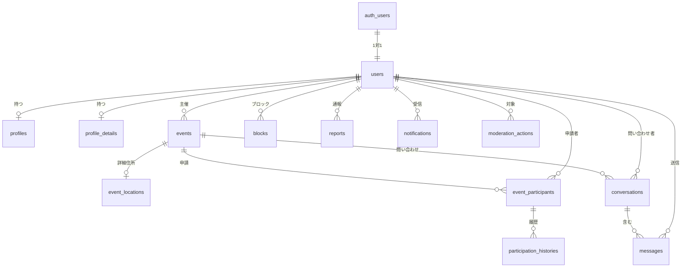
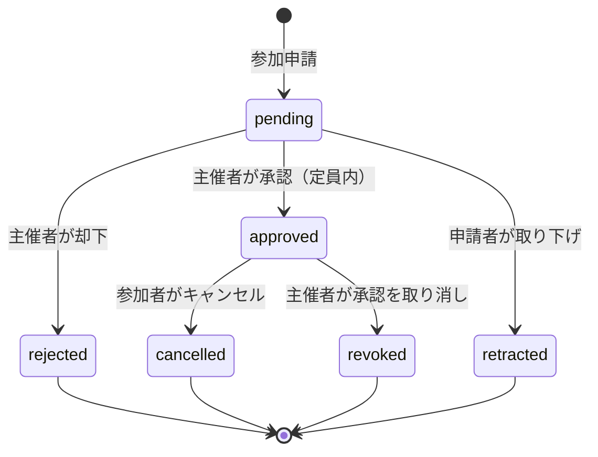

# 06 データベース設計（基本方針）

表記ルールは [01_企画概要](01_企画概要.md) を参照。

> 実装前の設計案【提案】であり、SQLは作成していない。文字数や選択肢の値は [11_詳細仕様](11_詳細仕様.md) の3-3（Q-19）。本書の `Q-xx` のうち決定済みのものは11を参照。

## 1. 基本方針

1. **公開範囲の違う情報はテーブルを分ける。** RLSは行単位の制御であり、同じ行の一部の列だけを隠す用途には向かない
2. 公開スキーマの全テーブルでRLSを有効にし、許可する操作だけを定義する
3. 定員・重複・ブロック・送信回数は、画面ではなくDBで強制する
4. 状態変更（申請・承認・却下・承認の取り消し・キャンセル・利用停止・解除）はDB関数を通し、テーブルの直接更新を許可しない
5. 日時は `timestamptz` で保存し、画面では日本時間で表示する
6. 主キーは原則 `uuid`
7. メールアドレスは `auth.users` だけに置き、アプリのテーブルへ複製しない
8. DB変更は `supabase/migrations` で管理する

## 2. テーブル一覧

| テーブル | 役割 | 区分 |
|---|---|---|
| `auth.users` | 認証情報（Supabase管理） | 既存の仕組み |
| `users` | 権限・利用状態 | 指示された対象 |
| `profiles` | プロフィール（ログイン済みに公開する項目） | 指示された対象 |
| `profile_details` | プロフィール（年代・性別・活動地域） | **追加** |
| `events` | 募集の公開情報 | 指示された対象 |
| `event_locations` | 募集の詳細住所 | **追加** |
| `event_participants` | 参加申請・参加状態 | 指示された対象 |
| `participation_histories` | 申請・キャンセルなどの履歴 | **追加** |
| `conversations` | 会話 | 指示された対象 |
| `messages` | メッセージ | 指示された対象 |
| `blocks` | ブロック | 指示された対象 |
| `reports` | 通報 | 指示された対象 |
| `notifications` | 通知 | 指示された対象 |
| `moderation_actions` | 利用停止などの記録 | **追加** |
| `reregistration_blocks` | 利用停止中に退会した人の再登録の防止 | **追加** |

追加した理由：

- `profile_details`：公開範囲の違う年代・性別・活動地域を、`profiles` と行単位で分けて制御するため
- `event_locations`：公開情報と分け、承認済みユーザーだけに行単位で許可するため
- `participation_histories`：キャンセル履歴を、現在の状態と分けて改ざんできない形で残すため
- `moderation_actions`：誰がいつ利用停止したかを残すため
- `reregistration_blocks`：退会後に個人情報を残さず、利用停止逃れを防ぐため

## 3. 関係図

## 4. テーブル定義案

「必須」は NOT NULL を表す。

### 4-1. users

| カラム | 型 | 必須 | 制約・備考 |
|---|---|:-:|---|
| id | uuid | ○ | 主キー。`auth.users.id` に対応する（外部キーの持ち方は5-8） |
| role | text | ○ | `user` / `admin`。初期値 `user`。運営者がDBの管理操作で付与する（Q-28） |
| status | text | ○ | `active` / `suspended` / `withdrawn`（退会）。初期値 `active` |
| age_category | text | ○ | 18歳以上／18歳未満（保護者の同意あり）。登録時の申告。生年月日は持たない。法的な条件はQ-30 |
| created_at / updated_at | timestamptz | ○ | |

- メールアドレス・電話番号を持たない
- 利用者による `role`・`status`・`age_category` の変更を禁止する
- 退会後も行を残し、記録の参照先とする（5-8）

### 4-2. profiles

| カラム | 型 | 必須 | 制約・備考 |
|---|---|:-:|---|
| user_id | uuid | ○ | 主キー、外部キー → `users.id` |
| nickname | text | ○ | 空白のみ不可。1〜20文字。重複を認める |
| experience_level | text | ○ | 未経験者・初心者・経験者に対応する値 |
| avatar_path | text | | Storage上のパス |
| bio | text | | 自己紹介 |
| volleyball_history | text | | バレーボール歴 |
| position | text[] | | 複数選択。選択肢は11の3-3 |
| created_at / updated_at | timestamptz | ○ | |

未ログインユーザーには、募集の表示に必要な**主催者ニックネームだけ**を、限定したビューまたは関数で返す。このテーブルの項目はログイン済みユーザーに公開する【合意済み】。年代・性別・活動地域は `profile_details`（4-13）に分ける。

### 4-3. events

公開してよい情報だけを置く。

| カラム | 型 | 必須 | 制約・備考 |
|---|---|:-:|---|
| id | uuid | ○ | 主キー |
| host_id | uuid | ○ | 外部キー → `users.id` |
| title | text | ○ | 空白のみ不可 |
| starts_at | timestamptz | ○ | 開催日時 |
| ends_at | timestamptz | ○ | 終了日時。`starts_at` より後 |
| area | text | ○ | 名古屋市の16区のいずれか（CHECK制約） |
| target_levels | text[] | ○ | 対象レベル。1つ以上 |
| description | text | | 説明。1,000文字まで |
| belongings | text | | 持ち物。200文字まで |
| capacity | integer | ○ | 1〜100。募集する参加者の人数（主催者を含まない） |
| fee | integer | ○ | 円、0〜50,000。アプリ内決済は行わない |
| status | text | ○ | `open`（受付中）/ `closed`（締切）/ `cancelled`（中止）。初期値 `open`。「開催済み」は日時から判定する |
| hidden_at | timestamptz | | 管理者が非表示にした日時 |
| created_at / updated_at | timestamptz | ○ | |

- 編集・締切・再開・中止はDB関数で行い、開催開始前の主催者だけに許可する。中止は元に戻せない（Q-16）
- 募集の作成回数を利用者ごとに制限する（Q-47）
- 自由入力欄に住所が書かれると限定公開が崩れるため、入力時の注意表示と通報で補う
- 会話の主催者を検証するため、`(id, host_id)` に一意制約を置く
- インデックス：`(status, starts_at)`、`(area, starts_at)`、`host_id`

### 4-4. event_locations

| カラム | 型 | 必須 | 制約・備考 |
|---|---|:-:|---|
| event_id | uuid | ○ | 主キー、外部キー → `events.id` |
| venue_name | text | | 施設名 |
| address | text | ○ | 詳細住所 |
| note | text | | 集合場所など |
| updated_at | timestamptz | ○ | |

### 4-5. event_participants

| カラム | 型 | 必須 | 制約・備考 |
|---|---|:-:|---|
| id | uuid | ○ | 主キー |
| event_id | uuid | ○ | 外部キー → `events.id` |
| user_id | uuid | ○ | 外部キー → `users.id` |
| status | text | ○ | `pending` / `approved` / `rejected` / `cancelled` / `revoked`（承認取り消し）/ `retracted`（取り下げ） |
| applied_at | timestamptz | ○ | |
| decided_at | timestamptz | | 承認・却下の日時 |
| cancelled_at | timestamptz | | キャンセル日時 |
| revoked_at | timestamptz | | 承認を取り消した日時 |
| revoke_reason | text | | 取り消しの理由。`revoked` の場合は必須。選択肢は11の3-3 |
| retracted_at | timestamptz | | 取り下げた日時 |

- **部分一意インデックス**：`(event_id, user_id)`、条件 `status in ('pending','approved')`
- インデックス：`(event_id, status)`、`(user_id, status)`
- 1行を1人分とする【合意済み】。友人同士の場合も各自が1人ずつ申請する

状態の変化：

再申請は、キャンセル・取り下げの後だけ認め、新しい行を作って過去の記録を残す。却下・承認取り消しの後は認めない。同じ募集への申請は合計3回まで（Q-14）。退会・利用停止にともなう変更は、`approved` を `cancelled`、`pending` を `retracted` にする。

### 4-6. participation_histories

| カラム | 型 | 必須 | 制約・備考 |
|---|---|:-:|---|
| id | uuid | ○ | 主キー |
| participant_id | uuid | ○ | 外部キー → `event_participants.id` |
| from_status | text | | 初回は空 |
| to_status | text | ○ | |
| actor_id | uuid | | 操作者。退会後も残す（5-8） |
| created_at | timestamptz | ○ | |

状態変更と同じトランザクションで追加する。利用者による追加・更新・削除は許可しない。インデックス：`participant_id`

### 4-7. conversations

| カラム | 型 | 必須 | 制約・備考 |
|---|---|:-:|---|
| id | uuid | ○ | 主キー |
| event_id | uuid | ○ | |
| host_id | uuid | ○ | `(event_id, host_id)` を `events(id, host_id)` への複合外部キーとし、主催者のなりすましを防ぐ |
| inquirer_id | uuid | ○ | 外部キー → `users.id`。`host_id` と異なること |
| created_at / last_message_at | timestamptz | ○ | |

- 一意制約：`(event_id, inquirer_id)`。会話は募集と問い合わせユーザーごとに1つ（Q-21）
- 主催者が開始する場合は、相手がその募集に `pending` または `approved` の申請を持つことを検証する
- 新しい会話は利用者ごとに1日10件まで（Q-10）
- インデックス：`(host_id, last_message_at)`、`(inquirer_id, last_message_at)`

### 4-8. messages

| カラム | 型 | 必須 | 制約・備考 |
|---|---|:-:|---|
| id | uuid | ○ | 主キー |
| conversation_id | uuid | ○ | 外部キー → `conversations.id` |
| sender_id | uuid | ○ | 外部キー → `users.id`。会話の当事者であること。クライアントから受け取らず、送信関数が `auth.uid()` を設定する（5-7） |
| body | text | ○ | 空白のみ不可。1,000文字まで |
| hidden_at | timestamptz | | 管理者が非表示にした日時。一般ユーザーには本文を返さない |
| created_at | timestamptz | ○ | DB側で設定 |

インデックス：`(conversation_id, created_at)`、`(sender_id, created_at)`（後者は送信回数の検証にも使う）

### 4-9. blocks

| カラム | 型 | 必須 | 制約・備考 |
|---|---|:-:|---|
| blocker_id | uuid | ○ | 外部キー → `users.id` |
| blocked_id | uuid | ○ | 外部キー → `users.id`。`blocker_id` と異なること |
| created_at | timestamptz | ○ | |

主キー：`(blocker_id, blocked_id)`。インデックス：`blocked_id`

### 4-10. reports

| カラム | 型 | 必須 | 制約・備考 |
|---|---|:-:|---|
| id | uuid | ○ | 主キー |
| reporter_id | uuid | ○ | 外部キー → `users.id` |
| reported_user_id | uuid | | 外部キー → `users.id` |
| event_id | uuid | | 外部キー → `events.id` |
| message_id | uuid | | 外部キー → `messages.id` |
| reason | text | ○ | 分類は11の4-3 |
| detail | text | | 補足。500文字まで |
| status | text | ○ | `open` / `in_progress` / `resolved` / `dismissed` |
| snapshot | jsonb | ○ | 通報時の対象の控え。DB側で作成する。住所と画像は含めない |
| created_at / updated_at | timestamptz | ○ | |

- `reported_user_id`・`event_id`・`message_id` の**ちょうど1つ**に値があることをCHECK制約で保証する
- 通報はDB関数で受け付け、対象の控えを同じトランザクションで保存する
- 同じ人・同じ対象で、対応が終わっていない通報は1件までとする。自分自身・自分の募集・自分のメッセージは通報できない
- インデックス：`(status, created_at)`

### 4-11. notifications

| カラム | 型 | 必須 | 制約・備考 |
|---|---|:-:|---|
| id | uuid | ○ | 主キー |
| user_id | uuid | ○ | 受信者。外部キー → `users.id` |
| type | text | ○ | 参加申請、キャンセル、承認取り消し、承認、却下、募集の変更、中止、非表示（11の3-2） |
| event_id | uuid | | 外部キー → `events.id` |
| participant_id | uuid | | 外部キー → `event_participants.id` |
| read_at | timestamptz | | |
| created_at | timestamptz | ○ | |

通知文に住所やメールアドレスを保存しない。インデックス：`(user_id, read_at, created_at)`

### 4-12. moderation_actions

| カラム | 型 | 必須 | 制約・備考 |
|---|---|:-:|---|
| id | uuid | ○ | 主キー |
| admin_id | uuid | ○ | 外部キー → `users.id` |
| target_user_id | uuid | ○ | 外部キー → `users.id` |
| action | text | ○ | 利用停止、解除、募集の非表示、メッセージの非表示、画像の削除 |
| reason | text | ○ | 分類と補足 |
| event_id / message_id | uuid | | 非表示にした対象 |
| report_id | uuid | | 外部キー → `reports.id` |
| created_at | timestamptz | ○ | |

### 4-13. profile_details

| カラム | 型 | 必須 | 制約・備考 |
|---|---|:-:|---|
| user_id | uuid | ○ | 主キー、外部キー → `users.id` |
| age_group | text | | 年代。選択肢は11の3-3、未成年者の扱いはQ-30 |
| gender | text | | 性別。選択肢は11の3-3 |
| activity_areas | text[] | | 活動地域。名古屋市の16区から複数、または市外 |
| created_at / updated_at | timestamptz | ○ | |

閲覧できるのは本人と、その人の `pending` または `approved` の申請がある募集の主催者だけ【合意済み】。却下・キャンセル・承認取り消しになった場合は閲覧できなくなる。

### 4-14. reregistration_blocks

利用停止中に退会した人の再登録を防ぐための表（Q-52）。

| カラム | 型 | 必須 | 制約・備考 |
|---|---|:-:|---|
| email_hash | text | ○ | 主キー。メールアドレスの鍵付きハッシュ。鍵はブラウザとDBの外で管理する |
| created_at | timestamptz | ○ | |
| expires_at | timestamptz | | 保存期間はQ-32 |

利用者・管理者の画面からは閲覧できない。登録時の照合はサーバー側で行い、方法は実装前に検証する【未確認】。

## 5. 重点課題への対応

### 5-1. 定員超過を防ぐ

承認は1つのDB関数・1トランザクションで行う。

1. `events` の対象行を `FOR UPDATE` でロックする
2. 操作者が主催者で、利用停止中でないことを確認する
3. 申請が `pending` であることを確認する
4. ロック後に承認済み人数を数え、定員未満であることを確認する
5. `approved` に更新し、履歴を追加する

- 申請・キャンセル・承認の取り消しも同じ募集行をロックし、判定の競合を防ぐ
- 申請時も承認済み人数を数え、定員に達していれば拒否する。申請者が主催者（`host_id`）本人の場合、募集が `open` でない・非表示の場合、ブロック関係がある場合、再申請の条件（4-5）に反する場合も拒否する
- 承認の取り消しは、操作者が主催者で利用停止中でないこと、参加が `approved` であること、理由があることを確認し、`revoked` への更新・履歴・参加者への通知を1トランザクションで行う
- 申請・承認・却下・承認の取り消し・キャンセルは、ロック後にDBの現在時刻と `starts_at` を比べ、開催開始後であれば拒否する
- 開始後に残った `pending` は状態を変えず、`starts_at` から「受付終了」と判定して表示する（定期処理を使わない）
- 定員を変更できるようにする場合は、承認済み人数より小さくできないようにする
- 残り枠数は別カラムに保存せず、`capacity` と承認済み人数から算出する（不整合を防ぐため）
- 承認待ちと主催者は定員に数えない。満員になっても `pending` は残し、空きが出れば承認できる

### 5-2. 申請の重複を防ぐ

部分一意インデックスで保証する。「確認してから追加」だけでは同時送信を防げないため、制約を必須とする。

### 5-3. ブロックした相手とのメッセージを防ぐ

- 会話の作成時と送信時に、どちらか一方でもブロックしていれば拒否する
- 本人以外は `blocks` を読めないため、判定は限定したDB関数で行う
- 新しい参加申請も双方向に拒否する。すでにある申請・参加、募集とプロフィールの閲覧、過去の会話の閲覧には影響しない（Q-20）
- 送信時の判定は5-7の送信関数で行う

### 5-4. 承認済みユーザーだけが住所を閲覧する

`event_locations` の閲覧を、主催者、または**現在** `approved` の参加者に限定する。キャンセル・承認取り消し・中止の後、開催の終了日時（`ends_at`）を過ぎた後、利用停止中は閲覧できない。一度表示された情報を回収することはできない。

### 5-5. 個人情報を保護する

- メールアドレスは `auth.users` のみ。電話番号は収集しない
- 公開スキーマに `auth.users` を参照するビューを作らない
- 必要な列だけを取得し、`select *` を公開用の処理に使わない

### 5-6. 送信回数を制限する

送信用のDB関数で、`sender_id` ごとの直近の送信数を検証する（1分間に10通、1時間に60通まで。初期値、Q-10）。利用者単位のロックにより、並列送信で上限を超えないようにする。検証の順序は5-7を参照。

### 5-7. メッセージの送信・閲覧権限を保証する

メッセージの追加は**送信用のDB関数（以下、送信関数）だけ**で行い、一般ユーザーが `messages` へ直接INSERTできないようにする。RLSとDB関数のどちらか一方に頼らず、両方で権限を確認する。

| 保証する内容 | テーブル側（権限・RLS） | 送信関数 |
|---|---|---|
| ログイン済みであること | 未ログインには `messages` の権限を与えない | `auth.uid()` が空なら拒否する。未ログインに実行権限を与えない |
| 送信者が本人であること | 直接INSERTを許可しない | `sender_id` を引数で受け取らず、`auth.uid()` を設定する |
| 会話の当事者であること | 閲覧ポリシーを当事者（`host_id` または `inquirer_id` が `auth.uid()`）に限定する（管理者の例外は下記） | `auth.uid()` が対象会話の当事者でなければ拒否する |
| ブロックされていないこと | 直接INSERTを許可しない | どちらか一方でも相手をブロックしていれば拒否する |
| 利用停止中でないこと | 直接INSERTを許可しない | `users.status` が `active` でなければ拒否する |
| 送信回数の上限内であること | 直接INSERTを許可しない | 送信者の直近の送信数を数え、上限に達していれば拒否する（Q-10） |

テーブル側の方針：

- ログイン済み・未ログインのどちらのロールにも `messages` のINSERT権限を与えず（既定で付与される場合は取り消す）、INSERTを許可するRLSポリシーも作らない
- 閲覧は当事者だけに許可する。例外として、管理者は通報されたメッセージと、同じ会話の前後10件だけを、管理用関数で閲覧できる【合意済み】（Q-28）
- 一般ユーザーの更新・削除は認めない（Q-21）。非表示は管理用関数だけで行う

送信関数の処理（1トランザクション）：

1. 関数内で `auth.uid()` を取得し、空なら拒否する。引数は会話IDと本文だけとする
2. 対象の会話を取得し、`auth.uid()` が当事者であることを検証する。相手は会話の `host_id`・`inquirer_id` から求め、引数で受け取らない
3. 送信回数の判定が並列送信で競合しないよう、ロックを取得する。ロックは送信者単位とする
4. 利用停止状態を検証する
5. ブロック状態を双方向で検証する。相手が利用停止中・退会済みでないこと、送信できる期間（開催終了の7日後まで）であることも検証する
6. **ロック取得後に**直近の送信数を数え、上限内であることを検証する
7. `sender_id` に `auth.uid()`、`created_at` にDBの時刻を設定して追加し、会話の `last_message_at` を更新する

いずれかの検証に失敗した場合は、何も保存しない。

関数の権限：

- 呼び出した利用者の権限で動く関数（`SECURITY INVOKER`）だけで追加するには、利用者自身にINSERT権限が必要になり、直接INSERTを防げない。そのため、追加の処理は `SECURITY DEFINER` とする【提案】
- `SECURITY DEFINER` の関数内では、所有者によってはRLSが適用されない。上記の検証を省略せず、関数内で必ず行う
- `search_path` を固定し、参照するテーブルや関数にはスキーマ名を付ける
- 実行権限は既定の `PUBLIC` から取り消し、ログイン済みユーザーに必要なものだけを与える
- `SECURITY DEFINER` の関数を公開しないスキーマに置く方針（6章）を守るため、Data APIから呼ぶ入口は、公開スキーマの `SECURITY INVOKER` 関数とし、処理本体を呼び出すだけにする【提案】
- ブロックの判定関数は利用者から直接実行できないようにし、ブロック情報を推測されないようにする

関連する決定（11）：

- 一般ユーザーによるメッセージの削除は認めないため、削除による送信回数の回避は起きない。非表示にしたメッセージも回数に数える
- 拒否した場合は「送信できません」とだけ返し、ブロックや相手の停止を推測させない（Q-20）
- メール未認証ユーザーはログインできず、送信できない（Q-40）

### 5-8. 退会時に個人情報を消し、記録を残す

退会の処理は専用の関数で行い、途中で失敗した場合にやり直せるようにする。

1. 操作者を `auth.uid()` で確認し、開催開始前の募集（中止を除く）がある場合は拒否する。利用停止中の場合は拒否せず、募集を中止にして参加者へ通知する
2. 開催開始前の参加をキャンセルし、履歴と主催者への通知を追加する。承認待ちの申請は `retracted` にする
3. `profiles`・`profile_details`・プロフィール画像・本人の通知とブロックを削除する
4. `users.status` を `withdrawn` にする。以後、`active` を条件とする操作はすべて拒否される
5. 認証アカウント（メールアドレスを含む）を削除する

- 募集、参加、履歴、会話、メッセージ、通報、利用停止の記録は残し、「退会したユーザー」と表示する
- `users.id` を `auth.users` への外部キーにすると、認証アカウントの削除と `users` の行を残すことが両立しない場合がある。外部キーを置かない、削除の方式を変えるなどの持ち方を、実装前に検証する【未確認】
- 認証アカウントの削除は、シークレットキーが必要なためSupabase Edge Functionsで行う（11のQ-01）。Storageにファイルが残っていると削除できないため、先に画像を削除する
- 発行済みのアクセストークンは期限まで残り得るため、すべての操作で `users.status` を確認する
- 利用停止中の退会では、`reregistration_blocks` に記録する（Q-52）。通報・利用停止の記録の保存期間はQ-32で確定する

### 5-9. 利用停止の影響

利用停止のDB関数は、状態の変更と同じトランザクションで次を行う（Q-28）。

1. 理由を `moderation_actions` に記録する
2. 停止された人の開催開始前の `approved` を `cancelled`、`pending` を `retracted` にし、履歴と主催者への通知を追加する
3. 停止された人が主催する開催開始前の `open` の募集を `closed` にする

- 停止中の閲覧は未ログインと同じ範囲とし、住所・会話・ほかの人のプロフィールはRLSで拒否する
- 解除しても、取り消された参加や締切は自動で戻さない
- 管理者（`admin`）は停止できない

### 5-10. 操作回数を制限する

募集の作成（1日5件）、参加申請（1日20件）、通報（1日10件）、ブロック（1日50件）を、利用者ごとにDB関数で制限する（初期値、Q-47）。ブロックは解除と繰り返しても回避できないよう、回数を別に記録する。

## 6. RLS方針

| テーブル | 閲覧 | 追加 | 更新 | 削除 |
|---|---|---|---|---|
| users | 本人。管理者は管理用関数で、利用状態など必要な項目だけ | 登録処理 | 管理用関数・退会処理のみ | 不可（退会処理で匿名にする） |
| profiles | ログイン済みで停止中でない（未ログインは主催者ニックネームのみ） | 本人 | 本人 | 退会処理のみ |
| profile_details | 本人、申請先の主催者（申請が承認待ち・承認済みの間。管理者は不可） | 本人 | 本人 | 退会処理のみ |
| events | 全員（非表示でないもの） | 作成関数のみ（ログイン済み・停止中でない） | 編集・締切・中止関数、管理用関数のみ | 不可 |
| event_locations | 主催者・承認済み参加者（終了日時まで。中止・利用停止中は不可。管理者は不可） | 作成関数のみ | 編集関数のみ | 不可 |
| event_participants | 本人・主催者（参加者同士、管理者には見せない） | 申請関数のみ | 承認・却下・承認取り消し・キャンセル・取り下げ関数、退会・利用停止の処理のみ | 不可 |
| participation_histories | 本人、その募集の主催者 | 状態変更関数のみ | 不可 | 不可 |
| conversations | 当事者（停止中は不可） | 会話作成関数のみ | 送信関数のみ | 不可（退会後も残す） |
| messages | 当事者（停止中は不可）。管理者は管理用関数で、通報されたメッセージと前後10件のみ | 送信関数のみ（直接INSERT不可、5-7） | 管理用関数のみ（非表示） | 不可 |
| blocks | ブロックした本人 | ブロック関数のみ | 不可 | 本人 |
| reports | 通報者本人・管理者（通報者が確認する画面は設けない） | 通報関数のみ | 管理用関数のみ | 不可 |
| notifications | 受信者本人 | システム処理のみ | 受信者本人（既読のみ） | 退会処理のみ |
| moderation_actions | 管理者 | 管理用関数のみ | 不可 | 不可 |
| reregistration_blocks | 不可（サーバー側の処理のみ） | 退会処理のみ | 不可 | 期限後に運営者が削除 |

注意点：

- 参照し合うポリシーは無限再帰を起こし得るため、権限判定は専用関数にまとめる
- `SECURITY DEFINER` の関数は公開しないスキーマに置き、`search_path` を固定し、実行権限を必要最小限にする
- クライアントから呼ぶ状態変更関数は、引数の利用者IDを信用せず `auth.uid()` で判定する
- ビューは作り方によってRLSを迂回するため、`security_invoker` の指定や返す列を確認する
- 利用停止は、発行済みのセッションが残っていても効くよう、書き込み時にDBの `status` を確認する
- RLSを迂回できるシークレットキーはブラウザで使わない

## 7. Storage方針

- 保存対象はプロフィール画像
- パスは `<ユーザーID>/<ファイル名>` とし、本人の領域だけに追加・更新・削除を許可する
- 公開バケットのURLは閲覧時に権限判定を通らないため、非公開バケットとし、ログイン済みユーザーだけに期限付きのURLなどで表示する【合意済み】
- 無料プランに画像変換が含まれないため、送信前に縮小する
- JPEG・PNG・WebP、2MBまで（Q-19）
- 管理者は不適切な画像を管理用の処理で削除できる（Q-51）

## 8. 実装時の確認項目

- [ ] 定員1の募集に複数の承認を同時実行しても1件だけ成功する
- [ ] 同じユーザーの同時申請で1件だけ登録される
- [ ] 満員の募集に申請・承認できず、キャンセル後に残っている承認待ちを承認できる
- [ ] 主催者が自分の募集に申請できない
- [ ] 開催開始後は、申請・承認・却下・承認の取り消し・キャンセルができない
- [ ] 未ログイン・承認待ち・却下・キャンセル済み・承認取り消しでは住所を取得できない
- [ ] 主催者以外は承認を取り消せず、理由なしでは取り消せない
- [ ] 他人のメールアドレスを取得できない
- [ ] 年代・性別・活動地域を、本人と申請先の主催者以外が取得できない
- [ ] 未ログインで、主催者ニックネーム以外のプロフィールと画像を取得できない
- [ ] 主催者以外が、ほかの参加者・申請者の一覧を取得できない
- [ ] ブロック後、APIを直接呼んでも双方向に送信できない
- [ ] 会話の当事者でも、`messages` へ直接INSERTできない
- [ ] 未ログインでは送信関数を実行できない
- [ ] 他人を送信者として送信できない
- [ ] 会話の当事者以外は、APIでもRealtimeでもメッセージを取得・送信できない（管理者の限定した閲覧を除く）
- [ ] 利用停止後、既存のセッションで送信関数を実行しても送信できない
- [ ] 並列に送信しても、送信回数の上限（Q-10）を超えない
- [ ] 一般ユーザーが `role`・`status`・申請状態を直接変更できない
- [ ] 一般ユーザーが利用停止・解除を実行できず、通報の一覧を取得できない
- [ ] 管理者でも、通報への対応に必要な範囲（Q-28）を超えてメッセージを取得できない
- [ ] 利用停止後、既存のセッションで書き込みできない
- [ ] 退会後、個人情報を取得できず、相手の会話や参加の記録は残っている
- [ ] 開催開始前の募集がある主催者は退会できない
- [ ] 取り下げ・キャンセル後は再申請でき、却下・承認取り消し後や4回目の申請は拒否される
- [ ] 締切・中止・非表示の募集に申請できず、中止・終了後は参加者が住所を取得できない
- [ ] 編集で定員を承認済み人数より少なくできない
- [ ] ブロック後、双方向に新しい参加申請ができない
- [ ] 主催者は、自分の募集に申請のない人との会話を開始できない
- [ ] 利用停止で、開催前の参加・申請・募集が決めたとおりに変わる
- [ ] 操作回数の上限を並列実行でも超えない
- [ ] 通報の控えを利用者が改ざんできない
- [ ] 全テーブルでRLSが有効になっている
