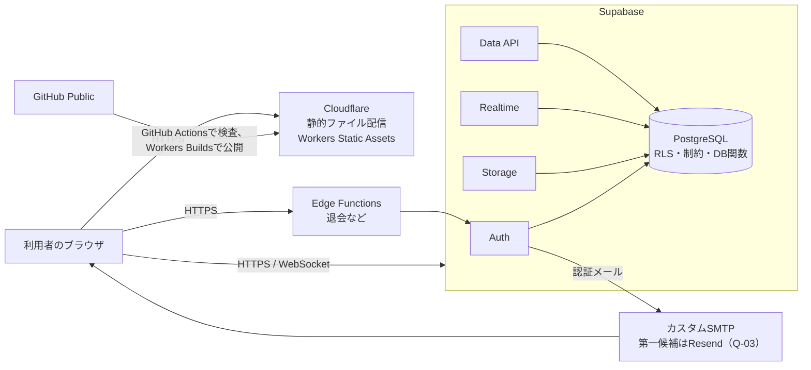
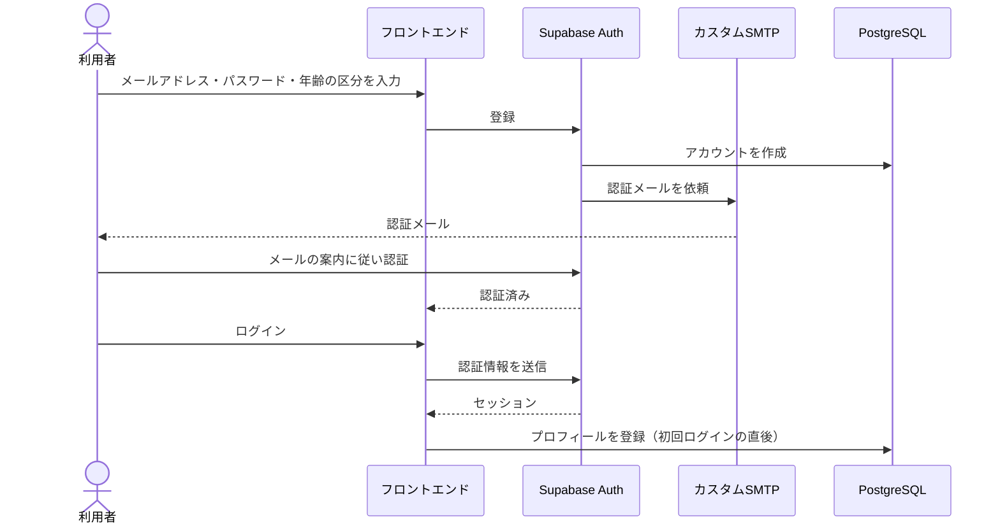
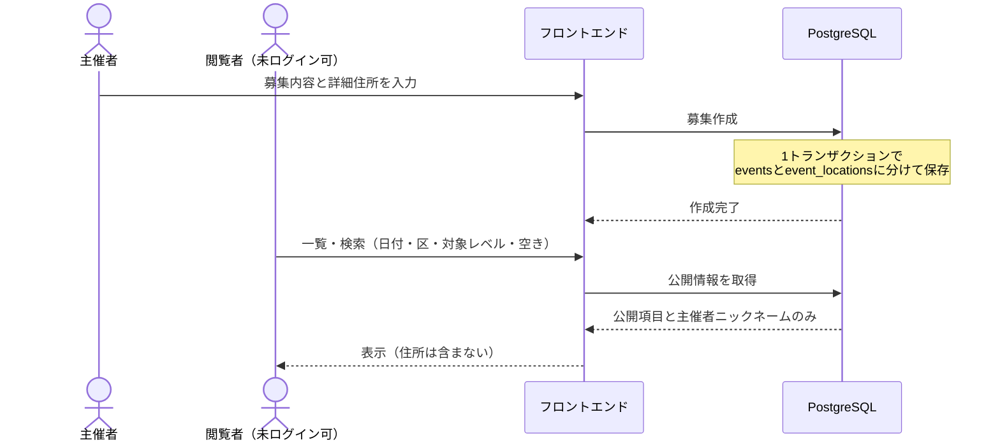
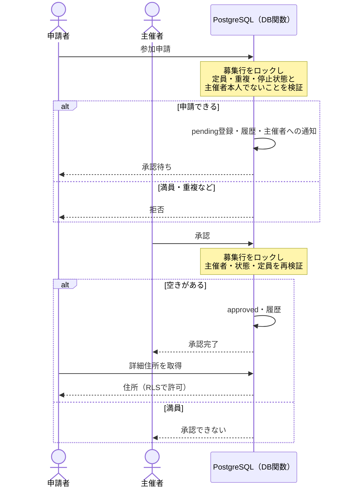
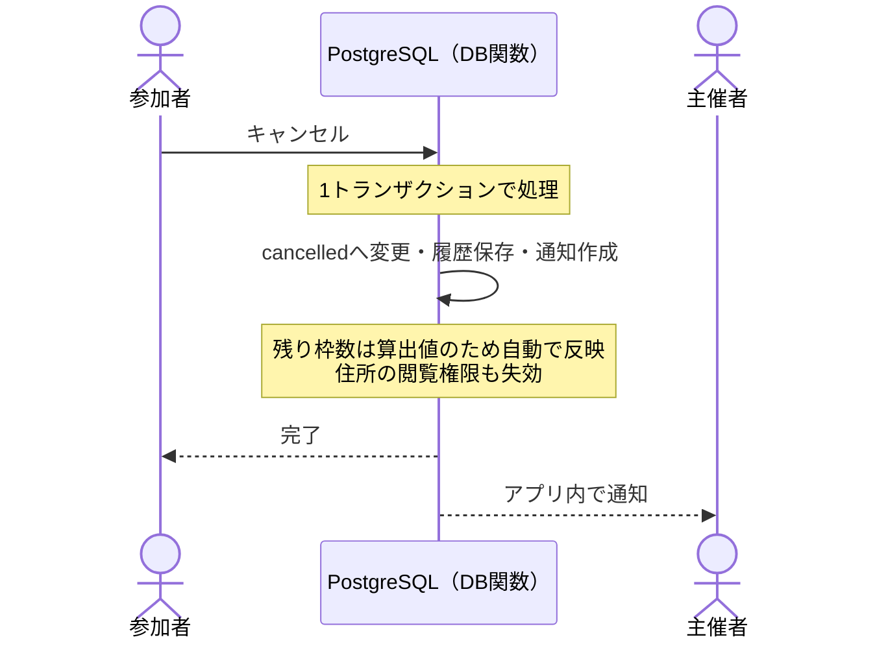
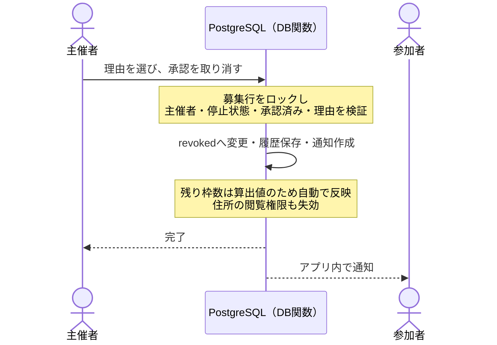
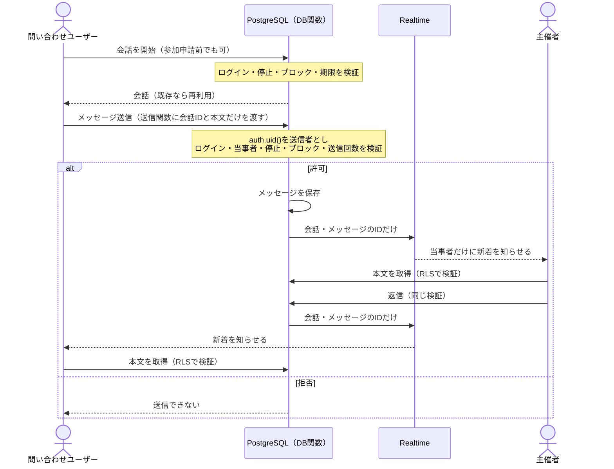
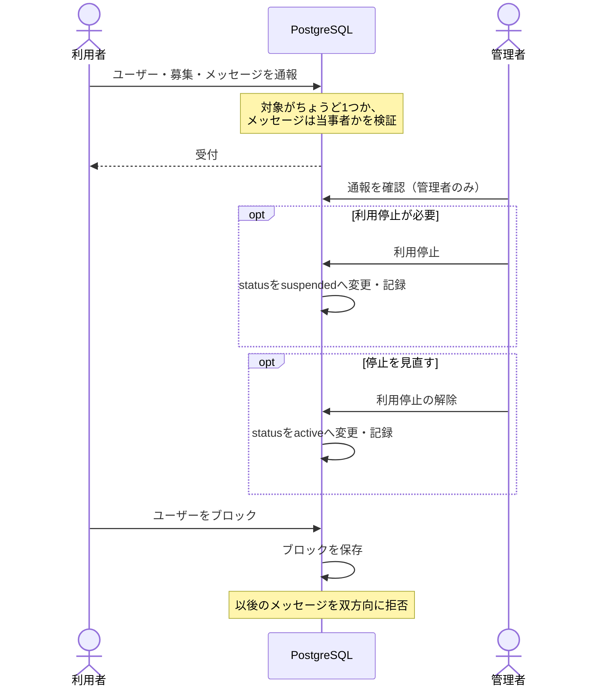

# 07 システムアーキテクチャ（基本方針）

表記ルールは [01_企画概要](01_企画概要.md) を参照。採用した技術構成（Q-01）に基づく。本書の `Q-xx` のうち決定済みのものは [11_詳細仕様](11_詳細仕様.md) を参照。

## 1. システム構成

### フォルダとの対応

| フォルダ | 役割 |
|---|---|
| `frontend/` | Reactアプリ |
| `backend/` | 独自サーバー処理が必要になった場合の領域。推奨構成では当面空の見込み |
| `supabase/migrations/` | DB定義・RLS・関数の変更履歴 |
| `supabase/seed/` | 開発用の架空データ（実在の個人情報を入れない） |

## 2. フロントエンドとSupabaseの関係

- 独自のAPIサーバーを置かず、ブラウザからSupabaseを直接利用する。シークレットキーが必要な処理（退会、再登録の照合など）だけをEdge Functionsで行う（Q-01）
- ブラウザのコードは利用者が改変できる。**画面側の検証は使いやすさのため、権限判定はDB側**で行う

| 処理 | 担当 |
|---|---|
| 画面表示、入力補助 | フロントエンド |
| 本人確認 | Supabase Auth |
| 閲覧できる行の制御 | RLS。未ログインの閲覧、ほかの人のプロフィール、通報・措置など管理者の閲覧はDB関数を通す（06の6章） |
| 申請・承認・承認の取り消し・キャンセル・送信 | DB関数（トランザクション） |
| 重複・値の範囲 | DB制約 |
| シークレットキーを使う処理（退会など） | Supabase Edge Functions |
| Bot対策 | Cloudflare Turnstile（Supabase AuthのCAPTCHA保護、Q-48） |

## 3. 認証の流れ

- Supabaseの標準メール送信はチームメンバー以外に送れないため、カスタムSMTPが前提
- 登録済みかどうかを、エラーメッセージから第三者が判別できないようにする
- 管理者も一般ユーザーと同じ認証基盤を使い、管理者権限によって使える画面・操作を分ける【合意済み】。権限はDB側で判定し、運営者がDBの管理操作で付与する（Q-28）

### 退会

退会の処理は [06](06_データベース設計.md) の5-8に従う【合意済み】。認証アカウントの削除はシークレットキーが必要なため、Edge Functionsで行う（2章、Q-01）。

## 4. 募集作成・検索の流れ

## 5. 参加申請・承認の流れ

却下は、主催者と `pending` の状態を検証して `rejected` にする。承認・却下は申請者へアプリ内で通知する（Q-12）。

### キャンセル

### 承認の取り消し

取り消された人は、同じ募集に再申請できない（Q-14）。

### 操作の期限

申請・承認・却下・承認の取り消し・キャンセルは、いずれもDB関数で開催開始時刻を検証し、開始後は拒否する【合意済み】。残った承認待ちは「受付終了」と表示する。

## 6. チャットの流れ

- メッセージの追加は送信関数だけで行い、`messages` への直接INSERTを許可しない。会話の当事者かどうかなどの判定はRLSとDB関数の両方で行う（[06](06_データベース設計.md) の5-7）
- 送信者は `auth.uid()` で決め、クライアントから渡された `sender_id` を使わない
- Realtimeは、データベースからのBroadcast（非公開チャンネル）を使う。実装前に小さく検証する（Q-07）
- 当事者以外が購読・受信できないようにする。利用者からRealtimeへの直接送信でメッセージを届けることは許可せず、送信関数が保存したものだけを配信する
- 本文は配信しない。接続中に利用停止された人へ本文が届くことや、配信の記録に本文が残ることを防ぐ（06の5-7）
- 再接続時は、受け取れなかったメッセージをDBから取得し直す
- 会話画面を開いている間だけ購読し、同時接続数を抑える
- 拒否した場合は「送信できません」とだけ示す（Q-20）
- 主催者から始める場合は、相手が自分の募集の申請者・参加者であることを検証する（Q-21）

## 7. 通報・ブロックの流れ

- 管理者の操作画面は「通報管理」と「利用者管理」の2画面に分ける【合意済み】。詳細は11の4章（Q-28）
- 通報されたメッセージは、対象のメッセージと、その前後10件ずつ（同じ会話内）に限定して、対応中の通報だけで管理者が閲覧できる【合意済み】（Q-28）
- 管理者の閲覧・操作は、多要素認証を済ませたうえで管理用関数だけで行い、記録する（06の4-15・6-3）
- 通報時に対象の控えを保存する。不適切な内容は管理者が非表示にでき、誤りの場合は理由を記録して戻せる（Q-29・Q-51）
- 利用停止では、開催前の参加・申請の取り消しと、募集の締切または中止（管理者が選ぶ）も同時に行う（06の5-9）

## 8. データアクセス制御

| 情報 | 未ログイン | ログイン済み | 承認待ち・却下・キャンセル済み・承認取り消し・取り下げ | 承認済み参加者 | 主催者 | 管理者 |
|---|:-:|:-:|:-:|:-:|:-:|:-:|
| 募集の公開情報（開催前・開催中） | ○ | ○ | ○ | ○ | ○ | ○ |
| 募集の公開情報（終了・中止） | × | × | ○ | ○ | ○ | ○ |
| 募集の公開情報（非表示） | × | × | 開催日時だけ | 開催日時だけ | 開催日時だけ | ○ |
| 主催者ニックネーム | ○ | ○ | ○ | ○ | ○ | ○ |
| 詳細住所 | × | × | × | ○（終了日時まで、中止・非表示は×） | ○（非表示は×） | × |
| プロフィール（年代・性別・活動地域以外） | × | ○ | ○ | ○ | ○ | ○ |
| 年代・性別・活動地域 | × | 本人の分 | 本人の分 | 本人の分 | 本人の分と、承認待ち・承認済みの申請者の分（終了日時まで、中止・非表示は×） | × |
| 参加者・申請者の一覧 | × | × | 本人の分 | 本人の分 | ○ | × |
| メールアドレス | × | 本人のみ | 本人のみ | 本人のみ | 本人のみ | × |
| 会話 | × | 当事者のみ | 当事者のみ | 当事者のみ | 当事者のみ | 対応中の通報のメッセージと前後10件ずつのみ |
| ブロック | × | 本人の分 | 本人の分 | 本人の分 | 本人の分 | × |
| 通報 | × | × | × | × | × | ○ |

多層で保護する。

1. テーブル分離（公開情報と住所、認証情報とプロフィール、公開範囲の違うプロフィール項目）
2. RLS
3. DB関数と制約
4. 画面表示の制御（補助）

RLSの詳細は [06_データベース設計](06_データベース設計.md) を参照。

## 9. 環境の分離

- 開発と本番のSupabaseプロジェクトを分け、開発では架空データだけを使う
- 無料プランの有効なプロジェクトは2つまで。ほかのプロジェクトの利用状況も含めて確認する（Q-04）
- プレビュー環境を本番DBにつながない
