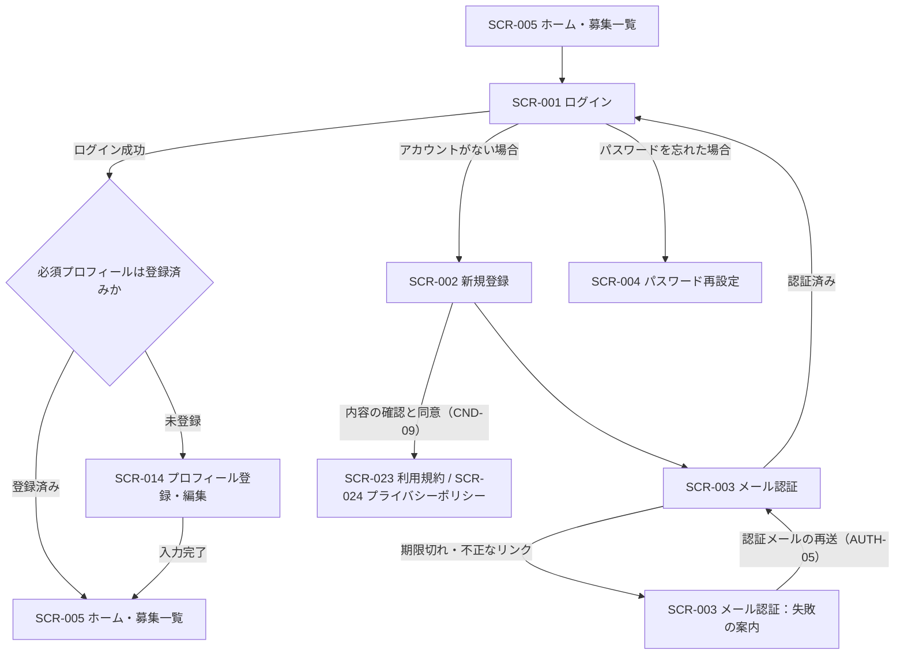
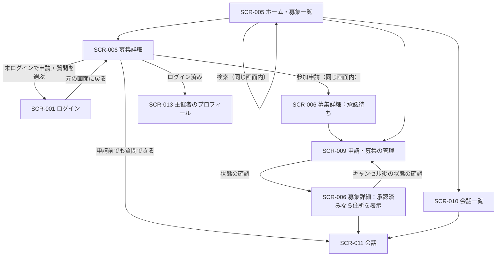
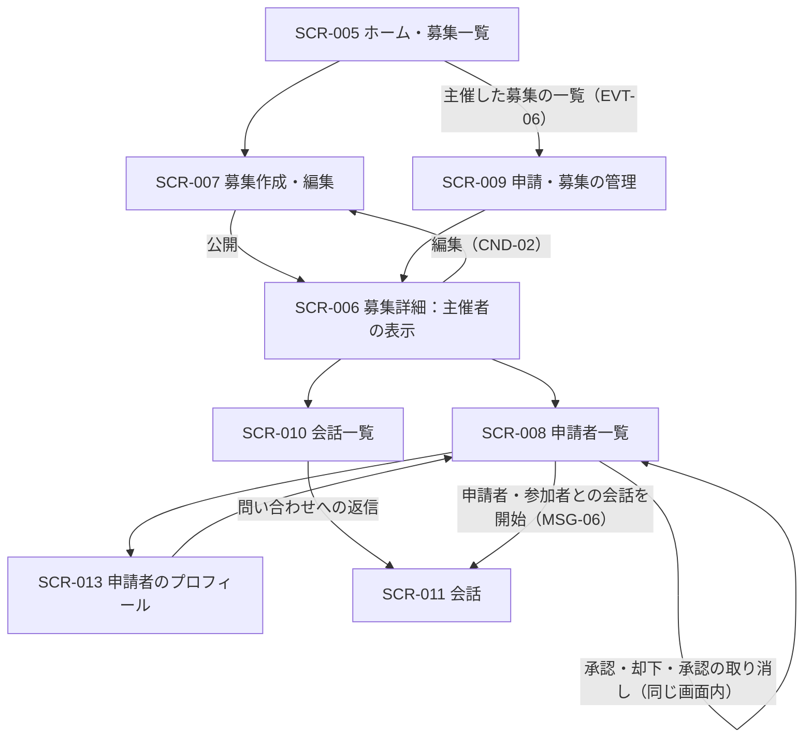
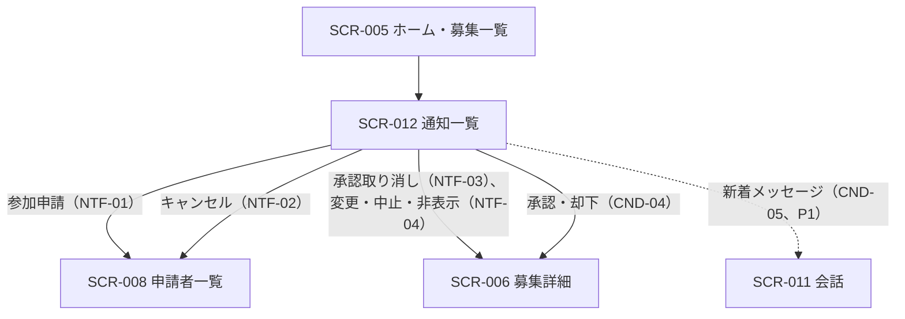
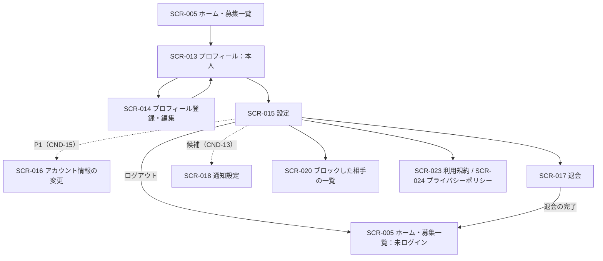
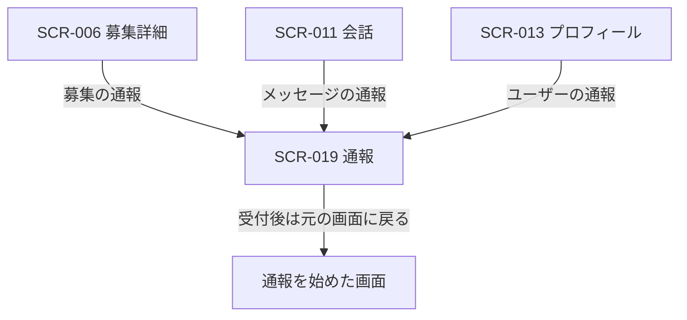
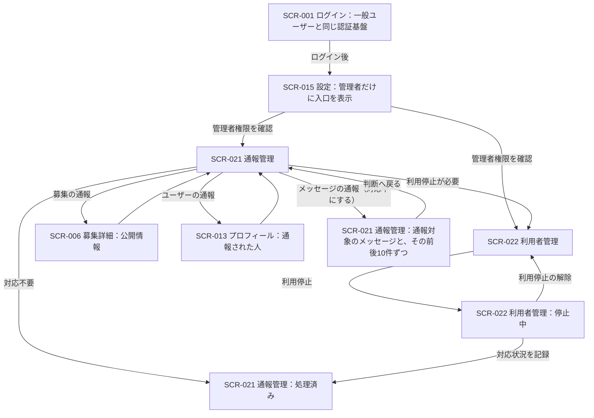
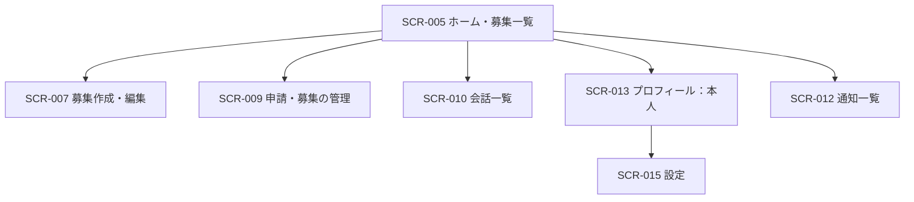
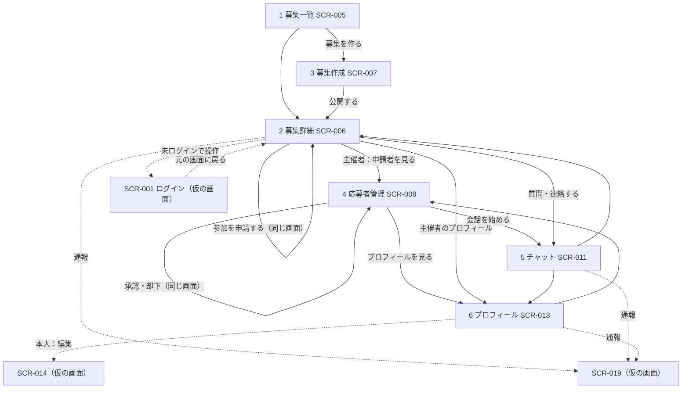

# 10 画面一覧

表記ルールは [01_企画概要](01_企画概要.md) を参照。

> - 画面の分け方・統合・遷移は2026-11-25に採用を決めた（[11_詳細仕様](11_詳細仕様.md) の5章）。
> - 見た目のデザインは扱わない（配置の方針は11の5-1、Q-45）。最初にデザインする6画面の目的・操作・遷移・共通の部品は11章に示す。
> - 開発方針は「MVP優先のアジャイル開発」【合意済み】。プロトタイプ・限定公開MVP・将来追加の3段階に分ける（04の5-4）。
> - **優先度（P0など）は、決定の記録がある元の仕様（22画面）を示す。** MVPを21画面に絞る案（M-12、未承認）との違いと、画面ごとの段階は7-3に示す。
> - `Q-xx` は [09_未決定事項](09_未決定事項.md)、`追加-xx` は本書の9-2の番号。決定済みの内容は11を参照。

## 1. 目的・前提

### 1-1. 目的

初期リリースと将来候補に必要な画面を洗い出し、各画面の役割と、[04_機能一覧](04_機能一覧.md) の機能との対応を明確にする。

### 1-2. 前提

| 前提 | 状態 | 資料 |
|---|---|---|
| 募集の一覧・詳細はログインせずに閲覧できる | 【合意済み】 | 03のFR-04 |
| 登録・ログインはメールアドレス＋パスワード。メール認証を行う | 【合意済み】 | 03のFR-01・02 |
| 詳細住所は主催者と承認済みユーザーだけに見せる | 【合意済み】 | 03の6-2・9章 |
| 主催者・参加者は、固定の種別ではなく募集ごとの立場とする | 【提案】 | 03の5章 |
| スマートフォンとPCのブラウザを対象とし、スマートフォンを優先する | 【提案】 | 03の10章 |
| 管理者向けの画面は「通報管理」と「利用者管理」の2画面に分ける | 【合意済み】 | 09の決定記録（2026-11-25） |
| 管理者が閲覧できるメッセージは、通報対象のメッセージと、その前後10件ずつ（同じ会話内）に限定する | 【合意済み】 | 同上 |
| 利用停止の解除（CND-07）を初期リリース（P0）に含める。条件は11の4-2 | 【合意済み】 | 同上 |
| 管理者は一般ユーザーと同じ認証基盤を使い、管理者権限によって使える画面・操作を分ける。付与方法は11の4-1 | 【合意済み】 | 同上 |

### 1-3. 画面の数え方

- 固有の目的を持ち、ほかの画面から移動して使うまとまりを1画面とする
- 確認、完了、入力エラー、該当なしなどの表示は、元の画面の一部とし、数えない
- 同じ画面で立場や状態によって表示・操作が変わる場合は、1画面とする

### 1-4. 優先度の書き方

優先度は04の実装段階（P0・P1・P2）に従う。確定していないものは、次のように「要確認」とする。

| 表記 | 意味 |
|---|---|
| P0 | 対応する機能が初期リリースに確定しており（04、09のF章）、その機能を使う場所がアプリ内に必要 |
| P1 | 初期リリース後に追加することが決まっている（04） |
| 要確認（P1仮） | 対応する機能の採否が未決定で、04で「P1（仮）」 |
| 要確認（機能IDなし） | 04に対応する機能がなく、採否が未決定 |

- P0は、その画面に含まれるすべての操作が確定しているという意味ではない。未確定の操作は5章に示す
- P0は、独立した画面として確定しているという意味でもない。操作の置き方はQ-45のレイアウトで決める

## 2. 画面設計の基本方針

### 2-1. 主催者と参加者の画面を分けない

- 1つのアプリの中で、利用者の立場と募集の状態に応じて、見せる情報と操作を切り替える
- 募集詳細（SCR-006）と、申請・募集の管理（SCR-009）は、主催者と参加者で共用する
- 管理者向けの画面は、一般ユーザー向けの画面と分けて整理し、画面遷移も分ける【合意済み】
- 管理者も一般ユーザーと同じ認証基盤を使い、管理者権限によって使える画面・操作を分ける【合意済み】
- 画面の切り替えは補助であり、権限はDB側で判定する（07の2章・8章）

### 2-2. 画面の共通化

| 対象 | 方針 | 理由 |
|---|---|---|
| ホーム・募集一覧・募集検索 | 統合（SCR-005） | 最初に募集を見つけることが目的で、ホーム固有の機能が04にない（追加-01） |
| 募集作成と募集編集 | 統合（SCR-007） | 入力項目が共通。（追加-02） |
| 申請状態と主催した募集 | 統合（SCR-009） | 同じ利用者が両方の立場になる（追加-04） |
| ユーザー・募集・メッセージの通報 | 統合（SCR-019） | 対象が違うだけで操作が同じ（追加-05） |
| 通知一覧と通知詳細 | 詳細は作らず、一覧から対象の画面へ移動（SCR-012） | 通知固有の操作が04にない（追加-03） |
| 自分と他人のプロフィール閲覧 | 統合（SCR-013） | 見せる項目と操作を切り替える |
| ログインと新規登録 | 分ける（SCR-001・002） | 登録は認証メールや規約への同意の有無など、目的と流れが異なる |
| プロフィール閲覧と編集 | 分ける（SCR-013・014） | 他人も開く画面と、本人だけの画面を区別する。編集は登録直後の入力にも使う |
| 募集詳細と申請者一覧 | 分ける（SCR-006・008） | 申請者の情報は主催者だけが扱う |
| 利用規約とプライバシーポリシー | 分ける（SCR-023・024） | 別の文書であり、個別に参照する |
| 通報管理と利用者管理 | 分ける（SCR-021・022）【合意済み】 | 通報への対応と、利用者の停止・解除は目的が異なる |

## 3. 画面カテゴリー一覧

| No. | カテゴリー | 画面 | 画面数 |
|---|---|---|:-:|
| 1 | 認証 | SCR-001〜004 | 4 |
| 2 | ホーム・募集検索 | SCR-005 | 1 |
| 3 | 募集詳細・募集管理 | SCR-006〜008 | 3 |
| 4 | 参加申請・参加管理 | SCR-009 | 1 |
| 5 | チャット | SCR-010・011 | 2 |
| 6 | 通知 | SCR-012 | 1 |
| 7 | プロフィール | SCR-013・014 | 2 |
| 8 | 設定・アカウント管理 | SCR-015〜018 | 4 |
| 9 | 安全対策 | SCR-019・020 | 2 |
| 10 | 管理者向け | SCR-021・022 | 2 |
| 11 | 規約等 | SCR-023・024 | 2 |
| | 計 | | **24** |

## 4. 全画面一覧

「主催者」「参加者」は募集ごとの立場を示す。「本人」は、ログイン済みユーザー自身の情報を扱うことを示す。

| 画面ID | 画面名 | カテゴリー | 利用者 | 画面の目的 | 関連機能ID | 優先度 |
|---|---|---|---|---|---|---|
| SCR-001 | ログイン | 認証 | 未ログイン（管理者を含む） | 本人として利用を始める | AUTH-03、SAFE-10、CND-12 | P0 |
| SCR-002 | 新規登録 | 認証 | 未ログイン | アカウントを作る | AUTH-01、SAFE-10、CND-09、CND-12 | P0 |
| SCR-003 | メール認証 | 認証 | 登録したユーザー | 認証の案内と結果を確認する | AUTH-02、AUTH-05 | P0 |
| SCR-004 | パスワード再設定 | 認証 | 登録済み | ログインできない状態から復旧する | CND-01、SAFE-10 | P0 |
| SCR-005 | ホーム・募集一覧 | ホーム・募集検索 | 全員 | 参加先の募集を見つける | EVT-02、EVT-05、APP-10、CND-14 | P0 |
| SCR-006 | 募集詳細 | 募集詳細・募集管理 | 全員（立場で切り替え） | 募集の内容を確認し、申請・質問などを行う | EVT-03、EVT-04、APP-01、APP-05〜08、APP-10、MSG-01、SAFE-02、CND-03、CND-10、CND-11 | P0 |
| SCR-007 | 募集作成・編集 | 募集詳細・募集管理 | ログイン済み（編集は主催者） | 募集を公開する | EVT-01、CND-02 | P0 |
| SCR-008 | 申請者一覧 | 募集詳細・募集管理 | 主催者 | 申請者を確認し、承認・却下・承認の取り消しを行う | APP-02〜05、APP-10、APP-11、MSG-06 | P0 |
| SCR-009 | 申請・募集の管理 | 参加申請・参加管理 | ログイン済み（本人） | 自分の申請の状態と、主催した募集を確認する | APP-07、APP-08、CND-10、EVT-06 | P0 |
| SCR-010 | 会話一覧 | チャット | 会話の当事者 | 過去のやり取りを探す | MSG-03、CND-05 | P0 |
| SCR-011 | 会話 | チャット | 会話の当事者 | 主催者と問い合わせユーザーがやり取りする | MSG-01、MSG-02、MSG-04〜06、SAFE-03、SAFE-04 | P0 |
| SCR-012 | 通知一覧 | 通知 | ログイン済み（本人） | 申請・キャンセルなどに気付く | NTF-01〜04、CND-04 | P0 |
| SCR-013 | プロフィール | プロフィール | ログイン済み（項目により異なる） | 相手または自分の情報を確認する | PROF-03、SAFE-01、SAFE-04 | P0 |
| SCR-014 | プロフィール登録・編集 | プロフィール | ログイン済み（本人） | 自分の情報を登録・変更する | PROF-01、PROF-02 | P0 |
| SCR-015 | 設定 | 設定・アカウント管理 | ログイン済み（本人） | ログアウトと、アカウント関連の操作への入口 | AUTH-04 | P0 |
| SCR-016 | アカウント情報の変更 | 設定・アカウント管理 | ログイン済み（本人） | メールアドレスを変更する | CND-15 | P1 |
| SCR-017 | 退会 | 設定・アカウント管理 | ログイン済み（本人） | 利用をやめる | CND-08 | P0 |
| SCR-018 | 通知設定 | 設定・アカウント管理 | ログイン済み（本人） | 通知の手段を選ぶ | CND-13 | 要確認（P1仮） |
| SCR-019 | 通報 | 安全対策 | ログイン済み（メッセージは会話の当事者） | 問題のあるユーザー・募集・メッセージを知らせる | SAFE-01〜03 | P0 |
| SCR-020 | ブロックした相手の一覧 | 安全対策 | ブロックした本人 | ブロックを確認・解除する | SAFE-08、CND-06 | P0 |
| SCR-021 | 通報管理 | 管理者向け | 管理者 | 通報を確認し、対応する | SAFE-06、SAFE-07 | P0 |
| SCR-022 | 利用者管理 | 管理者向け | 管理者 | 利用者の利用停止と解除を行う | SAFE-05、CND-07 | P0 |
| SCR-023 | 利用規約 | 規約等 | 全員 | 利用条件を示す | CND-09 | P0 |
| SCR-024 | プライバシーポリシー | 規約等 | 全員 | 個人情報の取り扱いを示す | CND-09 | P0 |

- Googleログイン（CND-12）は、採用する場合の候補としてSCR-001・002に記載した。初期リリースでは実装しない【合意済み】
- 友人を含む申請（CND-11）は、採用する場合の候補としてSCR-006に記載した。初期リリースに含めない【合意済み】
- CND-01〜04・06〜08・10は追加候補だったが、P0に決まり、04の2章へ移した
- APP-09（キャンセル履歴の保存）とSAFE-09（操作回数の制限）は画面を持たない（5-12）

## 5. 各画面の役割・主な機能

Q番号・追加番号は、内容を定めた11の項目を示す。**未決定のものは「【未決定】」と明記**する。画面上の置き方はQ-45のレイアウトで決める。

### 5-1. 認証

| 画面ID | 主な機能 | 備考 |
|---|---|---|
| SCR-001 ログイン | メールアドレスとパスワードの入力、新規登録への移動、パスワード再設定への移動（CND-01）、Bot対策の検証（SAFE-10） | 管理者も同じ認証基盤を使う【合意済み】。ログイン後の管理者向け画面への入口は追加-16。要ログインの操作から来た場合の戻り先は追加-10。登録の有無を第三者が判別できる表示をしない（07の3章） |
| SCR-002 新規登録 | メールアドレスとパスワードの入力、年齢の区分の申告（AUTH-01、P0）、認証メールの依頼、Bot対策の検証（SAFE-10）、規約等への同意（CND-09） | パスワードの条件はQ-49。利用規約・プライバシーポリシー・通報時のメッセージ確認に、それぞれ同意する（初期状態は未選択、11の7-2）。18歳未満は保護者の同意を申告する（11の7-1）。法的な条件は公開前に確認する（Q-30） |
| SCR-003 メール認証 | 認証メールの案内、認証の結果、期限切れ・不正なリンクの案内、認証メールの再送（AUTH-05） | 未認証ではログインできない（Q-40）。リンクは1時間有効（Q-49） |
| SCR-004 パスワード再設定 | 再設定の申し込み（CND-01）、新しいパスワードの設定（CND-01） | ログイン中のパスワード変更にも使う（Q-50）。送信サービスはResend（Q-03） |

### 5-2. ホーム・募集検索

| 画面ID | 主な機能 | 備考 |
|---|---|---|
| SCR-005 ホーム・募集一覧 | 募集の公開情報の一覧、募集詳細への移動、条件による検索（EVT-05）、募集作成への移動 | 未ログインで閲覧できる【合意済み】。検索条件は日付・区・対象レベル・空き（Q-23）。残り枠数を表示し（Q-24）、開催前の募集だけを示す（Q-16）。地域の拡大（CND-14）はP2（仮） |

### 5-3. 募集詳細・募集管理

| 画面ID | 主な機能 | 備考 |
|---|---|---|
| SCR-006 募集詳細 | 公開情報の確認。立場ごとの操作は下の表を参照 | 未ログインで閲覧できる【合意済み】。項目はQ-17、残り枠数はQ-24、共有はQ-53。終了・中止した募集は、主催者と申請したことがある人だけが見られる。非表示の募集は、その人たちに「非表示になった募集」と開催日時だけを示し、ほかの人にはどちらもページがない場合と同じ表示にする（11の2-1・4-4）。参加者の一覧は主催者だけがSCR-008で見る【合意済み】 |
| SCR-007 募集作成・編集 | 公開情報と詳細住所の入力、公開、内容の変更（CND-02） | 公開情報と住所を分けて保存する。自由入力欄に住所を書かないよう注意を示す（06の4-3）。編集はQ-16、項目はQ-17、入力の上限はQ-19、エリアは16区から選ぶ（Q-46）。開催は24時間以内、開始は1年以内（11の2-1）。18歳未満は作成できない（11の7-1） |
| SCR-008 申請者一覧 | 自分の募集の申請の確認、申請者のプロフィールへの移動、承認、却下、定員・空きの確認、承認の取り消しと理由の選択（APP-11）、会話の開始（MSG-06） | 他人の募集の申請は見られない。定員は承認済みの参加者だけを数え、満員後も承認待ちは残る【合意済み】。1申請は1人分【合意済み】。操作は開催開始時刻まで【合意済み】。承認待ち・承認済みの申請者の年代・性別・活動地域も、終了日時まで見られる（中止・非表示は不可）【合意済み】。履歴は自分の募集の分だけ見られる（Q-26） |

SCR-006の立場ごとの違い：

| 立場・状態 | 見られる情報 | 主な操作 |
|---|---|---|
| 未ログイン | 公開情報 | ログイン・新規登録への移動 |
| ログイン済み・主催者以外（共通） | 公開情報 | 主催者への質問、募集の通報、主催者のプロフィールへの移動 |
| 　未申請 | 共通の情報 | 共通の操作、参加申請 |
| 　承認待ち | 共通の情報、自分の申請状態 | 共通の操作、取り下げ（CND-10、Q-15） |
| 　承認済み | 共通の情報、詳細住所、自分の申請状態 | 共通の操作、参加キャンセル |
| 　却下・キャンセル済み・承認取り消し・取り下げ | 共通の情報、自分の申請状態 | 共通の操作。キャンセル済み・取り下げの場合は再申請（Q-14） |
| 主催者（非表示の場合を除く） | 公開情報、詳細住所 | 申請者一覧・会話一覧への移動、編集（CND-02）、締切・中止（CND-03） |
| 管理者 | 公開情報（終了・中止・非表示を含む。詳細住所は見られない） | 通報対象の確認（SCR-021から移動） |

- 募集の通報は、未申請・承認待ち・承認済み・却下・キャンセル済み・承認取り消しのいずれでも行える（03の5章）
- 自分の募集は通報できない（11の4-3）
- 満員のときは申請できない。主催者は自分の募集に申請できない【合意済み】
- 参加申請・キャンセルなどの操作は開催開始時刻まで。開始後に残った承認待ちは「受付終了」と表示する【合意済み】。承認済みの参加者は、終了日時まで住所を閲覧できる（Q-16）
- 利用停止中は、未ログインと同じ公開情報の閲覧だけができる（11の4-2）
- 締切中は申請できない。中止後は申請できず、参加者は住所を見られない（Q-16）

### 5-4. 参加申請・参加管理

| 画面ID | 主な機能 | 備考 |
|---|---|---|
| SCR-009 申請・募集の管理 | 自分の申請の状態（承認待ち・承認・却下・キャンセル・承認取り消し・取り下げ）の確認、募集詳細への移動、参加キャンセル、取り下げ（CND-10）、主催した募集の確認（EVT-06） | 終了した募集・参加も確認できる（Q-16）。非表示の募集は「非表示になった募集」と開催日時だけを示す（11の4-4）。キャンセルは開催開始時刻まで【合意済み】 |

### 5-5. チャット

| 画面ID | 主な機能 | 備考 |
|---|---|---|
| SCR-010 会話一覧 | 自分の会話の確認、会話への移動 | 会話は募集と問い合わせユーザーごとに1つ（Q-21）。募集のタイトルと開催日時を示す（非表示の場合は開催日時だけ）。新着の通知（CND-05）はP1 |
| SCR-011 会話 | メッセージの閲覧・送信、拒否された場合の案内、メッセージの通報、相手のブロック | 参加申請前でも開始できる【合意済み】。申請前の質問は開催開始まで始められる（11の3-1）。主催者は申請者・参加者に対して始められる（MSG-06）。送信は終了の7日後まで（Q-21）、回数はQ-10、拒否は「送信できません」とだけ示す（Q-20） |

### 5-6. 通知

| 画面ID | 主な機能 | 備考 |
|---|---|---|
| SCR-012 通知一覧 | 参加申請・キャンセル・承認取り消し・承認・却下・募集の変更・中止・非表示とその取り消しの通知の確認、既読、対象の画面への移動 | 通知はアプリ内だけで行う（Q-11）。種類はQ-12。90日で削除する（11の3-2）。通知詳細の画面は設けない |

### 5-7. プロフィール

| 画面ID | 主な機能 | 備考 |
|---|---|---|
| SCR-013 プロフィール | 許可された項目の閲覧、編集への移動（本人）、ユーザーの通報・ブロック（他人） | メールアドレス・電話番号は表示しない【合意済み】。ログイン済みユーザーが閲覧でき、年代・性別・活動地域は本人と申請先の主催者（終了日時まで）だけが見られる。画像もログイン済みだけに表示する【合意済み】。管理者は、通報された人の公開項目だけを、通報管理から見られる（Q-28）。ブロックしても閲覧は変わらない（Q-20） |
| SCR-014 プロフィール登録・編集 | 各項目の入力、画像の選択・削除 | ニックネームと経験レベルは必須【合意済み】。初回ログインの直後に入力する（Q-40）。選択肢・上限はQ-19。18歳になった人は、ここで年齢の区分を「18歳以上」に変えられる（戻せない、11の7-1） |

### 5-8. 設定・アカウント管理

| 画面ID | 主な機能 | 備考 |
|---|---|---|
| SCR-015 設定 | ログアウト、SCR-016（P1）・017・020・023・024への移動、管理者向け画面への入口（管理者だけ） | SCR-018は候補 |
| SCR-016 アカウント情報の変更 | メールアドレスの変更（CND-15） | P1。パスワードの変更はSCR-004で行う（Q-50） |
| SCR-017 退会 | 退会の説明と申し込み（CND-08、P0） | 個人情報（主催した募集の住所を含む）をすぐに削除し、記録は匿名で残す。開催開始前の募集がある主催者は退会できない【合意済み】。住所が削除されることを説明する。再登録・利用停止中の退会はQ-52 |
| SCR-018 通知設定 | 通知手段の選択（CND-13） | 【未決定】CND-13の採否。初期リリースには含めない |

### 5-9. 安全対策

| 画面ID | 主な機能 | 備考 |
|---|---|---|
| SCR-019 通報 | 理由の選択、補足の入力、送信 | 通報は相手に見えない。通報者が後から確認する画面は設けない。理由の分類と緊急時の案内はQ-29 |
| SCR-020 ブロックした相手の一覧 | ブロックした相手の確認（SAFE-08）、解除（CND-06） | 影響範囲はQ-20。ブロックの操作（SAFE-04）はSCR-011・013で行う |

### 5-10. 管理者向け

| 画面ID | 主な機能 | 備考 |
|---|---|---|
| SCR-021 通報管理 | 未対応の件数、通報の一覧と内容・控えの確認（SAFE-06）、通報対象の確認、対応状況の記録、募集・メッセージの非表示とその取り消し、画像の削除（SAFE-07）、利用者管理への移動 | 閲覧できるメッセージは、通報対象のメッセージと、その前後10件ずつ（同じ会話内）【合意済み】。見られるのは対応中の間だけで、それ以外は控えだけ。終わった通報は、理由を記録して対応中に戻せる（11の4-1）。会話全体（SCR-011）へは移動しない。詳細住所・メールアドレスなどは見られない（Q-28）。理由・状態・手順はQ-29 |
| SCR-022 利用者管理 | 利用者の検索（ニックネーム）、利用状態と過去の措置の確認、利用停止と記録（SAFE-05）、利用停止の解除と記録（CND-07） | 停止のときは、主催する募集を締め切るか中止するかを選ぶ。中止は戻せないことを示す（11の4-2）。理由の記録は必須。停止の範囲、参加・募集への影響、解除の条件は11の4-2（Q-28）。通報されていない人は、ニックネーム・利用状態・措置の履歴だけを示し、プロフィールへは移動しない |

管理者向け画面に共通すること：

- 2画面を初期リリースに含める【合意済み】。SAFE-05・SAFE-06・CND-07を、この2画面で行う
- 管理者だけが使える。画面の表示だけに頼らず、DB側で管理者権限を確認する（03のSR-04・SR-07、07の8章）
- 実施者は、ログインした管理者として記録する（06の4-12の `admin_id`）
- 利用停止は直ちに反映する（04のSAFE-05）
- 権限は運営者がDBの管理操作で付与する。画面への入口は設定画面に置き、管理用アカウントでは一般の操作を行わない（11の4-1）

### 5-11. 規約等

| 画面ID | 主な機能 | 備考 |
|---|---|---|
| SCR-023 利用規約 | 規約の表示、版と施行日の表示 | 内容は11の7-2。改定で同意が必要な場合は、共通の案内として同意を求める（独立した画面にしない） |
| SCR-024 プライバシーポリシー | ポリシーの表示、問い合わせ先の表示 | 内容は11の7-3 |

### 5-12. 画面を持たない機能

次の機能は独立した画面を持たず、結果をほかの画面に反映する。

| 機能ID | 反映する画面 |
|---|---|
| APP-05 定員管理、APP-06 重複申請の防止 | SCR-006（申請時）。APP-05はSCR-008（承認時）にも反映 |
| APP-09 キャンセル履歴の保存 | なし（04の操作内容も「－」。履歴は本人とその募集の主催者だけが見られる（Q-26）） |
| APP-10 残り枠数の算出 | SCR-005・006・008（未ログインにも表示、Q-24） |
| MSG-04 ブロック相手の拒否、MSG-05 送信回数の制限 | SCR-011（拒否の表示はQ-20） |
| SAFE-09 操作回数の制限 | SCR-006・007・013・011・019（超えた場合の案内、Q-47） |

## 6. 主要な画面遷移

- 実線：P0の画面・機能による遷移
- 点線：【未決定】事項に依存する遷移、またはP1・候補の画面への遷移
- 一般ユーザーの遷移（6-1〜6-6、6-8）と管理者の遷移（6-7）を分ける

### 6-1. シナリオA：新規ユーザー

- メール認証を行うことは【合意済み】。未認証ではログインできない（Q-40）
- 認証後に改めてログインする流れは、07の3章の設計案に基づく
- ログインに成功した後は、初回か2回目以降かによらず、必須プロフィールが登録済みかを判定する
- 必須プロフィールの入力が終わるまでは、閲覧だけができる（Q-40）

### 6-2. シナリオB：参加者

- 承認待ちは取り下げられ、キャンセル・取り下げの後は再申請できる（Q-14・Q-15）。操作は開催開始時刻まで【合意済み】。友人同士の場合も、各自が1人ずつ申請する【合意済み】
- 申請・キャンセルの後は、同じ画面に結果を示す（追加-09）

### 6-3. シナリオC：主催者

- 主催者から会話を始められるのは、承認待ち・承認済みの人に対してだけで、送信できる期間内に限る（Q-21）
- 締切・再開・中止はSCR-006で行う（CND-03）。操作は開催開始時刻まで【合意済み】

### 6-4. シナリオD：通知

- 通知はアプリ内だけで行い、通知詳細の画面は設けない（Q-11、追加-03）

### 6-5. シナリオE：アカウント管理

### 6-6. 補足：通報・ブロック（一般ユーザー）

- ブロック（SAFE-04）は、SCR-011・013の中で操作し、画面を移動しない
- 受け付けた通報に対応するのは管理者だけとし、一般ユーザーの画面から管理者向け画面へは移動しない
- 通報者本人が後から通報を確認する画面は設けない（追加-15）

### 6-7. 補足：管理者

- 一般ユーザーの遷移とは別の流れとする。管理者以外は、この図の管理者向け画面に入れない
- 管理者が閲覧できるメッセージは、通報対象のメッセージと、その前後10件ずつ（同じ会話内）に限定する【合意済み】。SCR-021の中で、対応中の通報だけで見せる（Q-28）
- 対応不要とする流れは02の5-3に基づく。状態の値はQ-29
- 新しい通報は、SCR-021の未対応件数で気付く（追加-13）
- 停止・解除の条件と影響は11の4-2

### 6-8. 補足：ホームからの移動（一般ユーザー）

- ログイン後は、ホーム・申請と募集の管理・会話・通知・プロフィールへ、どの画面からも移動できる（追加-12）
- 未ログインの場合は、いずれもログインが必要。ログイン後は元の画面に戻る（追加-10）

## 7. 初期リリース対象画面

### 7-1. P0の画面（22画面）

| カテゴリー | 画面 |
|---|---|
| 認証 | SCR-001 ログイン、SCR-002 新規登録、SCR-003 メール認証、SCR-004 パスワード再設定 |
| ホーム・募集検索 | SCR-005 ホーム・募集一覧 |
| 募集詳細・募集管理 | SCR-006 募集詳細、SCR-007 募集作成・編集、SCR-008 申請者一覧 |
| 参加申請・参加管理 | SCR-009 申請・募集の管理 |
| チャット | SCR-010 会話一覧、SCR-011 会話 |
| 通知 | SCR-012 通知一覧 |
| プロフィール | SCR-013 プロフィール、SCR-014 プロフィール登録・編集 |
| 設定・アカウント管理 | SCR-015 設定、SCR-017 退会 |
| 安全対策 | SCR-019 通報、SCR-020 ブロックした相手の一覧 |
| 管理者向け | SCR-021 通報管理、SCR-022 利用者管理 |
| 規約等 | SCR-023 利用規約、SCR-024 プライバシーポリシー |

- P0の機能を提供するために必要な画面である
- 確定したP0の機能（09のF章の54件）のうち、52件はこの22画面で提供する。残りは、画面を持たないAPP-09とSAFE-09（5-12）
- 04の8章の「21画面」は、M-12が承認された場合にSCR-020を将来へ移す案を数えたもの。承認されるまでは22画面とする

### 7-2. 機能IDがなく、採否・時期が未決定（0画面）

該当なし。SCR-023・024は、CND-09を初期リリースに含めることを決めたため、P0とした（Q-31・Q-32）。

### 7-3. 画面ごとの段階（04との対応）

**画面の段階は本表を正とし、機能の段階は04の9-2・9-3を正とする。** 各段階に入れる画面は【提案】。どの段階でも、画面を削除するものではない。

| 区分 | 意味 | 画面数 |
|---|---|:-:|
| 初回デザイン | Figmaで最初にデザインする（11章） | 6 |
| 初回実装 | プロトタイプ（実装）。サイクル1。公開しない | 13（初回デザインの6を含む） |
| 限定公開まで | 実際の利用者に使ってもらう前に必要 | 22（案では21。初回実装の13を含む） |
| 将来 | 利用状況を見て追加する | 2（案では3） |

| 画面 | 初回デザイン | 初回実装 | 限定公開まで | 将来 | 備考 |
|---|:-:|:-:|:-:|:-:|---|
| SCR-001 ログイン | － | ○ | ○ | － | |
| SCR-002 新規登録 | － | ○ | ○ | － | 初回実装では仮の規約で同意を記録する |
| SCR-003 メール認証 | － | ○ | ○ | － | |
| SCR-004 パスワード再設定 | － | － | ○ | － | |
| SCR-005 ホーム・募集一覧 | **○** | ○ | ○ | － | 初回実装は一覧だけ。検索は限定公開まで |
| SCR-006 募集詳細 | **○** | ○ | ○ | － | 取り下げ・キャンセル・中止・通報などは限定公開まで |
| SCR-007 募集作成・編集 | **○** | ○ | ○ | － | 初回は作成だけ。編集は限定公開まで（案では将来、M-02） |
| SCR-008 申請者一覧 | **○** | ○ | ○ | － | 承認の取り消し・会話の開始は限定公開まで |
| SCR-009 申請・募集の管理 | － | ○ | ○ | － | |
| SCR-010 会話一覧 | － | ○ | ○ | － | PCではSCR-011の左の列（R-05） |
| SCR-011 会話 | **○** | ○ | ○ | － | ブロック・通報・送信の制限は限定公開まで |
| SCR-012 通知一覧 | － | － | ○ | － | |
| SCR-013 プロフィール | **○** | ○ | ○ | － | ブロック・通報は限定公開まで |
| SCR-014 プロフィール登録・編集 | － | ○ | ○ | － | R-06 |
| SCR-015 設定 | － | ○ | ○ | － | 初回実装はログアウトだけ |
| SCR-016 アカウント情報の変更 | － | － | － | ○ | CND-15 |
| SCR-017 退会 | － | － | ○ | － | |
| SCR-018 通知設定 | － | － | － | ○ | CND-13の採否は未決定 |
| SCR-019 通報 | － | － | ○ | － | |
| SCR-020 ブロックした相手の一覧 | － | － | ○ | 案 | 案では将来（M-12、未承認） |
| SCR-021 通報管理 | － | － | ○ | － | |
| SCR-022 利用者管理 | － | － | ○ | － | |
| SCR-023 利用規約 | － | － | ○ | － | 文章は公開前に確認する（Q-31） |
| SCR-024 プライバシーポリシー | － | － | ○ | － | 同上（Q-32） |
| 計 | **6** | **13** | **22** | **2** | 24画面。案では限定公開まで21、将来3 |

初回実装の画面に限定公開までに加える操作は、後から足せるよう、デザインでは置き場所を決めておく（11-1）。

## 8. 将来追加候補の画面

### 8-1. P1・P1仮（2画面）

| 画面 | 対応する機能 | 関連 |
|---|---|---|
| SCR-016 アカウント情報の変更（P1） | CND-15 | Q-50 |
| SCR-018 通知設定（P1仮） | CND-13 | 採否は未決定 |

P2（仮）のCND-14（対象地域の拡大）は、採用する場合もSCR-005などへの追加で対応し、独立した画面を設けない案とする。

### 8-2. 画面数の集計

| 優先度 | 画面数 |
|---|:-:|
| P0 | 22 |
| P1 | 1 |
| P2 | 0 |
| 要確認（P1仮） | 1 |
| 要確認（機能IDなし） | 0 |
| 計 | **24** |

## 9. 未決定事項・追加検討事項

### 9-1. 画面に影響する未決定事項

| 番号 | 画面への影響 | 主な画面 |
|---|---|---|
| Q-30〜Q-35 | 規約等の文章、未成年者の条件、問い合わせ先、前後10件ずつの閲覧。方針は決定済みで、公開前の確認により変わり得る | SCR-002・014・021・023・024 |
| Q-38 | サービスの正式名称・ドメイン。方針は決定済みで、名称は確認待ち | SCR-001〜005 |

| M-01〜M-04・M-07〜M-09・M-12（未承認） | プロフィールの項目と画像、編集、締切・再開、検索の条件、自動更新、非表示、「未読あり」、ブロックした相手の一覧 | SCR-005〜008・010・011・013・014・020〜022 |
| DB-19・DB-21・DB-22・DB-26（未承認） | 非表示の募集の申請者一覧、ニックネーム・年代の制限、退会前の再入力 | SCR-008・014・017 |
| R-01〜R-07（未確認） | 段階の定義、限定公開の範囲、初回デザインの範囲と見た目 | 全画面 |

未承認・未確認の内容は09・11の8章を参照。ほかの事項は決定の記録がある（11）。

### 9-2. 追加検討事項の決定

| 番号 | 事項 |
|---|---|
| 追加-01 | ホームを募集一覧と別の画面にするか |
| 追加-02 | 募集の作成と編集を共通の画面にするか |
| 追加-03 | 通知詳細を独立した画面にするか |
| 追加-04 | 主催した募集の一覧を設けるか |
| 追加-05 | 通報・ブロックの操作場所 |
| 追加-06 | 認証メールを再送する操作を設けるか |
| 追加-07 | 設定画面を設けるか、ログアウトをどこに置くか |
| 追加-08 | 共通の案内の扱い |
| 追加-09 | 申請・キャンセル・通報などの操作場所と、操作後に表示する画面 |
| 追加-10 | ログイン・登録後の戻り先 |
| 追加-11 | 問い合わせ窓口・使い方の案内を設けるか |
| 追加-12 | 主要な画面への共通の移動手段 |
| 追加-13 | 新しい通報に管理者が気付く方法 |
| 追加-14 | ブロックした相手を確認する操作を設けるか |
| 追加-15 | 通報者本人が自分の通報を確認する画面を設けるか |
| 追加-16 | 管理者向け画面への入口と、管理者の一般操作 |

すべて2026-11-25に決定した。決定内容は11の5章。

## 10. 参照資料

| 資料 | 参照した内容 |
|---|---|
| [README](../README.md) | 主な機能、資料の一覧 |
| [01_企画概要](01_企画概要.md) | 表記ルール、対象、特徴 |
| [02_ターゲット・利用シーン](02_ターゲット・利用シーン.md) | 利用シーン、利用フロー |
| [03_要件定義書](03_要件定義書.md) | 利用条件、権限、機能要件、初期リリースの範囲 |
| [04_機能一覧](04_機能一覧.md) | 機能ID、操作内容、実装段階 |
| [05_技術構成・開発環境](05_技術構成・開発環境.md) | 認証メールの制限、SPAの注意点 |
| [06_データベース設計](06_データベース設計.md) | 参加状態、通知・通報の項目、RLS |
| [07_システムアーキテクチャ](07_システムアーキテクチャ.md) | 認証、募集、申請、チャットの流れ、アクセス制御 |
| [08_開発ルール](08_開発ルール.md) | 未決定事項の扱い |
| [09_未決定事項](09_未決定事項.md) | Q番号、機能の採否、決定記録 |
| [11_詳細仕様](11_詳細仕様.md) | 決定した詳細 |

## 11. 初回デザインの6画面

Figmaで最初にデザインする画面の内容を示す。対象の6画面はユーザーの指示。**表示する項目・権限・期限は決定の記録がある仕様に従い、操作の強弱や置き方は【提案】**。未承認の提案（M-xx・DB-xx）は確定事項として描かない。

### 11-1. デザインの前提

| 項目 | 内容 |
|---|---|
| 目的 | 「募集を作る → 探す → 見る → 申請する → 承認する → 連絡する」の流れを、実装の前に確かめる |
| 画面の幅 | スマートフォン360pxを先に作り、PCは1,024px以上（11の5-1）。PCの枠は1,280pxを案とする |
| 配置 | 11の5-1の表に従う |
| 未承認の提案に関わる要素 | 元の仕様で描き、**外しても配置が崩れない独立した部品**にする（11-6） |
| 後の段階で加える操作 | 通報・ブロック・キャンセルなどは、初回実装になくても**置き場所を最初から決める**。安全の入口を後付けにしない |
| 公開範囲の表示 | 「全員に公開」「ログインした人に公開」「承認された人だけ」を、入力と表示の両方で文字で示す |
| 内容 | 架空のものだけを使う。実在の人名・写真・住所・連絡先を入れない。サービス名は仮の名称とし、正式名称の候補を書かない（Q-38） |
| 描かないもの | 性別での検索・並べ替え、相手を探す機能、募集に結び付かない会話（11の7-4、Q-35）、参加者どうしの一覧、相手の既読 |

### 11-2. 対象の画面

| # | 呼び名 | 画面 | 使う人 | 最も目立たせる操作【提案】 |
|---|---|---|---|---|
| 1 | 募集一覧 | SCR-005 | 全員 | 募集を選ぶ（ログイン後は「募集を作る」も） |
| 2 | 募集詳細 | SCR-006 | 全員（立場で切り替え） | 立場ごとに1つ（11-3の表） |
| 3 | 募集作成 | SCR-007（作成） | ログイン済み（18歳以上の申告） | 公開する |
| 4 | 応募者管理 | SCR-008 | 主催者 | 承認する |
| 5 | チャット | SCR-011（PCではSCR-010を左に置く） | 会話の当事者 | 送信する |
| 6 | プロフィール | SCR-013 | ログイン済み | 本人は編集、他人はなし（閲覧が目的） |

「応募者」と「申請者」の呼び名は統一する必要がある（R-04）。資料では「申請者」を使う。

### 11-3. 画面ごとの目的と操作

#### 1. 募集一覧（SCR-005）

| 項目 | 内容 |
|---|---|
| 目的 | ログインせずに、参加できそうな募集を見つける |
| 一件の表示 | タイトル、開催日時、区、対象レベル、参加費、残り枠数と募集人数、主催者ニックネーム、状態（受付中・満員・受付終了）。**住所は出さない** |
| 主な操作 | 募集を選ぶ → 募集詳細 |
| そのほか | 条件で絞り込む（日付の範囲・区・対象レベル・空き）、条件を外す、続きを読み込む、募集を作る（ログイン後） |
| 状態 | 読み込み中、該当なし（条件を外す案内）、失敗（やり直し） |
| 注意 | 開催日時の順。開催前で、中止・非表示でない募集だけ。18歳未満の申告の人には、募集を作れないことを案内する |

#### 2. 募集詳細（SCR-006）

| 項目 | 内容 |
|---|---|
| 目的 | 参加するかを判断し、申請・質問する。承認後は会場を確認する |
| 表示 | タイトル、状態、開催日時（開始・終了）、区、残り枠数と募集人数、参加費、対象レベル、説明、持ち物、主催者ニックネーム、自分の申請の状態。**詳細な住所は、主催者と承認済みの人だけ** |
| そのほか | 主催者のプロフィールへ（ログイン済み）、URLのコピー、募集の通報（「…」の中） |
| 状態 | 読み込み中、失敗、ページがない（終了・中止・非表示を第三者が開いた場合も同じ表示）、「非表示になった募集」と開催日時だけ（主催者・申請したことがある人） |

立場ごとに最も目立たせる操作：

| 立場・状態 | 目立たせる操作 | ほかの操作・案内 |
|---|---|---|
| 未ログイン | ログインして申請する | 新規登録。ログイン後は元の画面に戻る |
| 未申請・受付中 | 参加を申請する | 主催者に質問する |
| 未申請・満員／受付終了 | なし（理由を文字で示す） | 質問は開催開始まで |
| 承認待ち | 主催者に質問する | 取り下げる（「…」または下部の文字） |
| 承認済み | 主催者に連絡する | 住所、参加をキャンセルする（確認を挟む） |
| 却下・承認取り消し | なし（状態を示す） | 再申請はできない。質問は開催開始まで |
| キャンセル済み・取り下げ | もう一度申請する（同じ募集に合計3回まで） | 質問は開催開始まで |
| 開催開始後 | 承認済みは、主催者に連絡する | 申請・キャンセルなどはできない。承認待ちは「受付終了」 |
| 主催者 | 申請者を見る（件数を示す） | 住所、編集・締切・再開・中止（1つのメニューにまとめる） |
| 中止（主催者・申請したことがある人） | なし（「中止」を示す） | 参加者は住所を見られない |

#### 3. 募集作成（SCR-007）

| 項目 | 内容 |
|---|---|
| 目的 | 公開する内容と、承認した人だけに見せる住所を、間違えずに分けて入力する |
| 全員に公開する項目 | タイトル（50文字）、開始・終了の日時、区（16区から1つ）、対象レベル（複数）、募集人数（1〜100、主催者を含まない）、参加費（0〜50,000円）、説明（1,000文字）、持ち物（200文字） |
| 承認された人だけの項目 | 詳細な住所（200文字、必須）、施設名（50文字）、集合場所など（300文字） |
| 主な操作 | 公開する |
| そのほか | 入力をやめる（入力がある場合は確認する） |
| 案内 | 説明などに住所を書かないこと、参加費は当日の支払いが基本であること、18歳未満が参加し得ることと深夜の注意（11の7-1） |
| 誤りの表示 | 必須、文字数、終了が開始より後、24時間以内、開始が未来で1年以内、1日5件の上限 |
| 状態 | 送信中（二重に押せない）、失敗（入力を残す）、18歳未満の申告では作れない案内 |
| 注意 | 2つの区分を見た目ではっきり分ける。公開前の確認の表示はM-02と関わるため、独立した部品にする |

#### 4. 応募者管理（SCR-008）

| 項目 | 内容 |
|---|---|
| 目的 | 主催者が、定員を見ながら申請者を確認し、承認・却下する |
| 表示 | 募集のタイトルと開催日時、承認済みの数と定員、申請者（ニックネーム、経験レベル、申請の日時、状態） |
| 区分 | 承認待ち・承認済み・そのほか（却下・キャンセル・取り下げ・承認取り消し）のタブ |
| 主な操作 | 承認する（承認待ち） |
| そのほか | 却下する、承認を取り消す（理由を選び、確認を挟む）、プロフィールを見る、会話を始める |
| 状態 | 読み込み中、失敗、申請がない、満員（承認を押せない理由を示す）、開催開始後（操作できない）、主催者でない人（権限なし） |
| 注意 | 見られるのは主催者だけ。年代・性別・活動地域は、承認待ち・承認済みの人の分だけ（SCR-013で見る）。却下・取り消しは、相手が再申請できなくなることを示す。非表示の募集での見せ方はDB-19が未承認のため描かない |

#### 5. チャット（SCR-011、PCはSCR-010を左に）

| 項目 | 内容 |
|---|---|
| 目的 | 申請前の質問と、参加に関する連絡をする |
| 表示 | 相手のニックネーム、募集のタイトルと開催日時（募集詳細へ）、メッセージ（日付の区切り、送信の時刻）、入力欄（1,000文字） |
| 主な操作 | 送信する |
| そのほか | メッセージを通報する、相手をブロックする（どちらも「…」の中）、相手のプロフィールへ |
| 状態 | まだメッセージがない、送信中、送信に失敗、「送信できません」（理由を示さない。ブロック・停止・退会を推測させない）、回数の上限、送信できる期間の終了（開催の終了から7日。閲覧はできる）、「退会したユーザー」 |
| 案内 | 住所・連絡先を書かないこと |
| 注意 | 編集・削除・既読はない。会話は募集ごとに1つ。募集の外から会話を始める入口を作らない。自動更新と「未読あり」はM-07・M-09が未承認 |

#### 6. プロフィール（SCR-013）

| 項目 | 内容 |
|---|---|
| 目的 | 主催者・申請者を判断する手がかりを確認する |
| ログイン済みに公開 | 画像、ニックネーム、経験レベル、自己紹介、バレーボール歴、ポジション |
| 本人と、申請先の主催者だけ | 年代、性別、活動地域（主催者は、承認待ち・承認済みの人の分を終了日時まで。中止・非表示では見られない） |
| 主な操作 | 本人：編集する（SCR-014） |
| そのほか | 本人：設定へ。他人：通報する、ブロックする（「…」の中） |
| 状態 | 読み込み中、失敗、任意の項目が未入力、退会したユーザー、未ログイン（ログインの案内） |
| 注意 | メールアドレス・電話番号・年齢の区分を出さない。**プロフィールから会話を始める操作を置かない**。限られた人だけの項目は、区切って公開範囲を示す。画像と項目の範囲はM-01が未承認 |

### 11-4. 画面の移動

- 実線は6画面の中の移動、点線は6画面の外への移動。外の画面は、移動先が分かる**仮の画面**だけを置き、デザインしない
- 戻る操作は、来た画面に戻る。申請・承認の後は同じ画面に結果を示す（追加-09）
- 6画面の移動は6章の遷移に基づく。チャットから募集詳細・相手のプロフィールへの移動は6章にないため【提案】とする

確かめる流れ：

| 流れ | 順序 |
|---|---|
| 参加者 | 1 → 2（未申請）→ 5（質問）→ 2（申請 → 承認待ち）→ 2（承認済み・住所）→ 5（連絡） |
| 主催者 | 1 → 3 → 2（主催者）→ 4（申請あり）→ 6 → 4（承認）→ 5 |
| 断る・満員 | 4（却下、満員）、2（却下・満員の表示） |
| 未ログイン | 1 → 2 → 仮のログイン → 2 |

### 11-5. 共通のUI要素

| 部品 | 使う画面 | 内容・種類 |
|---|---|---|
| 上部の帯（未ログイン） | 1・2 | サービス名（仮）、ログイン、新規登録 |
| 主な移動（ログイン後） | 1・2・6と、ほかの一覧 | スマートフォンは下部、PCは上部に、ホーム・申請と募集・会話・通知・プロフィール。未読の通知は数 |
| 画面の見出し | 2〜6 | 戻る、題名、「…」メニュー |
| 下部の操作帯 | 1・2・3・5 | 主な操作を1つ。下部の移動と重ねない |
| ボタン | 全画面 | 主・副・取り消せない操作・文字だけ。通常・押下・送信中・押せない（理由つき）。44px四方以上 |
| 募集カード | 1 | 受付中・満員・受付終了 |
| 状態の札 | 1・2・4 | 募集（受付中・満員・受付終了・中止・非表示）、申請（承認待ち・承認済み・却下・キャンセル・承認取り消し・取り下げ）。色と文字の両方 |
| 公開範囲の札 | 2・3・6 | 全員／ログインした人／承認された人だけ／申請先の主催者だけ |
| 入力欄 | 3・5 | 項目名、必須、文字数、補足、誤り。1行・複数行・日時・数・選択・複数選択 |
| 絞り込み | 1 | スマートフォンは開く形、PCは左の列。条件を足し引きしても崩れない |
| タブ | 4 | 件数つき |
| 利用者の行 | 4・6 | 画像（ない場合は絵柄）、ニックネーム、経験レベル、退会したユーザー |
| メッセージ | 5 | 自分・相手、日付の区切り、送信中・失敗 |
| 「…」メニュー | 2・5・6 | 通報、ブロック、URLのコピー、主催者の操作 |
| 確認の表示 | 2・3・4・5 | 影響の説明、実行、やめる（中止・キャンセル・却下・承認の取り消し・ブロック） |
| 案内の帯 | 全画面 | お知らせ（障害）、利用停止中、住所を書かない注意 |
| 空・読み込み・失敗・権限なし | 全画面 | 共通の形（追加-08） |
| 短い通知 | 全画面 | 操作の成功・失敗 |

基本の決まり：文字は16px以上、WCAG 2.2のレベルAA、主な色は1色、ダークモードなし、shadcn/uiの標準を基本とする（11の5-1）。色は11の5-2の基本配色【合意済み】に従い、主要アクションはメインカラーとする。濃淡・補助の色の割り当ては11の5-2の【提案】、書体はR-07。

### 11-6. 未承認の提案に関わる要素の描き方

| 要素 | 画面 | 番号 | 描き方 |
|---|---|---|---|
| 対象レベル・空きの条件 | 1 | M-04 | 絞り込みの中の独立した項目 |
| 編集・締切・再開 | 2・3 | M-02・M-03 | 主催者のメニューの項目。中止だけになっても成り立つ |
| 公開前の確認 | 3 | M-02 | 公開するを押した後の独立した表示 |
| 画像、バレーボール歴、ポジション、年代・性別・活動地域 | 4・6 | M-01 | 区切りごとに外せる部品。画像は「ない場合」も描く |
| 申請の履歴 | 4 | M-14 | 行の中の開閉する部分。初回は描かなくてよい |
| 自動更新・「未読あり」 | 5 | M-07・M-09 | 描かない。会話の行に札を足せる余白だけ残す |
| ブロックの解除 | 6 | M-12 | 「…」の項目（ブロック中の表示）。一覧（SCR-020）は初回の対象外 |

### 11-7. 進め方と完了の目安【提案】

1. 共通のUI要素（11-5）の基本：文字、色の役割、ボタン、入力欄、札
2. 1 募集一覧 → 2 募集詳細（立場ごと）
3. 4 応募者管理 → 5 チャット
4. 3 募集作成 → 6 プロフィール
5. 4つの流れ（11-4）をつなぎ、確かめる

| 完了の目安 |
|---|
| 6画面を、スマートフォンとPCの両方で描いている |
| 募集詳細を、11-3の立場・状態ごとに描いている |
| 読み込み中・該当なし・失敗・権限なしを描いている |
| 4つの流れを、途切れずにたどれる |
| 住所・連絡先・年代などが、見てはいけない立場の画面に出ていない |
| 未承認の要素を外しても、配置が崩れない |
| 架空の内容だけを使っている |
