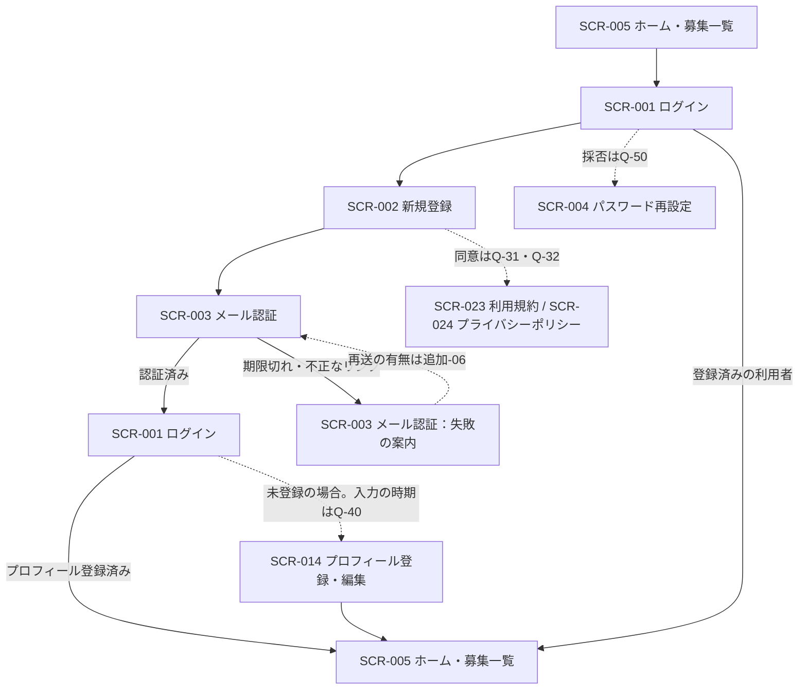
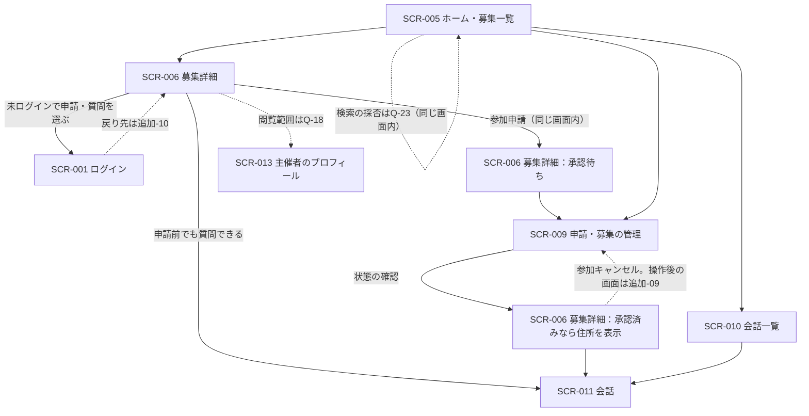
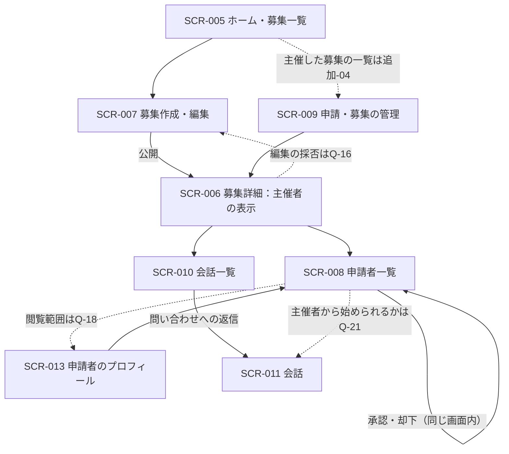
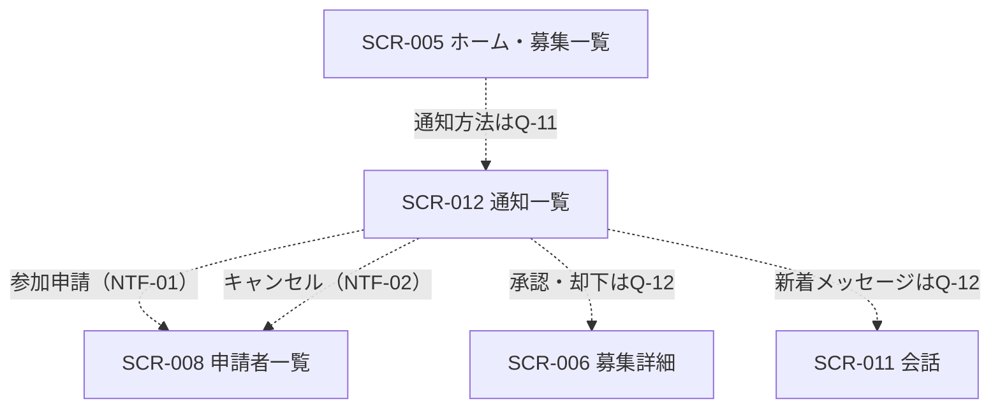
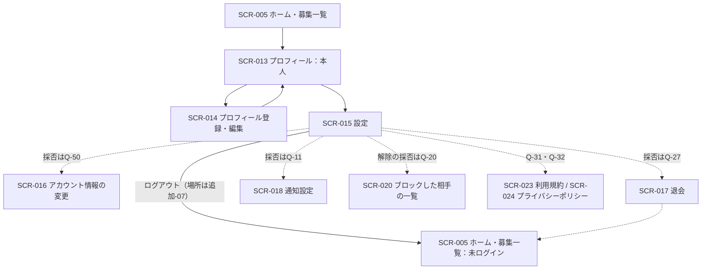
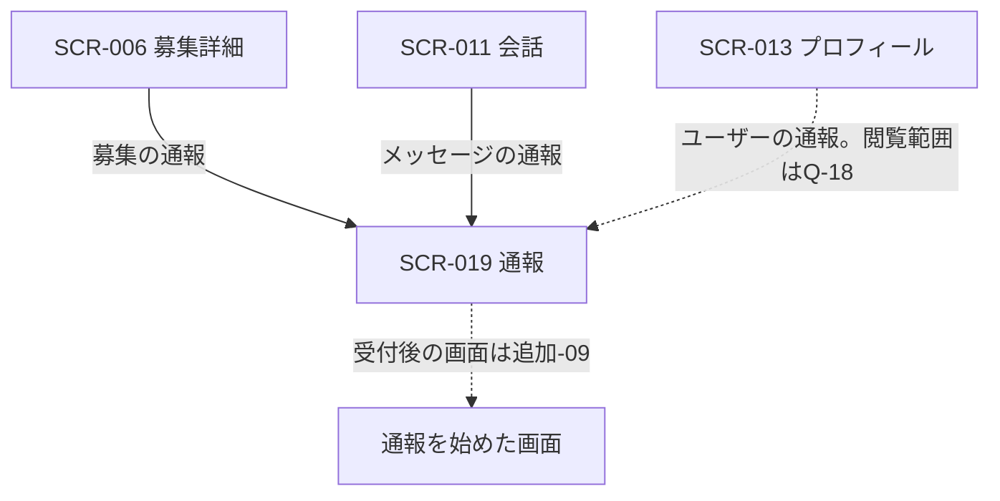
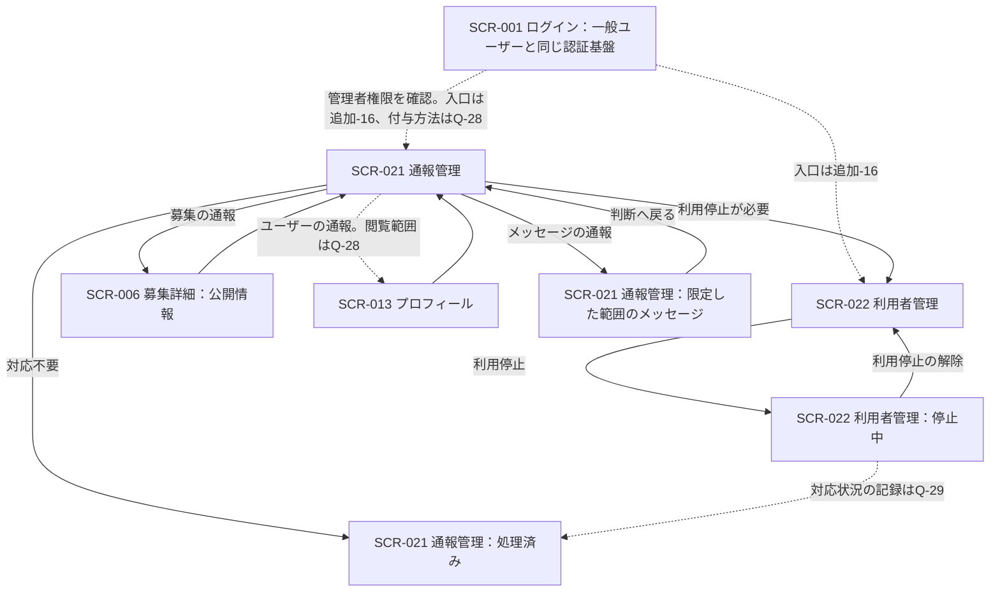
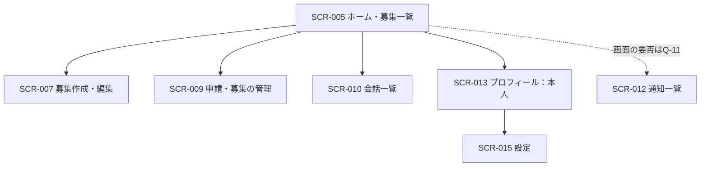

# 10 画面一覧

表記ルールは [01_企画概要](01_企画概要.md) を参照。

> - 画面の分け方・統合・遷移は**設計案【提案】**であり、合意後に確定する。
> - 画面のデザイン、レイアウト、ワイヤーフレームは扱わない（【未決定】Q-45）。
> - 【未決定】事項は確定していない。`Q-xx` は [09_未決定事項](09_未決定事項.md)、`追加-xx` は本書の9-2の番号。

## 1. 目的・前提

### 1-1. 目的

初期リリースと将来候補に必要な画面を洗い出し、各画面の役割と、[04_機能一覧](04_機能一覧.md) の機能との対応を明確にする。

### 1-2. 前提

| 前提 | 状態 | 資料 |
|---|---|---|
| 募集の一覧・詳細はログインせずに閲覧できる | 【合意済み】 | 03のFR-04 |
| 登録・ログインはメールアドレス＋パスワード。メール認証を行う | 【合意済み】 | 03のFR-01・02 |
| 詳細住所は主催者と承認済みユーザーだけに見せる | 【合意済み】 | 03の6-2・9章 |
| 主催者・参加者は、固定の種別ではなく募集ごとの立場とする | 【提案】 | 03の5章 |
| スマートフォンとPCのブラウザを対象とし、スマートフォンを優先する | 【提案】 | 03の10章 |
| 管理者向けの画面は「通報管理」と「利用者管理」の2画面に分ける | 【合意済み】 | 09の決定記録（2026-11-25） |
| 通報対象のメッセージは、対象のメッセージと対応に必要な範囲に限定して管理者が閲覧できる。具体的な範囲はQ-28 | 【合意済み】 | 同上 |
| 利用停止の解除（CND-07）を初期リリース（P0）に含める。解除の条件はQ-28 | 【合意済み】 | 同上 |
| 管理者は一般ユーザーと同じ認証基盤を使い、管理者権限によって使える画面・操作を分ける。権限の付与方法はQ-28 | 【合意済み】 | 同上 |

### 1-3. 画面の数え方

- 固有の目的を持ち、ほかの画面から移動して使うまとまりを1画面とする
- 確認、完了、入力エラー、該当なしなどの表示は、元の画面の一部とし、数えない
- 同じ画面で立場や状態によって表示・操作が変わる場合は、1画面とする

### 1-4. 優先度の書き方

優先度は04の実装段階（P0・P1・P2）に従う。確定していないものは、次のように「要確認」とする。

| 表記 | 意味 |
|---|---|
| P0 | 対応する機能が初期リリースに確定しており（04、09のF章）、その機能を使う場所がアプリ内に必要 |
| 要確認（機能はP0） | 機能はP0だが、その機能をアプリ内の画面で提供するか自体が未決定 |
| 要確認（P0仮）・要確認（P1仮） | 対応する機能の実装段階が、04で「P0（仮）」「P1（仮）」 |
| 要確認（機能IDなし） | 04に対応する機能がなく、採否が未決定 |

- P0は、その画面に含まれるすべての操作が確定しているという意味ではない。未確定の操作は5章に示す
- P0は、独立した画面として確定しているという意味でもない。ほかの画面との統合や操作の場所（追加-05・07など）は【提案】である

## 2. 画面設計の基本方針

### 2-1. 主催者と参加者の画面を分けない

- 1つのアプリの中で、利用者の立場と募集の状態に応じて、見せる情報と操作を切り替える
- 募集詳細（SCR-006）と、申請・募集の管理（SCR-009）は、主催者と参加者で共用する
- 管理者向けの画面は、一般ユーザー向けの画面と分けて整理し、画面遷移も分ける【合意済み】
- 管理者も一般ユーザーと同じ認証基盤を使い、管理者権限によって使える画面・操作を分ける【合意済み】
- 画面の切り替えは補助であり、権限はDB側で判定する（07の2章・8章）

### 2-2. 画面の共通化

| 対象 | 方針【提案】 | 理由 |
|---|---|---|
| ホーム・募集一覧・募集検索 | 統合（SCR-005） | 最初に募集を見つけることが目的で、ホーム固有の機能が04にない（追加-01） |
| 募集作成と募集編集 | 統合（SCR-007） | 入力項目が共通。編集の採否はQ-16（追加-02） |
| 申請状態と主催した募集 | 統合（SCR-009） | 同じ利用者が両方の立場になる（追加-04） |
| ユーザー・募集・メッセージの通報 | 統合（SCR-019） | 対象が違うだけで操作が同じ（追加-05） |
| 通知一覧と通知詳細 | 詳細は作らず、一覧から対象の画面へ移動（SCR-012） | 通知固有の操作が04にない（追加-03） |
| 自分と他人のプロフィール閲覧 | 統合（SCR-013） | 見せる項目と操作を切り替える |
| ログインと新規登録 | 分ける（SCR-001・002） | 登録は認証メールや規約への同意の有無など、目的と流れが異なる |
| プロフィール閲覧と編集 | 分ける（SCR-013・014） | 他人も開く画面と、本人だけの画面を区別する。編集は登録直後の入力にも使う |
| 募集詳細と申請者一覧 | 分ける（SCR-006・008） | 申請者の情報は主催者だけが扱う |
| 利用規約とプライバシーポリシー | 分ける（SCR-023・024） | 別の文書であり、個別に参照する |
| 通報管理と利用者管理 | 分ける（SCR-021・022）【合意済み】 | 通報への対応と、利用者の停止・解除は目的が異なる |

## 3. 画面カテゴリー一覧

| No. | カテゴリー | 画面 | 画面数 |
|---|---|---|:-:|
| 1 | 認証 | SCR-001〜004 | 4 |
| 2 | ホーム・募集検索 | SCR-005 | 1 |
| 3 | 募集詳細・募集管理 | SCR-006〜008 | 3 |
| 4 | 参加申請・参加管理 | SCR-009 | 1 |
| 5 | チャット | SCR-010・011 | 2 |
| 6 | 通知 | SCR-012 | 1 |
| 7 | プロフィール | SCR-013・014 | 2 |
| 8 | 設定・アカウント管理 | SCR-015〜018 | 4 |
| 9 | 安全対策 | SCR-019・020 | 2 |
| 10 | 管理者向け | SCR-021・022 | 2 |
| 11 | 規約等 | SCR-023・024 | 2 |
| | 計 | | **24** |

## 4. 全画面一覧

「主催者」「参加者」は募集ごとの立場を示す。「本人」は、ログイン済みユーザー自身の情報を扱うことを示す。

| 画面ID | 画面名 | カテゴリー | 利用者 | 画面の目的 | 関連機能ID | 優先度 |
|---|---|---|---|---|---|---|
| SCR-001 | ログイン | 認証 | 未ログイン（管理者を含む） | 本人として利用を始める | AUTH-03、CND-12 | P0 |
| SCR-002 | 新規登録 | 認証 | 未ログイン | アカウントを作る | AUTH-01、CND-09、CND-12 | P0 |
| SCR-003 | メール認証 | 認証 | 登録したユーザー | 認証の案内と結果を確認する | AUTH-02 | P0 |
| SCR-004 | パスワード再設定 | 認証 | 登録済み | ログインできない状態から復旧する | CND-01 | 要確認（P0仮） |
| SCR-005 | ホーム・募集一覧 | ホーム・募集検索 | 全員 | 参加先の募集を見つける | EVT-02、EVT-05、APP-10、CND-14 | P0 |
| SCR-006 | 募集詳細 | 募集詳細・募集管理 | 全員（立場で切り替え） | 募集の内容を確認し、申請・質問などを行う | EVT-03、EVT-04、APP-01、APP-05〜08、APP-10、MSG-01、SAFE-02、CND-03、CND-10、CND-11 | P0 |
| SCR-007 | 募集作成・編集 | 募集詳細・募集管理 | ログイン済み（編集は主催者） | 募集を公開する | EVT-01、CND-02 | P0 |
| SCR-008 | 申請者一覧 | 募集詳細・募集管理 | 主催者 | 申請者を確認し、承認・却下する | APP-02〜05、APP-10 | P0 |
| SCR-009 | 申請・募集の管理 | 参加申請・参加管理 | ログイン済み（本人） | 自分の申請の状態と、主催した募集を確認する | APP-07、APP-08、CND-10 | P0 |
| SCR-010 | 会話一覧 | チャット | 会話の当事者 | 過去のやり取りを探す | MSG-03、CND-05 | P0 |
| SCR-011 | 会話 | チャット | 会話の当事者 | 主催者と問い合わせユーザーがやり取りする | MSG-01、MSG-02、MSG-04、MSG-05、SAFE-03、SAFE-04 | P0 |
| SCR-012 | 通知一覧 | 通知 | ログイン済み（本人） | 申請・キャンセルなどに気付く | NTF-01、NTF-02、CND-04、CND-05 | 要確認（機能はP0） |
| SCR-013 | プロフィール | プロフィール | 閲覧範囲は【未決定】Q-18 | 相手または自分の情報を確認する | PROF-03、SAFE-01、SAFE-04 | P0 |
| SCR-014 | プロフィール登録・編集 | プロフィール | ログイン済み（本人） | 自分の情報を登録・変更する | PROF-01、PROF-02 | P0 |
| SCR-015 | 設定 | 設定・アカウント管理 | ログイン済み（本人） | ログアウトと、アカウント関連の操作への入口 | AUTH-04 | P0 |
| SCR-016 | アカウント情報の変更 | 設定・アカウント管理 | ログイン済み（本人） | メールアドレス・パスワードを変更する | なし（Q-50） | 要確認（機能IDなし） |
| SCR-017 | 退会 | 設定・アカウント管理 | ログイン済み（本人） | 利用をやめる | CND-08 | 要確認（P0仮） |
| SCR-018 | 通知設定 | 設定・アカウント管理 | ログイン済み（本人） | 通知の手段を選ぶ | CND-13 | 要確認（P1仮） |
| SCR-019 | 通報 | 安全対策 | ログイン済み（メッセージは会話の当事者） | 問題のあるユーザー・募集・メッセージを知らせる | SAFE-01〜03 | P0 |
| SCR-020 | ブロックした相手の一覧 | 安全対策 | ブロックした本人 | ブロックを確認・解除する | CND-06 | 要確認（P0仮） |
| SCR-021 | 通報管理 | 管理者向け | 管理者 | 通報を確認し、対応を判断する | SAFE-06 | P0 |
| SCR-022 | 利用者管理 | 管理者向け | 管理者 | 利用者の利用停止と解除を行う | SAFE-05、CND-07 | P0 |
| SCR-023 | 利用規約 | 規約等 | 【未決定】Q-31 | 利用条件を示す | なし（Q-31。関連：CND-09） | 要確認（機能IDなし） |
| SCR-024 | プライバシーポリシー | 規約等 | 【未決定】Q-32 | 個人情報の取り扱いを示す | なし（Q-32。関連：CND-09） | 要確認（機能IDなし） |

- Googleログイン（CND-12）は、採用する場合の候補としてSCR-001・002に記載した。初期リリースでは実装しない【合意済み】
- CND-07は追加候補だったが、合意によりP0となった（04の2-6）
- APP-09（キャンセル履歴の保存）は画面を持たない（5-12）

## 5. 各画面の役割・主な機能

「主な機能」に候補機能（CND）、Q番号、追加番号を（ ）で付けたものは、採否または内容が決まっていない。「P0」と付けたものは確定している。印のないものは、確定した機能を使うための操作で、画面上の置き方は【提案】である。

### 5-1. 認証

| 画面ID | 主な機能 | 備考 |
|---|---|---|
| SCR-001 ログイン | メールアドレスとパスワードの入力、新規登録への移動、パスワード再設定への移動（CND-01） | 管理者も同じ認証基盤を使う【合意済み】。ログイン後の管理者向け画面への入口は追加-16。要ログインの操作から来た場合の戻り先は追加-10。登録の有無を第三者が判別できる表示をしない（07の3章） |
| SCR-002 新規登録 | メールアドレスとパスワードの入力、認証メールの依頼、規約等への同意（CND-09） | パスワードの条件はQ-49、同意はQ-31・Q-32、未成年者の条件はQ-30、Bot対策はQ-48 |
| SCR-003 メール認証 | 認証メールの案内、認証の結果、期限切れ・不正なリンクの案内 | 再送の操作は04に記載がない（追加-06）。未認証ユーザーの利用範囲はQ-40、有効期限はQ-49 |
| SCR-004 パスワード再設定 | 再設定の申し込み（CND-01）、新しいパスワードの設定（CND-01） | 採否と方法はQ-50、送信サービスはQ-03 |

### 5-2. ホーム・募集検索

| 画面ID | 主な機能 | 備考 |
|---|---|---|
| SCR-005 ホーム・募集一覧 | 募集の公開情報の一覧、募集詳細への移動、条件による検索（EVT-05、P0仮）、募集作成への移動 | 未ログインで閲覧できる【合意済み】。検索の採否・条件はQ-23、残り枠数の表示はQ-24、終了した募集の表示はQ-16、地域はQ-17・Q-46、地域の拡大（CND-14）はP2仮 |

### 5-3. 募集詳細・募集管理

| 画面ID | 主な機能 | 備考 |
|---|---|---|
| SCR-006 募集詳細 | 公開情報の確認。立場ごとの操作は下の表を参照 | 未ログインで閲覧できる【合意済み】。項目はQ-17、残り枠数はQ-24、参加者の表示はQ-44、共有はQ-53 |
| SCR-007 募集作成・編集 | 公開情報と詳細住所の入力、公開、内容の変更（CND-02） | 公開情報と住所を分けて保存する。自由入力欄に住所を書かないよう注意を示す（06の4-3）。編集はQ-16、項目はQ-17、入力の上限はQ-19、地域はQ-46 |
| SCR-008 申請者一覧 | 自分の募集の申請の確認、申請者のプロフィールへの移動、承認、却下、定員・空きの確認、承認の取り消し（Q-42） | 他人の募集の申請は見られない。定員の数え方はQ-13、友人を含む申請はQ-22、期限はQ-43、申請者に関する情報の範囲はQ-18・Q-26 |

SCR-006の立場ごとの違い：

| 立場・状態 | 見られる情報 | 主な操作 |
|---|---|---|
| 未ログイン | 公開情報 | ログイン・新規登録への移動 |
| ログイン済み・主催者以外（共通） | 公開情報 | 主催者への質問、募集の通報、主催者のプロフィールへの移動（Q-18） |
| 　未申請 | 共通の情報 | 共通の操作、参加申請 |
| 　承認待ち | 共通の情報、自分の申請状態 | 共通の操作、取り下げ（CND-10、Q-15） |
| 　承認済み | 共通の情報、詳細住所、自分の申請状態 | 共通の操作、参加キャンセル |
| 　却下・キャンセル済み | 共通の情報、自分の申請状態 | 共通の操作、再申請（Q-14） |
| 主催者 | 公開情報、詳細住所 | 申請者一覧・会話一覧への移動、編集（CND-02）、締切・中止（CND-03） |
| 管理者 | 公開情報。詳細住所はQ-28 | 通報対象の確認（SCR-021から移動） |

- 募集の通報は、未申請・承認待ち・承認済み・却下・キャンセル済みのいずれでも行える（03の5章）
- 03の5章では主催者も通報できるが、自分の募集を通報の対象に含めるかは**要確認**
- 満員のときは申請できない【合意済み】。主催者が自分の募集に申請できるかはQ-13
- 開催開始後・終了後の操作はQ-43。キャンセルを「いつでもできる」ことは【合意済み】
- 利用停止中に制限する操作の範囲はQ-28（メッセージを送信できないことは決定済み）

### 5-4. 参加申請・参加管理

| 画面ID | 主な機能 | 備考 |
|---|---|---|
| SCR-009 申請・募集の管理 | 自分の申請の状態（承認待ち・承認・却下・キャンセル）の確認、募集詳細への移動、参加キャンセル、取り下げ（CND-10）、主催した募集の確認（追加-04） | 主催した募集の一覧は04に機能IDがない。申請・キャンセルの操作場所は追加-09。取り下げはQ-15、期限はQ-43 |

### 5-5. チャット

| 画面ID | 主な機能 | 備考 |
|---|---|---|
| SCR-010 会話一覧 | 自分の会話の確認、会話への移動、新着の表示（CND-05） | 会話の単位はQ-21、新着の通知はQ-12 |
| SCR-011 会話 | メッセージの閲覧・送信、拒否された場合の案内、メッセージの通報、相手のブロック | 参加申請前でも開始できる【合意済み】。主催者から始められるかはQ-21、送信回数はQ-10、拒否の表示はQ-20、通信方式はQ-07、ブロックの操作場所は追加-05 |

### 5-6. 通知

| 画面ID | 主な機能 | 備考 |
|---|---|---|
| SCR-012 通知一覧 | 参加申請・キャンセルの通知の確認（Q-11）、既読（Q-11）、対象の画面への移動、承認・却下（CND-04）と新着メッセージ（CND-05）の通知 | 通知の機能はP0だが、アプリ内で知らせるかは**【未決定】Q-11**。対象の出来事はQ-12、通知詳細は追加-03 |

### 5-7. プロフィール

| 画面ID | 主な機能 | 備考 |
|---|---|---|
| SCR-013 プロフィール | 許可された項目の閲覧、編集への移動（本人）、ユーザーの通報・ブロック（他人） | メールアドレス・電話番号は表示しない【合意済み】。閲覧できる人と項目はQ-18。閲覧できない相手を通報・ブロックする入口は追加-05 |
| SCR-014 プロフィール登録・編集 | 各項目の入力、画像の選択・削除 | ニックネームと経験レベルは必須【合意済み】。入力の時期はQ-40、選択肢・上限はQ-19、年代などの扱いはQ-30 |

### 5-8. 設定・アカウント管理

| 画面ID | 主な機能 | 備考 |
|---|---|---|
| SCR-015 設定 | ログアウト（P0）、SCR-016〜018・020・023・024への移動（いずれも採否が未決定） | ログアウトをこの画面に置くかは追加-07 |
| SCR-016 アカウント情報の変更 | メールアドレスの変更（Q-50）、パスワードの変更（Q-50） | 機能の採否が未決定。04に機能IDがない |
| SCR-017 退会 | 退会の説明と申し込み（CND-08） | データの扱いはQ-27、再登録はQ-52 |
| SCR-018 通知設定 | 通知手段の選択（CND-13） | Q-11 |

### 5-9. 安全対策

| 画面ID | 主な機能 | 備考 |
|---|---|---|
| SCR-019 通報 | 理由の選択、補足の入力、送信 | 通報は相手に見えない。通報者本人が後から確認する画面は追加-15。理由の分類はQ-29、独立した画面にするかは追加-05 |
| SCR-020 ブロックした相手の一覧 | ブロックした相手の確認（追加-14）、解除（CND-06） | 解除の採否と影響範囲はQ-20。ブロックの操作（SAFE-04）はSCR-011・013に置く案 |

### 5-10. 管理者向け

| 画面ID | 主な機能 | 備考 |
|---|---|---|
| SCR-021 通報管理 | 通報の一覧と内容の確認（SAFE-06、P0）、通報対象（ユーザー・募集・メッセージ）の確認、対応の要否の判断、対応状況の記録（Q-29）、利用者管理への移動、募集・画像・メッセージの非表示・削除（Q-51） | 通報されたメッセージは、対象のメッセージと対応に必要な範囲に限定して閲覧できる【合意済み】。前後のメッセージの件数など**具体的な範囲はQ-28**。会話全体を開くSCR-011へは移動しない案。募集の詳細住所とプロフィールの閲覧範囲もQ-28。理由・状態の値、証跡、手順はQ-29。新しい通報に気付く方法は追加-13 |
| SCR-022 利用者管理 | 対象の利用者の選択、現在の利用状態の確認、利用停止と記録（SAFE-05、P0）、利用停止の解除と記録（CND-07、P0）、理由の記録（Q-28）、過去の措置の確認（Q-28） | 記録することは04のSAFE-05・CND-07に基づく。記録する項目（対象、操作、実施者、日時など）は06の4-12の設計案による。停止の範囲・期間・条件、解除の条件、開催中の募集の扱いはQ-28。利用者の探し方と表示する項目もQ-28 |

管理者向け画面に共通すること：

- 2画面を初期リリースに含める【合意済み】。SAFE-05・SAFE-06・CND-07を、この2画面で行う
- 管理者だけが使える。画面の表示だけに頼らず、DB側で管理者権限を確認する（03のSR-04・SR-07、07の8章）
- 実施者は、ログインした管理者として記録する案とする（06の4-12の `admin_id`）
- 利用停止は直ちに反映する（04のSAFE-05）
- 管理者権限の付与方法はQ-28、画面への入口は追加-16、新しい通報に気付く方法は追加-13で確認する

### 5-11. 規約等

| 画面ID | 主な機能 | 備考 |
|---|---|---|
| SCR-023 利用規約 | 規約の表示 | 内容と同意の要否はQ-31 |
| SCR-024 プライバシーポリシー | ポリシーの表示 | 内容と問い合わせ先の示し方はQ-32。外部送信に関する表示はQ-57 |

### 5-12. 画面を持たない機能

次の機能は独立した画面を持たず、結果をほかの画面に反映する。

| 機能ID | 反映する画面 |
|---|---|
| APP-05 定員管理、APP-06 重複申請の防止 | SCR-006（申請時）。APP-05はSCR-008（承認時）にも反映 |
| APP-09 キャンセル履歴の保存 | なし（04の操作内容も「－」。履歴の公開範囲はQ-26） |
| APP-10 残り枠数の算出 | SCR-005・006・008（表示範囲はQ-24） |
| MSG-04 ブロック相手の拒否、MSG-05 送信回数の制限 | SCR-011（拒否の表示はQ-20） |

## 6. 主要な画面遷移

- 実線：P0の画面・機能による遷移【提案】
- 点線：【未決定】事項・追加検討事項に依存する遷移、または採否が未決定の画面への遷移
- 一般ユーザーの遷移（6-1〜6-6、6-8）と管理者の遷移（6-7）を分ける

### 6-1. シナリオA：新規ユーザー

- メール認証を行うことは【合意済み】。未認証のまま使える範囲はQ-40
- 認証後に改めてログインする流れは、07の3章の設計案に基づく
- プロフィール登録を後からにする場合（Q-40）は、未登録でもホームへ進む

### 6-2. シナリオB：参加者

- 申請の取り下げ（Q-15）、再申請（Q-14）、友人を含む申請（Q-22）、操作の期限（Q-43）は【未決定】
- 申請・キャンセルの操作場所と、操作後の画面は追加-09。ホームからの移動手段は追加-12

### 6-3. シナリオC：主催者

- 主催者から申請者への会話の開始は【未決定】Q-21。決まるまでは、問い合わせがあった会話への返信だけを実線とする
- 締切・中止（Q-16）、承認の取り消し（Q-42）は【未決定】

### 6-4. シナリオD：通知

- アプリ内の通知を採用する場合の案。メールなどを採用する場合は、移動元が通知一覧ではなくなる
- 通知詳細の画面は設けない案（追加-03）

### 6-5. シナリオE：アカウント管理

### 6-6. 補足：通報・ブロック（一般ユーザー）

- ブロック（SAFE-04）は、SCR-011・013の中で操作し、画面を移動しない案とする。操作場所は追加-05
- 受け付けた通報に対応するのは管理者だけとし、一般ユーザーの画面から管理者向け画面へは移動しない
- 通報者本人が後から通報を確認する画面は追加-15

### 6-7. 補足：管理者

- 一般ユーザーの遷移とは別の流れとする。管理者以外は、この図の管理者向け画面に入れない
- 通報されたメッセージの閲覧は、対応に必要な範囲に限定する【合意済み】。SCR-021の中で見せることは【提案】、具体的な範囲はQ-28
- 対応不要とする流れは02の5-3に基づく。記録する状態の値はQ-29
- 新しい通報に管理者が気付く方法は追加-13
- 停止の範囲・期間・条件、解除の条件はQ-28

### 6-8. 補足：ホームからの移動（一般ユーザー）

- どの画面からもこれらへ移動できるようにするかなど、共通の移動手段は追加-12
- 未ログインの場合は、いずれもログインが必要（戻り先は追加-10）

## 7. 初期リリース対象画面

### 7-1. P0の画面（16画面）

| カテゴリー | 画面 |
|---|---|
| 認証 | SCR-001 ログイン、SCR-002 新規登録、SCR-003 メール認証 |
| ホーム・募集検索 | SCR-005 ホーム・募集一覧 |
| 募集詳細・募集管理 | SCR-006 募集詳細、SCR-007 募集作成・編集、SCR-008 申請者一覧 |
| 参加申請・参加管理 | SCR-009 申請・募集の管理 |
| チャット | SCR-010 会話一覧、SCR-011 会話 |
| プロフィール | SCR-013 プロフィール、SCR-014 プロフィール登録・編集 |
| 設定・アカウント管理 | SCR-015 設定 |
| 安全対策 | SCR-019 通報 |
| 管理者向け | SCR-021 通報管理、SCR-022 利用者管理 |

- P0の機能を提供するために必要な画面である。画面の分け方は【提案】（管理者向けの2画面に分けることは【合意済み】）
- 確定したP0の機能（09のF章の35件）のうち、32件はこの16画面で提供する。残りは、画面の要否が未決定のNTF-01・NTF-02（7-2）と、画面を持たないAPP-09（5-12）

### 7-2. 機能はP0だが、画面の要否が未決定（1画面）

| 画面 | 決まっていないこと |
|---|---|
| SCR-012 通知一覧 | 通知をアプリ内で知らせるか（Q-11） |

画面を作らない場合も、対応する機能（NTF-01・02）は初期リリースに含む。

### 7-3. 初期リリースに含めるか未決定（P0仮、3画面）

| 画面 | 対応する機能 | 関連 |
|---|---|---|
| SCR-004 パスワード再設定 | CND-01 | Q-50・Q-03 |
| SCR-017 退会 | CND-08 | Q-27 |
| SCR-020 ブロックした相手の一覧 | CND-06 | Q-20 |

### 7-4. 機能IDがなく、採否・時期が未決定（3画面）

| 画面 | 関連 | 備考 |
|---|---|---|
| SCR-016 アカウント情報の変更 | Q-50 | 04に機能がない |
| SCR-023 利用規約 | Q-31 | 同意の機能（CND-09）はP0（仮）。公開前に決める |
| SCR-024 プライバシーポリシー | Q-32 | 同上 |

将来の候補と確定したものではなく、初期リリースに含める可能性がある。

## 8. 将来追加候補の画面

### 8-1. P1仮（1画面）

| 画面 | 対応する機能 | 関連 |
|---|---|---|
| SCR-018 通知設定 | CND-13 | Q-11 |

P2（仮）のCND-14（対象地域の拡大）は、採用する場合もSCR-005などへの追加で対応し、独立した画面を設けない案とする。

### 8-2. 画面数の集計

| 優先度 | 画面数 |
|---|:-:|
| P0 | 16 |
| P1 | 0 |
| P2 | 0 |
| 要確認（機能はP0） | 1 |
| 要確認（P0仮） | 3 |
| 要確認（P1仮） | 1 |
| 要確認（機能IDなし） | 3 |
| 計 | **24** |

## 9. 未決定事項・追加検討事項

### 9-1. 画面構成に影響する既存の未決定事項

| 番号 | 画面への影響 | 主な画面 |
|---|---|---|
| Q-11・Q-12 | 通知一覧の要否、通知の種類と移動先 | SCR-012・018 |
| Q-13・Q-22 | 申請の入力、定員の表示 | SCR-006・008 |
| Q-14・Q-15・Q-42・Q-43 | 再申請、取り下げ、承認の取り消し、時期ごとの操作 | SCR-006・008・009 |
| Q-16 | 編集、締切・中止、終了後の表示 | SCR-005〜007・009 |
| Q-17・Q-23・Q-24・Q-46 | 募集の項目、検索、残り枠数、地域 | SCR-005〜007 |
| Q-18・Q-44 | プロフィールと参加者の表示範囲、移動の可否 | SCR-006・008・011・013 |
| Q-20・Q-21 | ブロックの影響・解除、会話の単位と開始 | SCR-010・011・020 |
| Q-27・Q-52 | 退会、再登録 | SCR-002・017 |
| Q-28（管理者） | 権限の付与方法、通報されたメッセージ・住所・プロフィールの具体的な閲覧範囲、利用者の探し方 | SCR-001・006・013・021・022 |
| Q-28（利用停止） | 停止の範囲・期間・条件、解除の条件、停止中の表示と操作、停止された主催者の募集と参加者への表示 | SCR-001・005〜014・019・022 |
| Q-29・Q-51 | 通報の理由・状態・証跡・手順、非表示・削除 | SCR-006・011・013・019・021 |
| Q-30・Q-31・Q-32 | 登録時の条件と同意、文書の表示 | SCR-002・014・023・024 |
| Q-40 | プロフィール登録の時期、未認証での利用範囲 | SCR-003・014 |
| Q-03・Q-49・Q-50 | メールを使う画面、認証の設定、アカウント情報の変更 | SCR-001〜004・016 |
| Q-53 | 募集ページの共有・検索エンジンへの掲載 | SCR-005・006 |
| Q-07・Q-10 | 会話の更新のしかた、送信回数を超えた場合の案内 | SCR-011 |
| Q-19 | 入力項目の選択肢・上限 | SCR-007・011・014 |
| Q-25 | 参加費の支払い方法の示し方 | SCR-006・007 |
| Q-26 | キャンセル履歴・無断欠席の表示 | SCR-008・009 |
| Q-47・Q-48 | 操作回数を超えた場合の案内、Bot対策の操作 | SCR-002・006・007・019 |
| Q-54 | 障害の告知 | 全画面（追加-08に関係） |
| Q-57 | 外部送信に関する表示・同意 | SCR-024ほか |
| Q-08・Q-45 | 対応ブラウザ、画面遷移・レイアウト | 全画面 |

ログイン前に募集の一覧・詳細を閲覧できることは【合意済み】（FR-04）であり、未決定ではない。Q-28のうち、管理者画面を2画面に分けること、メッセージの閲覧を限定すること、解除をP0に含めること、同じ認証基盤を使うことは【合意済み】（1-2）。利用停止中にメッセージを送信できないことは09の決定記録で決定済み。

### 9-2. 追加検討事項（09に番号がないもの）

| 番号 | 事項 | 本書での案 |
|---|---|---|
| 追加-01 | ホームを募集一覧と別の画面にするか | 統合（SCR-005） |
| 追加-02 | 募集の編集を採用する場合、作成と共通の画面にするか | 統合（SCR-007） |
| 追加-03 | 通知詳細を独立した画面にするか | 設けない |
| 追加-04 | 主催した募集の一覧を設けるか。申請者一覧（APP-02）へ移動する手段として必要だが、**04に機能IDがない** | SCR-009に含める |
| 追加-05 | 通報・ブロックの操作場所と、独立した画面にするか。プロフィールを閲覧できない相手（Q-18）を通報・ブロックする入口 | 通報はSCR-019、ブロックはSCR-011・013。入口は**要確認** |
| 追加-06 | 認証メールを再送する操作を設けるか。**04に記載がない** | **要確認** |
| 追加-07 | 設定画面を設けるか、ログアウトをどこに置くか | SCR-015 |
| 追加-08 | 共通の案内（ページがない、権限がない、利用停止中、通信エラー）の扱い。利用停止中の表示はQ-28に関係 | **要確認**。画面数に含めていない |
| 追加-09 | 申請・キャンセル・通報などの操作場所と、操作後に表示する画面 | 申請はSCR-006、キャンセルはSCR-006・009 |
| 追加-10 | 未ログインで要ログインの操作を選んだ場合の、ログイン・登録後の戻り先 | 元の画面に戻す。登録を挟む場合は**要確認** |
| 追加-11 | 問い合わせ窓口・使い方の案内の画面を設けるか。**04に記載がない**（問い合わせ先はQ-32） | **要確認**。画面数に含めていない |
| 追加-12 | 主要な画面への共通の移動手段。ホーム以外からも移動できるようにするか | ホームからの移動だけを6-8に示した。ほかは**要確認** |
| 追加-13 | 新しい通報に管理者が気付く方法。04のSAFE-01の完了条件は「管理者に届き」だが、Q-11・Q-12に管理者への通知がない | **要確認** |
| 追加-14 | ブロックした相手を確認する操作を設けるか。**04に記載がない**（解除はCND-06） | SCR-020に含める |
| 追加-15 | 通報者本人が自分の通報を確認する画面を設けるか。RLSの案では閲覧できるが、**04に記載がない** | **要確認**。画面数に含めていない |
| 追加-16 | 管理者向け画面への入口。管理者が一般ユーザーの操作（申請・募集など）も行えるか（Q-28に関係） | **要確認** |

本書では採否を決めない。09ではQ-45でまとめて扱う。

### 9-3. 既存資料との確認が必要な点

| 内容 | 資料 |
|---|---|
| 通知の操作は「通知を確認」だが、アプリ内で確認するかは未決定。通知テーブルの設計案はアプリ内の通知にも使える形になっている | 04のNTF-01・02、06の4-11、Q-11 |
| 主催者は「自分の募集の申請を開く」が、自分の募集を探す機能がない | 04のAPP-02、追加-04 |
| ユーザーの通報・ブロックはログイン済みユーザーができるが、相手のプロフィールを閲覧できる範囲が未決定 | 04のSAFE-01・04、Q-18、追加-05 |
| 主催者は返信できるが、主催者から会話を始められるかは未決定。承認後の連絡の流れに影響する | 03のFR-20、Q-21 |
| 主催者は「自分の募集」の列でも通報できるとあるが、自分の募集を通報の対象に含めるかが分からない | 03の5章 |

## 10. 参照資料

| 資料 | 参照した内容 |
|---|---|
| [README](../README.md) | 主な機能、資料の一覧 |
| [01_企画概要](01_企画概要.md) | 表記ルール、対象、特徴 |
| [02_ターゲット・利用シーン](02_ターゲット・利用シーン.md) | 利用シーン、利用フロー |
| [03_要件定義書](03_要件定義書.md) | 利用条件、権限、機能要件、初期リリースの範囲 |
| [04_機能一覧](04_機能一覧.md) | 機能ID、操作内容、実装段階 |
| [05_技術構成・開発環境](05_技術構成・開発環境.md) | 認証メールの制限、SPAの注意点 |
| [06_データベース設計](06_データベース設計.md) | 参加状態、通知・通報の項目、RLS |
| [07_システムアーキテクチャ](07_システムアーキテクチャ.md) | 認証、募集、申請、チャットの流れ、アクセス制御 |
| [08_開発ルール](08_開発ルール.md) | 未決定事項の扱い |
| [09_未決定事項](09_未決定事項.md) | Q番号、機能の採否、決定記録 |
