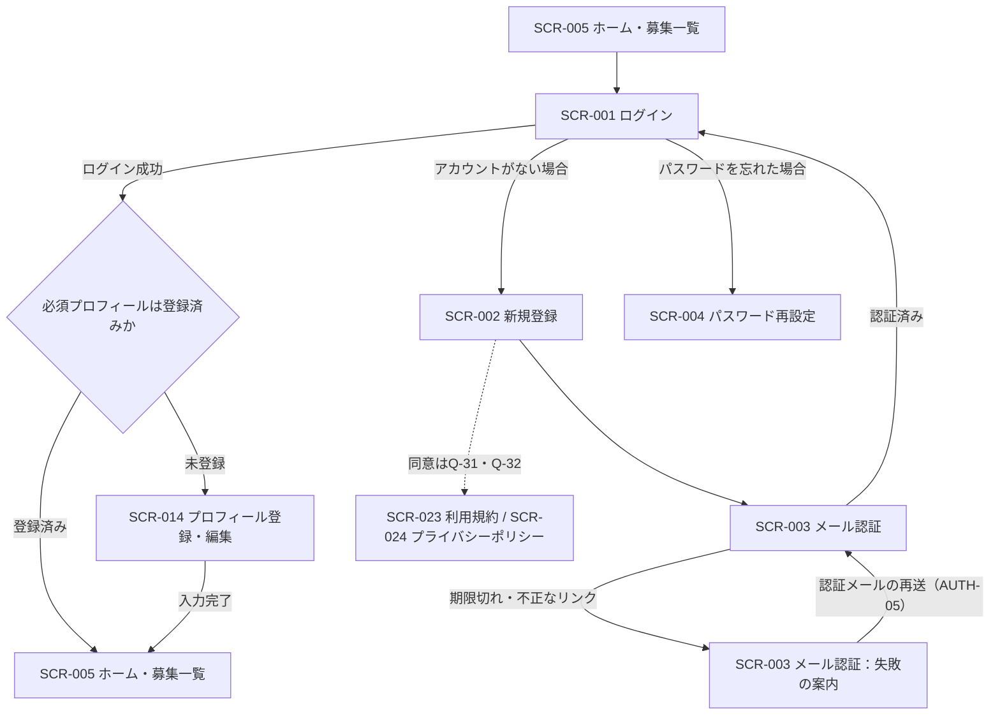
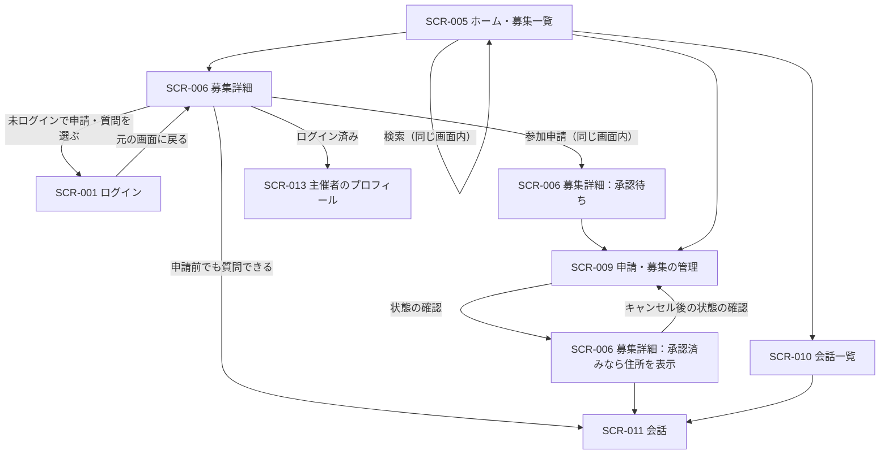
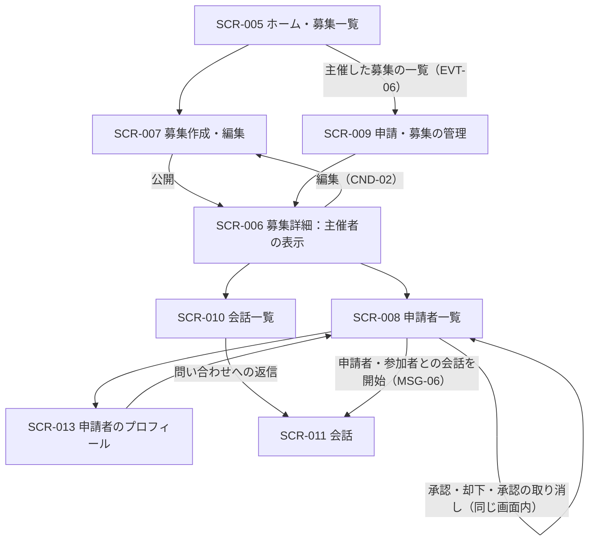
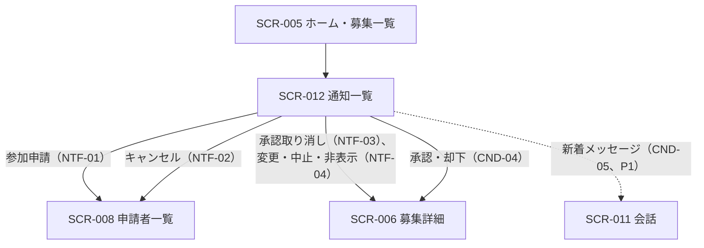
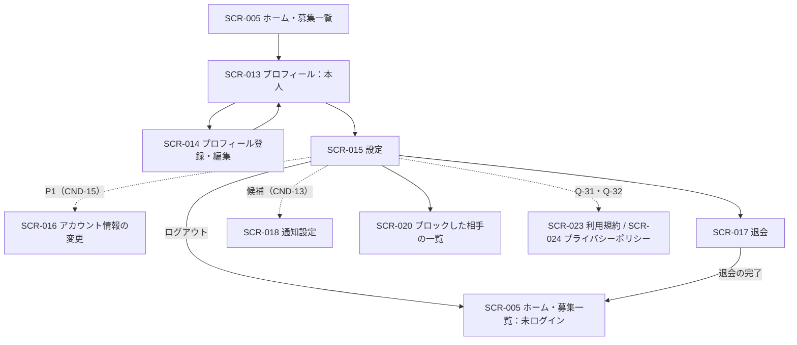
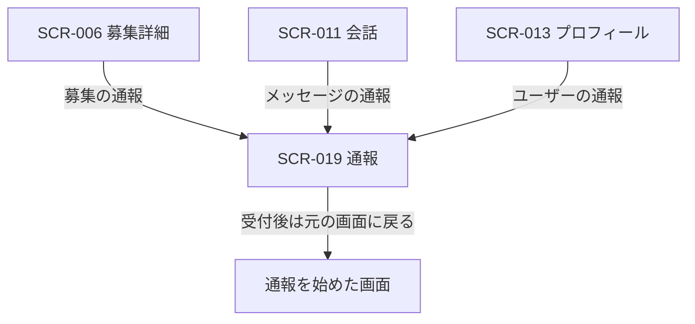
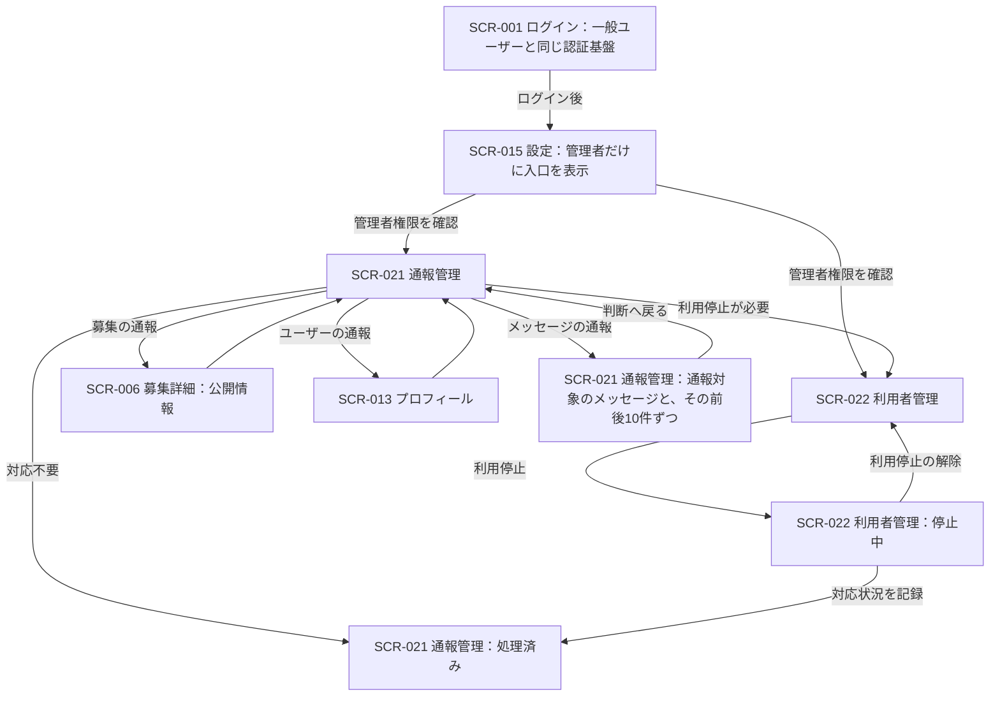
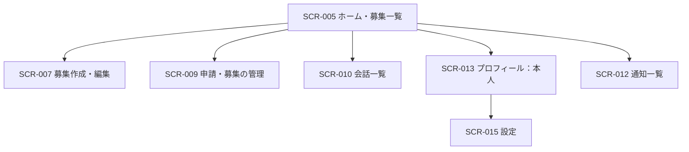

# 10 画面一覧

表記ルールは [01_企画概要](01_企画概要.md) を参照。

> - 画面の分け方・統合・遷移は2026-11-25に採用を決めた（[11_詳細仕様](11_詳細仕様.md) の5章）。
> - 画面のデザイン、レイアウト、ワイヤーフレームは扱わない（【未決定】Q-45）。
> - `Q-xx` は [09_未決定事項](09_未決定事項.md)、`追加-xx` は本書の9-2の番号。決定済みの内容は11を参照。

## 1. 目的・前提

### 1-1. 目的

初期リリースと将来候補に必要な画面を洗い出し、各画面の役割と、[04_機能一覧](04_機能一覧.md) の機能との対応を明確にする。

### 1-2. 前提

| 前提 | 状態 | 資料 |
|---|---|---|
| 募集の一覧・詳細はログインせずに閲覧できる | 【合意済み】 | 03のFR-04 |
| 登録・ログインはメールアドレス＋パスワード。メール認証を行う | 【合意済み】 | 03のFR-01・02 |
| 詳細住所は主催者と承認済みユーザーだけに見せる | 【合意済み】 | 03の6-2・9章 |
| 主催者・参加者は、固定の種別ではなく募集ごとの立場とする | 【提案】 | 03の5章 |
| スマートフォンとPCのブラウザを対象とし、スマートフォンを優先する | 【提案】 | 03の10章 |
| 管理者向けの画面は「通報管理」と「利用者管理」の2画面に分ける | 【合意済み】 | 09の決定記録（2026-11-25） |
| 管理者が閲覧できるメッセージは、通報対象のメッセージと、その前後10件ずつ（同じ会話内）に限定する | 【合意済み】 | 同上 |
| 利用停止の解除（CND-07）を初期リリース（P0）に含める。条件は11の4-2 | 【合意済み】 | 同上 |
| 管理者は一般ユーザーと同じ認証基盤を使い、管理者権限によって使える画面・操作を分ける。付与方法は11の4-1 | 【合意済み】 | 同上 |

### 1-3. 画面の数え方

- 固有の目的を持ち、ほかの画面から移動して使うまとまりを1画面とする
- 確認、完了、入力エラー、該当なしなどの表示は、元の画面の一部とし、数えない
- 同じ画面で立場や状態によって表示・操作が変わる場合は、1画面とする

### 1-4. 優先度の書き方

優先度は04の実装段階（P0・P1・P2）に従う。確定していないものは、次のように「要確認」とする。

| 表記 | 意味 |
|---|---|
| P0 | 対応する機能が初期リリースに確定しており（04、09のF章）、その機能を使う場所がアプリ内に必要 |
| P1 | 初期リリース後に追加することが決まっている（04） |
| 要確認（P1仮） | 対応する機能の採否が未決定で、04で「P1（仮）」 |
| 要確認（機能IDなし） | 04に対応する機能がなく、採否が未決定 |

- P0は、その画面に含まれるすべての操作が確定しているという意味ではない。未確定の操作は5章に示す
- P0は、独立した画面として確定しているという意味でもない。操作の置き方はQ-45のレイアウトで決める

## 2. 画面設計の基本方針

### 2-1. 主催者と参加者の画面を分けない

- 1つのアプリの中で、利用者の立場と募集の状態に応じて、見せる情報と操作を切り替える
- 募集詳細（SCR-006）と、申請・募集の管理（SCR-009）は、主催者と参加者で共用する
- 管理者向けの画面は、一般ユーザー向けの画面と分けて整理し、画面遷移も分ける【合意済み】
- 管理者も一般ユーザーと同じ認証基盤を使い、管理者権限によって使える画面・操作を分ける【合意済み】
- 画面の切り替えは補助であり、権限はDB側で判定する（07の2章・8章）

### 2-2. 画面の共通化

| 対象 | 方針 | 理由 |
|---|---|---|
| ホーム・募集一覧・募集検索 | 統合（SCR-005） | 最初に募集を見つけることが目的で、ホーム固有の機能が04にない（追加-01） |
| 募集作成と募集編集 | 統合（SCR-007） | 入力項目が共通。（追加-02） |
| 申請状態と主催した募集 | 統合（SCR-009） | 同じ利用者が両方の立場になる（追加-04） |
| ユーザー・募集・メッセージの通報 | 統合（SCR-019） | 対象が違うだけで操作が同じ（追加-05） |
| 通知一覧と通知詳細 | 詳細は作らず、一覧から対象の画面へ移動（SCR-012） | 通知固有の操作が04にない（追加-03） |
| 自分と他人のプロフィール閲覧 | 統合（SCR-013） | 見せる項目と操作を切り替える |
| ログインと新規登録 | 分ける（SCR-001・002） | 登録は認証メールや規約への同意の有無など、目的と流れが異なる |
| プロフィール閲覧と編集 | 分ける（SCR-013・014） | 他人も開く画面と、本人だけの画面を区別する。編集は登録直後の入力にも使う |
| 募集詳細と申請者一覧 | 分ける（SCR-006・008） | 申請者の情報は主催者だけが扱う |
| 利用規約とプライバシーポリシー | 分ける（SCR-023・024） | 別の文書であり、個別に参照する |
| 通報管理と利用者管理 | 分ける（SCR-021・022）【合意済み】 | 通報への対応と、利用者の停止・解除は目的が異なる |

## 3. 画面カテゴリー一覧

| No. | カテゴリー | 画面 | 画面数 |
|---|---|---|:-:|
| 1 | 認証 | SCR-001〜004 | 4 |
| 2 | ホーム・募集検索 | SCR-005 | 1 |
| 3 | 募集詳細・募集管理 | SCR-006〜008 | 3 |
| 4 | 参加申請・参加管理 | SCR-009 | 1 |
| 5 | チャット | SCR-010・011 | 2 |
| 6 | 通知 | SCR-012 | 1 |
| 7 | プロフィール | SCR-013・014 | 2 |
| 8 | 設定・アカウント管理 | SCR-015〜018 | 4 |
| 9 | 安全対策 | SCR-019・020 | 2 |
| 10 | 管理者向け | SCR-021・022 | 2 |
| 11 | 規約等 | SCR-023・024 | 2 |
| | 計 | | **24** |

## 4. 全画面一覧

「主催者」「参加者」は募集ごとの立場を示す。「本人」は、ログイン済みユーザー自身の情報を扱うことを示す。

| 画面ID | 画面名 | カテゴリー | 利用者 | 画面の目的 | 関連機能ID | 優先度 |
|---|---|---|---|---|---|---|
| SCR-001 | ログイン | 認証 | 未ログイン（管理者を含む） | 本人として利用を始める | AUTH-03、SAFE-10、CND-12 | P0 |
| SCR-002 | 新規登録 | 認証 | 未ログイン | アカウントを作る | AUTH-01、SAFE-10、CND-09、CND-12 | P0 |
| SCR-003 | メール認証 | 認証 | 登録したユーザー | 認証の案内と結果を確認する | AUTH-02、AUTH-05 | P0 |
| SCR-004 | パスワード再設定 | 認証 | 登録済み | ログインできない状態から復旧する | CND-01、SAFE-10 | P0 |
| SCR-005 | ホーム・募集一覧 | ホーム・募集検索 | 全員 | 参加先の募集を見つける | EVT-02、EVT-05、APP-10、CND-14 | P0 |
| SCR-006 | 募集詳細 | 募集詳細・募集管理 | 全員（立場で切り替え） | 募集の内容を確認し、申請・質問などを行う | EVT-03、EVT-04、APP-01、APP-05〜08、APP-10、MSG-01、SAFE-02、CND-03、CND-10、CND-11 | P0 |
| SCR-007 | 募集作成・編集 | 募集詳細・募集管理 | ログイン済み（編集は主催者） | 募集を公開する | EVT-01、CND-02 | P0 |
| SCR-008 | 申請者一覧 | 募集詳細・募集管理 | 主催者 | 申請者を確認し、承認・却下・承認の取り消しを行う | APP-02〜05、APP-10、APP-11、MSG-06 | P0 |
| SCR-009 | 申請・募集の管理 | 参加申請・参加管理 | ログイン済み（本人） | 自分の申請の状態と、主催した募集を確認する | APP-07、APP-08、CND-10、EVT-06 | P0 |
| SCR-010 | 会話一覧 | チャット | 会話の当事者 | 過去のやり取りを探す | MSG-03、CND-05 | P0 |
| SCR-011 | 会話 | チャット | 会話の当事者 | 主催者と問い合わせユーザーがやり取りする | MSG-01、MSG-02、MSG-04〜06、SAFE-03、SAFE-04 | P0 |
| SCR-012 | 通知一覧 | 通知 | ログイン済み（本人） | 申請・キャンセルなどに気付く | NTF-01〜04、CND-04 | P0 |
| SCR-013 | プロフィール | プロフィール | ログイン済み（項目により異なる） | 相手または自分の情報を確認する | PROF-03、SAFE-01、SAFE-04 | P0 |
| SCR-014 | プロフィール登録・編集 | プロフィール | ログイン済み（本人） | 自分の情報を登録・変更する | PROF-01、PROF-02 | P0 |
| SCR-015 | 設定 | 設定・アカウント管理 | ログイン済み（本人） | ログアウトと、アカウント関連の操作への入口 | AUTH-04 | P0 |
| SCR-016 | アカウント情報の変更 | 設定・アカウント管理 | ログイン済み（本人） | メールアドレスを変更する | CND-15 | P1 |
| SCR-017 | 退会 | 設定・アカウント管理 | ログイン済み（本人） | 利用をやめる | CND-08 | P0 |
| SCR-018 | 通知設定 | 設定・アカウント管理 | ログイン済み（本人） | 通知の手段を選ぶ | CND-13 | 要確認（P1仮） |
| SCR-019 | 通報 | 安全対策 | ログイン済み（メッセージは会話の当事者） | 問題のあるユーザー・募集・メッセージを知らせる | SAFE-01〜03 | P0 |
| SCR-020 | ブロックした相手の一覧 | 安全対策 | ブロックした本人 | ブロックを確認・解除する | SAFE-08、CND-06 | P0 |
| SCR-021 | 通報管理 | 管理者向け | 管理者 | 通報を確認し、対応する | SAFE-06、SAFE-07 | P0 |
| SCR-022 | 利用者管理 | 管理者向け | 管理者 | 利用者の利用停止と解除を行う | SAFE-05、CND-07 | P0 |
| SCR-023 | 利用規約 | 規約等 | 【未決定】Q-31 | 利用条件を示す | なし（Q-31。関連：CND-09） | 要確認（機能IDなし） |
| SCR-024 | プライバシーポリシー | 規約等 | 【未決定】Q-32 | 個人情報の取り扱いを示す | なし（Q-32。関連：CND-09） | 要確認（機能IDなし） |

- Googleログイン（CND-12）は、採用する場合の候補としてSCR-001・002に記載した。初期リリースでは実装しない【合意済み】
- 友人を含む申請（CND-11）は、採用する場合の候補としてSCR-006に記載した。初期リリースに含めない【合意済み】
- CND-01〜04・06〜08・10は追加候補だったが、P0に決まり、04の2章へ移した
- APP-09（キャンセル履歴の保存）とSAFE-09（操作回数の制限）は画面を持たない（5-12）

## 5. 各画面の役割・主な機能

Q番号・追加番号は、内容を定めた11の項目を示す。**未決定のものは「【未決定】」と明記**する。画面上の置き方はQ-45のレイアウトで決める。

### 5-1. 認証

| 画面ID | 主な機能 | 備考 |
|---|---|---|
| SCR-001 ログイン | メールアドレスとパスワードの入力、新規登録への移動、パスワード再設定への移動（CND-01）、Bot対策の検証（SAFE-10） | 管理者も同じ認証基盤を使う【合意済み】。ログイン後の管理者向け画面への入口は追加-16。要ログインの操作から来た場合の戻り先は追加-10。登録の有無を第三者が判別できる表示をしない（07の3章） |
| SCR-002 新規登録 | メールアドレスとパスワードの入力、年齢の区分の申告（AUTH-01、P0）、認証メールの依頼、Bot対策の検証（SAFE-10）、規約等への同意（CND-09、【未決定】） | パスワードの条件はQ-49。【未決定】：同意はQ-31・Q-32、未成年者の法的な条件・保護者の同意の確認方法はQ-30 |
| SCR-003 メール認証 | 認証メールの案内、認証の結果、期限切れ・不正なリンクの案内、認証メールの再送（AUTH-05） | 未認証ではログインできない（Q-40）。リンクは1時間有効（Q-49） |
| SCR-004 パスワード再設定 | 再設定の申し込み（CND-01）、新しいパスワードの設定（CND-01） | ログイン中のパスワード変更にも使う（Q-50）。送信サービスはQ-03（第一候補はResend） |

### 5-2. ホーム・募集検索

| 画面ID | 主な機能 | 備考 |
|---|---|---|
| SCR-005 ホーム・募集一覧 | 募集の公開情報の一覧、募集詳細への移動、条件による検索（EVT-05）、募集作成への移動 | 未ログインで閲覧できる【合意済み】。検索条件は日付・区・対象レベル・空き（Q-23）。残り枠数を表示し（Q-24）、開催前の募集だけを示す（Q-16）。地域の拡大（CND-14）はP2（仮） |

### 5-3. 募集詳細・募集管理

| 画面ID | 主な機能 | 備考 |
|---|---|---|
| SCR-006 募集詳細 | 公開情報の確認。立場ごとの操作は下の表を参照 | 未ログインで閲覧できる【合意済み】。項目はQ-17、残り枠数はQ-24、共有はQ-53。参加者の一覧は主催者だけがSCR-008で見る【合意済み】 |
| SCR-007 募集作成・編集 | 公開情報と詳細住所の入力、公開、内容の変更（CND-02） | 公開情報と住所を分けて保存する。自由入力欄に住所を書かないよう注意を示す（06の4-3）。編集はQ-16、項目はQ-17、入力の上限はQ-19、エリアは16区から選ぶ（Q-46） |
| SCR-008 申請者一覧 | 自分の募集の申請の確認、申請者のプロフィールへの移動、承認、却下、定員・空きの確認、承認の取り消しと理由の選択（APP-11）、会話の開始（MSG-06） | 他人の募集の申請は見られない。定員は承認済みの参加者だけを数え、満員後も承認待ちは残る【合意済み】。1申請は1人分【合意済み】。操作は開催開始時刻まで【合意済み】。承認待ち・承認済みの申請者の年代・性別・活動地域も見られる【合意済み】。履歴は自分の募集の分だけ見られる（Q-26） |

SCR-006の立場ごとの違い：

| 立場・状態 | 見られる情報 | 主な操作 |
|---|---|---|
| 未ログイン | 公開情報 | ログイン・新規登録への移動 |
| ログイン済み・主催者以外（共通） | 公開情報 | 主催者への質問、募集の通報、主催者のプロフィールへの移動 |
| 　未申請 | 共通の情報 | 共通の操作、参加申請 |
| 　承認待ち | 共通の情報、自分の申請状態 | 共通の操作、取り下げ（CND-10、Q-15） |
| 　承認済み | 共通の情報、詳細住所、自分の申請状態 | 共通の操作、参加キャンセル |
| 　却下・キャンセル済み・承認取り消し・取り下げ | 共通の情報、自分の申請状態 | 共通の操作。キャンセル済み・取り下げの場合は再申請（Q-14） |
| 主催者 | 公開情報、詳細住所 | 申請者一覧・会話一覧への移動、編集（CND-02）、締切・中止（CND-03） |
| 管理者 | 公開情報（詳細住所は見られない） | 通報対象の確認（SCR-021から移動） |

- 募集の通報は、未申請・承認待ち・承認済み・却下・キャンセル済み・承認取り消しのいずれでも行える（03の5章）
- 自分の募集は通報できない（11の4-3）
- 満員のときは申請できない。主催者は自分の募集に申請できない【合意済み】
- 参加申請・キャンセルなどの操作は開催開始時刻まで。開始後に残った承認待ちは「受付終了」と表示する【合意済み】。承認済みの参加者は、終了日時まで住所を閲覧できる（Q-16）
- 利用停止中は、未ログインと同じ公開情報の閲覧だけができる（11の4-2）
- 締切中は申請できない。中止後は申請できず、参加者は住所を見られない（Q-16）

### 5-4. 参加申請・参加管理

| 画面ID | 主な機能 | 備考 |
|---|---|---|
| SCR-009 申請・募集の管理 | 自分の申請の状態（承認待ち・承認・却下・キャンセル・承認取り消し・取り下げ）の確認、募集詳細への移動、参加キャンセル、取り下げ（CND-10）、主催した募集の確認（EVT-06） | 終了した募集・参加も確認できる（Q-16）。キャンセルは開催開始時刻まで【合意済み】 |

### 5-5. チャット

| 画面ID | 主な機能 | 備考 |
|---|---|---|
| SCR-010 会話一覧 | 自分の会話の確認、会話への移動 | 会話は募集と問い合わせユーザーごとに1つ（Q-21）。新着の通知（CND-05）はP1 |
| SCR-011 会話 | メッセージの閲覧・送信、拒否された場合の案内、メッセージの通報、相手のブロック | 参加申請前でも開始できる【合意済み】。主催者は申請者・参加者に対して始められる（MSG-06）。送信は終了の7日後まで（Q-21）、回数はQ-10、拒否は「送信できません」とだけ示す（Q-20） |

### 5-6. 通知

| 画面ID | 主な機能 | 備考 |
|---|---|---|
| SCR-012 通知一覧 | 参加申請・キャンセル・承認取り消し・承認・却下・募集の変更・中止・非表示の通知の確認、既読、対象の画面への移動 | 通知はアプリ内だけで行う（Q-11）。種類はQ-12。通知詳細の画面は設けない |

### 5-7. プロフィール

| 画面ID | 主な機能 | 備考 |
|---|---|---|
| SCR-013 プロフィール | 許可された項目の閲覧、編集への移動（本人）、ユーザーの通報・ブロック（他人） | メールアドレス・電話番号は表示しない【合意済み】。ログイン済みユーザーが閲覧でき、年代・性別・活動地域は本人と申請先の主催者だけが見られる。画像もログイン済みだけに表示する【合意済み】。管理者は公開項目だけを見られる（Q-28）。ブロックしても閲覧は変わらない（Q-20） |
| SCR-014 プロフィール登録・編集 | 各項目の入力、画像の選択・削除 | ニックネームと経験レベルは必須【合意済み】。初回ログインの直後に入力する（Q-40）。選択肢・上限はQ-19、未成年者の扱いは【未決定】Q-30 |

### 5-8. 設定・アカウント管理

| 画面ID | 主な機能 | 備考 |
|---|---|---|
| SCR-015 設定 | ログアウト、SCR-016（P1）・017・020・023・024への移動、管理者向け画面への入口（管理者だけ） | SCR-018は候補 |
| SCR-016 アカウント情報の変更 | メールアドレスの変更（CND-15） | P1。パスワードの変更はSCR-004で行う（Q-50） |
| SCR-017 退会 | 退会の説明と申し込み（CND-08、P0） | 個人情報をすぐに削除し、記録は匿名で残す。開催開始前の募集がある主催者は退会できない【合意済み】。再登録・利用停止中の退会はQ-52 |
| SCR-018 通知設定 | 通知手段の選択（CND-13） | 【未決定】CND-13の採否。初期リリースには含めない |

### 5-9. 安全対策

| 画面ID | 主な機能 | 備考 |
|---|---|---|
| SCR-019 通報 | 理由の選択、補足の入力、送信 | 通報は相手に見えない。通報者が後から確認する画面は設けない。理由の分類と緊急時の案内はQ-29 |
| SCR-020 ブロックした相手の一覧 | ブロックした相手の確認（SAFE-08）、解除（CND-06） | 影響範囲はQ-20。ブロックの操作（SAFE-04）はSCR-011・013で行う |

### 5-10. 管理者向け

| 画面ID | 主な機能 | 備考 |
|---|---|---|
| SCR-021 通報管理 | 未対応の件数、通報の一覧と内容・控えの確認（SAFE-06）、通報対象の確認、対応状況の記録、募集・メッセージの非表示と画像の削除（SAFE-07）、利用者管理への移動 | 閲覧できるメッセージは、通報対象のメッセージと、その前後10件ずつ（同じ会話内）【合意済み】。会話全体（SCR-011）へは移動しない。詳細住所・メールアドレスなどは見られない（Q-28）。理由・状態・手順はQ-29 |
| SCR-022 利用者管理 | 利用者の検索（ニックネーム）、利用状態と過去の措置の確認、利用停止と記録（SAFE-05）、利用停止の解除と記録（CND-07） | 理由の記録は必須。停止の範囲、参加・募集への影響、解除の条件は11の4-2（Q-28） |

管理者向け画面に共通すること：

- 2画面を初期リリースに含める【合意済み】。SAFE-05・SAFE-06・CND-07を、この2画面で行う
- 管理者だけが使える。画面の表示だけに頼らず、DB側で管理者権限を確認する（03のSR-04・SR-07、07の8章）
- 実施者は、ログインした管理者として記録する（06の4-12の `admin_id`）
- 利用停止は直ちに反映する（04のSAFE-05）
- 権限は運営者がDBの管理操作で付与する。画面への入口は設定画面に置き、管理用アカウントでは一般の操作を行わない（11の4-1）

### 5-11. 規約等

| 画面ID | 主な機能 | 備考 |
|---|---|---|
| SCR-023 利用規約 | 規約の表示 | 【未決定】内容と同意の要否はQ-31 |
| SCR-024 プライバシーポリシー | ポリシーの表示 | 【未決定】内容と問い合わせ先の示し方はQ-32 |

### 5-12. 画面を持たない機能

次の機能は独立した画面を持たず、結果をほかの画面に反映する。

| 機能ID | 反映する画面 |
|---|---|
| APP-05 定員管理、APP-06 重複申請の防止 | SCR-006（申請時）。APP-05はSCR-008（承認時）にも反映 |
| APP-09 キャンセル履歴の保存 | なし（04の操作内容も「－」。履歴は本人とその募集の主催者だけが見られる（Q-26）） |
| APP-10 残り枠数の算出 | SCR-005・006・008（未ログインにも表示、Q-24） |
| MSG-04 ブロック相手の拒否、MSG-05 送信回数の制限 | SCR-011（拒否の表示はQ-20） |
| SAFE-09 操作回数の制限 | SCR-006・007・013・011・019（超えた場合の案内、Q-47） |

## 6. 主要な画面遷移

- 実線：P0の画面・機能による遷移
- 点線：【未決定】事項に依存する遷移、またはP1・候補の画面への遷移
- 一般ユーザーの遷移（6-1〜6-6、6-8）と管理者の遷移（6-7）を分ける

### 6-1. シナリオA：新規ユーザー

- メール認証を行うことは【合意済み】。未認証ではログインできない（Q-40）
- 認証後に改めてログインする流れは、07の3章の設計案に基づく
- ログインに成功した後は、初回か2回目以降かによらず、必須プロフィールが登録済みかを判定する
- 必須プロフィールの入力が終わるまでは、閲覧だけができる（Q-40）

### 6-2. シナリオB：参加者

- 承認待ちは取り下げられ、キャンセル・取り下げの後は再申請できる（Q-14・Q-15）。操作は開催開始時刻まで【合意済み】。友人同士の場合も、各自が1人ずつ申請する【合意済み】
- 申請・キャンセルの後は、同じ画面に結果を示す（追加-09）

### 6-3. シナリオC：主催者

- 主催者から会話を始められるのは、承認待ち・承認済みの人に対してだけ（Q-21）
- 締切・再開・中止はSCR-006で行う（CND-03）。操作は開催開始時刻まで【合意済み】

### 6-4. シナリオD：通知

- 通知はアプリ内だけで行い、通知詳細の画面は設けない（Q-11、追加-03）

### 6-5. シナリオE：アカウント管理

### 6-6. 補足：通報・ブロック（一般ユーザー）

- ブロック（SAFE-04）は、SCR-011・013の中で操作し、画面を移動しない
- 受け付けた通報に対応するのは管理者だけとし、一般ユーザーの画面から管理者向け画面へは移動しない
- 通報者本人が後から通報を確認する画面は設けない（追加-15）

### 6-7. 補足：管理者

- 一般ユーザーの遷移とは別の流れとする。管理者以外は、この図の管理者向け画面に入れない
- 管理者が閲覧できるメッセージは、通報対象のメッセージと、その前後10件ずつ（同じ会話内）に限定する【合意済み】。SCR-021の中で見せる（Q-28）
- 対応不要とする流れは02の5-3に基づく。状態の値はQ-29
- 新しい通報は、SCR-021の未対応件数で気付く（追加-13）
- 停止・解除の条件と影響は11の4-2

### 6-8. 補足：ホームからの移動（一般ユーザー）

- ログイン後は、ホーム・申請と募集の管理・会話・通知・プロフィールへ、どの画面からも移動できる（追加-12）
- 未ログインの場合は、いずれもログインが必要。ログイン後は元の画面に戻る（追加-10）

## 7. 初期リリース対象画面

### 7-1. P0の画面（20画面）

| カテゴリー | 画面 |
|---|---|
| 認証 | SCR-001 ログイン、SCR-002 新規登録、SCR-003 メール認証、SCR-004 パスワード再設定 |
| ホーム・募集検索 | SCR-005 ホーム・募集一覧 |
| 募集詳細・募集管理 | SCR-006 募集詳細、SCR-007 募集作成・編集、SCR-008 申請者一覧 |
| 参加申請・参加管理 | SCR-009 申請・募集の管理 |
| チャット | SCR-010 会話一覧、SCR-011 会話 |
| 通知 | SCR-012 通知一覧 |
| プロフィール | SCR-013 プロフィール、SCR-014 プロフィール登録・編集 |
| 設定・アカウント管理 | SCR-015 設定、SCR-017 退会 |
| 安全対策 | SCR-019 通報、SCR-020 ブロックした相手の一覧 |
| 管理者向け | SCR-021 通報管理、SCR-022 利用者管理 |

- P0の機能を提供するために必要な画面である
- 確定したP0の機能（09のF章の53件）のうち、51件はこの20画面で提供する。残りは、画面を持たないAPP-09とSAFE-09（5-12）

### 7-2. 機能IDがなく、採否・時期が未決定（2画面）

| 画面 | 関連 | 備考 |
|---|---|---|
| SCR-023 利用規約 | Q-31 | 同意の機能（CND-09）はP0（仮）。公開前に決める |
| SCR-024 プライバシーポリシー | Q-32 | 同上 |

将来の候補と確定したものではなく、初期リリースに含める可能性がある。

## 8. 将来追加候補の画面

### 8-1. P1・P1仮（2画面）

| 画面 | 対応する機能 | 関連 |
|---|---|---|
| SCR-016 アカウント情報の変更（P1） | CND-15 | Q-50 |
| SCR-018 通知設定（P1仮） | CND-13 | 採否は未決定 |

P2（仮）のCND-14（対象地域の拡大）は、採用する場合もSCR-005などへの追加で対応し、独立した画面を設けない案とする。

### 8-2. 画面数の集計

| 優先度 | 画面数 |
|---|:-:|
| P0 | 20 |
| P1 | 1 |
| P2 | 0 |
| 要確認（P1仮） | 1 |
| 要確認（機能IDなし） | 2 |
| 計 | **24** |

## 9. 未決定事項・追加検討事項

### 9-1. 画面に影響する未決定事項

| 番号 | 画面への影響 | 主な画面 |
|---|---|---|
| Q-30・Q-31・Q-32 | 未成年者の条件、規約等への同意、文書の表示、問い合わせ先 | SCR-002・014・023・024 |
| Q-03・Q-38 | メールの送信サービス、サービス名・ドメイン | SCR-001〜004 |
| Q-45 | 各画面のレイアウト、スマートフォンとPCでの表示 | 全画面 |

ほかの事項は決定済み。内容は11を参照。

### 9-2. 追加検討事項の決定

| 番号 | 事項 |
|---|---|
| 追加-01 | ホームを募集一覧と別の画面にするか |
| 追加-02 | 募集の作成と編集を共通の画面にするか |
| 追加-03 | 通知詳細を独立した画面にするか |
| 追加-04 | 主催した募集の一覧を設けるか |
| 追加-05 | 通報・ブロックの操作場所 |
| 追加-06 | 認証メールを再送する操作を設けるか |
| 追加-07 | 設定画面を設けるか、ログアウトをどこに置くか |
| 追加-08 | 共通の案内の扱い |
| 追加-09 | 申請・キャンセル・通報などの操作場所と、操作後に表示する画面 |
| 追加-10 | ログイン・登録後の戻り先 |
| 追加-11 | 問い合わせ窓口・使い方の案内を設けるか |
| 追加-12 | 主要な画面への共通の移動手段 |
| 追加-13 | 新しい通報に管理者が気付く方法 |
| 追加-14 | ブロックした相手を確認する操作を設けるか |
| 追加-15 | 通報者本人が自分の通報を確認する画面を設けるか |
| 追加-16 | 管理者向け画面への入口と、管理者の一般操作 |

すべて2026-11-25に決定した。決定内容は11の5章。

## 10. 参照資料

| 資料 | 参照した内容 |
|---|---|
| [README](../README.md) | 主な機能、資料の一覧 |
| [01_企画概要](01_企画概要.md) | 表記ルール、対象、特徴 |
| [02_ターゲット・利用シーン](02_ターゲット・利用シーン.md) | 利用シーン、利用フロー |
| [03_要件定義書](03_要件定義書.md) | 利用条件、権限、機能要件、初期リリースの範囲 |
| [04_機能一覧](04_機能一覧.md) | 機能ID、操作内容、実装段階 |
| [05_技術構成・開発環境](05_技術構成・開発環境.md) | 認証メールの制限、SPAの注意点 |
| [06_データベース設計](06_データベース設計.md) | 参加状態、通知・通報の項目、RLS |
| [07_システムアーキテクチャ](07_システムアーキテクチャ.md) | 認証、募集、申請、チャットの流れ、アクセス制御 |
| [08_開発ルール](08_開発ルール.md) | 未決定事項の扱い |
| [09_未決定事項](09_未決定事項.md) | Q番号、機能の採否、決定記録 |
| [11_詳細仕様](11_詳細仕様.md) | 決定した詳細 |
